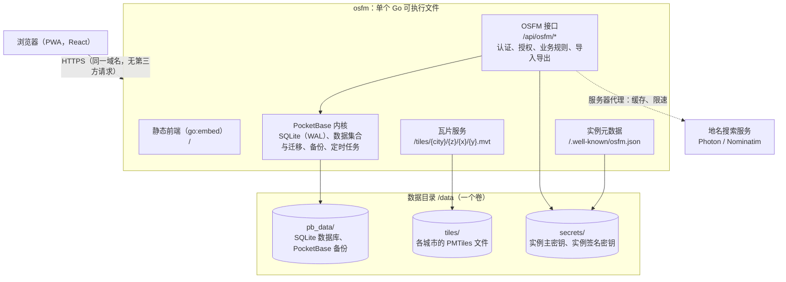
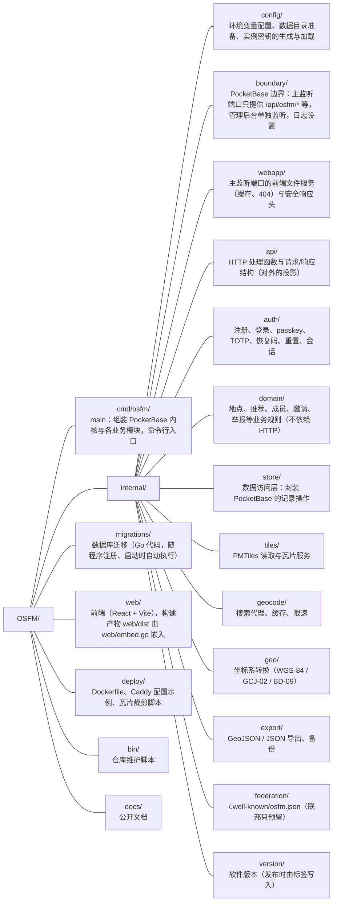
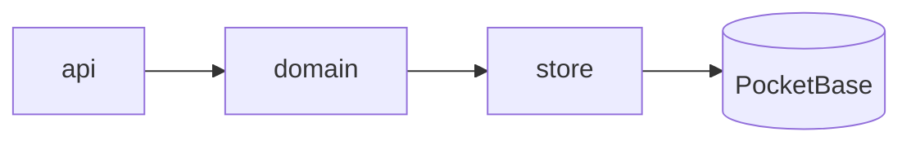
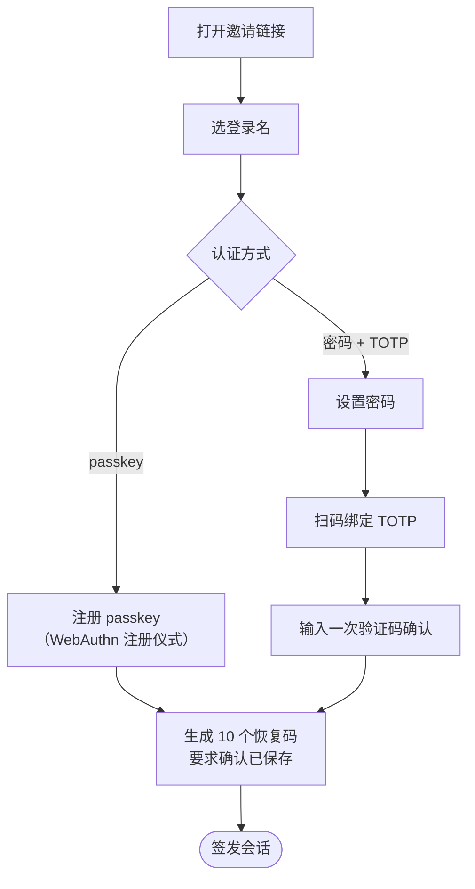
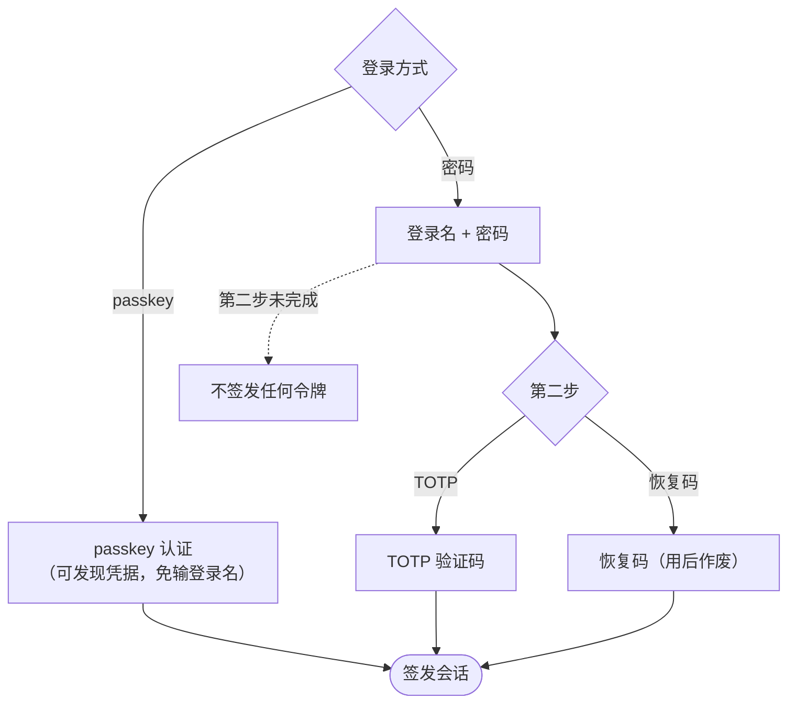
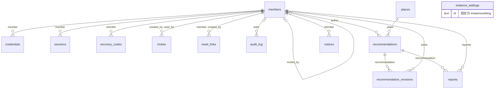

# OSFM 架构

> 版本：v0.1（2026-11-25），对应第一个里程碑（框架）开始之前的设计。需求编号（如 `D4`、`H2`）指产品需求文档中的条目；技术调研见 [research/tech-stack.md](research/tech-stack.md)。标「M1 验证」的内容需要在框架阶段用原型确认，确认后更新本文。

## 0. 概览

一个 OSFM 实例是**一个进程、一个数据目录**：



外部请求只有一类：服务器代理的地名搜索（Photon / Nominatim，`B7`），由服务器发出、缓存、限速，浏览器不直接访问任何第三方。

## 1. 设计约束

| 约束 | 来源 | 对架构的影响 |
| --- | --- | --- |
| 单文件交付，amd64 + arm64，小内存设备 | `G1` `G2` | Go + 纯 Go 的 SQLite 驱动（无 CGO，便于交叉编译）；前端打包后嵌入 |
| 浏览器不发出任何第三方请求 | `A1` `E5` `N3` | 底图、字形、图标、字体、脚本全部由实例提供；搜索走服务器代理 |
| 化名与主名的对应关系不能从任何接口推出 | `E2` `E3` | 客户端拿到的永远是投影后的数据，不含作者 ID；PocketBase 的自动数据接口对客户端关闭（§3.1） |
| 强制两步验证，不依赖邮件 | `D3` `D4` `D5` | passkey 与密码 + TOTP 自行实现；PocketBase 的内置登录方式全部关闭（§3.3） |
| 只显示城市级以上的缩放，不显示边界 | `H2` | 瓦片只需要各城市 z10 以上的切片，不需要全球低缩放数据（§3.6） |
| 联邦只预留 | `F5` | 对外 ID 一律 UUIDv7；软删除；实例签名密钥；导出格式带版本 |
| 地点层与推荐层分别授权 | `F1` `H5` | 两层分表存储、分别导出，地点层不含成员信息 |

## 2. 代码仓库结构



依赖方向（箭头表示"调用 / 依赖"）：



`domain` 不导入 PocketBase 的类型，业务规则可以脱离数据库做单元测试；替换 PocketBase 时只改 `store`。

## 3. 后端

### 3.1 PocketBase 的用法与边界

PocketBase 作为 Go 库嵌入（`pocketbase.New()`），版本在 `go.mod` 中锁定，升级单独开 PR。

| 用 | 不用 |
| --- | --- |
| SQLite 连接、事务、数据集合定义与 Go 迁移 | 自动生成的数据接口（`/api/collections/*`）：所有集合的访问规则都设为仅超级用户，客户端不可读写 |
| 认证集合 `members`（只作成员表；成员的会话是 OSFM 自己的 `sessions` 集合，不用 PocketBase 的认证令牌，见 §3.3） | 内置登录方式：密码、邮箱验证码、OAuth2、MFA 全部关闭，对应接口不提供（见下） |
| 备份（`app.CreateBackup`）、定时任务（清理过期会话、营业状态提示） | 实时订阅（不需要） |
| 限速设置：全局中间件，覆盖 `/api/osfm/*`，默认开启（见下） | 管理后台 `/_/` 与 PocketBase 自己的接口：主监听端口上不提供，见 §5.4 |
| 请求日志：保留 7 天、不记录 IP（§3.9） | 文件存储（照片是 `C10`，P2） |

这样做的代价是读写接口都要自己写；换来的是：客户端能拿到什么完全由 `internal/api` 里的结构体决定，作者 ID、化名映射、举报人这类字段从结构上就不会出现在响应里。

**边界**（T006 已验证，PocketBase v0.40.6；集成测试在 `internal/boundary`）：

- 主监听端口（反向代理转发的端口）只提供三类路径：已注册的 `/api/osfm/*` 路由、`/api/health`（容器与反向代理的健康检查），以及 `/api/`、`/_/` 以外的路径（前端、瓦片等）。其余 `/api/*`——记录增删改查、集合、各种登录与令牌刷新、找回密码、邮箱验证、OAuth2、模拟登录、实时订阅、文件、批量、设置、日志、备份、定时任务、SQL 接口，以及不存在的路径——和管理后台 `/_/` 一律返回 JSON 404，不论请求带的是成员令牌、超级用户令牌还是没有令牌。不存在的 `/api/*` 路径因此不再落到前端的 index.html。
- 实现是 `internal/boundary` 的全局中间件，排在 PocketBase 的请求日志与异常恢复之后、读取令牌与限速之前（被拒绝的请求照常记日志，但不读令牌、不占限额）。它同时检查请求路径和路由匹配到的模式，转义过的路径（如 `/api%2Fcollections…`）也拦得住。
- 放行的请求在进入后续处理前去掉 `Authorization` 请求头：主监听端口上唯一的凭据是会话 cookie（AD6），PocketBase 令牌（包括超级用户的）在这里不起作用，也就不能借超级用户身份绕过限速。
- 主监听端口不发送任何 CORS 响应头、也不应答跨源预检（T018）：前端与接口同源，用不到 CORS。PocketBase 默认对任何来源返回 `Access-Control-Allow-Origin: *`（`serve --origins` 的默认值），`internal/webapp` 让它的 CORS 中间件只在管理后台的监听地址上起作用，`--origins` 因此只影响那里。主监听端口的安全响应头同样由 `internal/webapp` 设置，替换 PocketBase 自己的默认值（§4.7）。
- 第二层在数据上：所有集合的访问规则为 `nil`（§3.5）；`members` 的密码、邮箱验证码、OAuth2、MFA 全部关闭，没有 OAuth2 提供方，新设备提醒关闭（它会保存由 IP 派生的指纹），认证规则（`authRule`）设为 `nil`——这样即使某个登录方式被重新打开，PocketBase 也不会为成员返回它自己的登录或刷新响应（只有超级用户的模拟登录例外）。迁移是 `1795600200_boundary`。

**限速**（T006 已验证）：PocketBase 的限速是挂在根路由上的全局中间件，自定义路由同样经过它，除非路由显式解除（PocketBase 自己的记录接口就解除了它，改用按集合的限速）。规则的标签与 `"方法 路径"` 或 `路径` 精确匹配，以 `/` 结尾的标签按前缀匹配；第一条匹配的规则生效，按客户端地址在固定窗口内计数，计数在内存中、修改设置时清零，超级用户不受限。PocketBase 默认关闭限速；迁移 `1795600200_boundary` 把它打开，沿用 PocketBase 的默认规则，其中 `/api/`（每个地址每 10 秒 300 次）覆盖 `/api/osfm/*`。维护者可以在管理后台调整规则，迁移只设初始值。局限：

- 客户端地址取自设置里的可信代理请求头（`trustedProxy.headers`），没有设置时取 TCP 对端地址。部署在同机反向代理后面而不设置时，所有客户端共用代理的地址，限额变成整个实例共享。这一项和部署方式有关，迁移不设置。
- 不能按登录名计数、不能只计失败的尝试、没有临时锁定，所以登录、TOTP、恢复码、重置链接的限速（`N5`）仍由 OSFM 自己实现。

### 3.2 接口设计

- 前缀 `/api/osfm/`，JSON，按资源组织：`places`、`places/{uuid}/recommendations`、`me`、`members`（维护者）、`invites`、`reports`、`exports`、`geocode`、`auth/*`。
- **对外只用 UUIDv7**（`uuid` 字段，唯一索引）。PocketBase 自己的记录 ID 只在服务器内部使用，不出现在任何响应、链接或导出中。集成测试（`cmd/osfm`）按 `osfm serve` 的方式启动程序，往每个集合写入编造的记录，再调用所有已注册的路由，在每个响应的头部和正文（包括其中 JSON Web Token 解码后的内容）里查找这些记录与集合的内部 ID；路由从路由器中枚举，新增的 OSFM 路由没有对应的测试请求时测试失败（§6）。
- **响应是投影**，例如推荐的响应只有 `uuid`、`displayName`（主名或化名，由服务器决定）、`attitude`、正文字段、`editedByMaintainerAt`，没有 `authorId`；只有当请求者就是作者时才附加 `isMine: true`，以便显示编辑入口。
- 地点卡片里按态度统计的人数（`A4`）在服务器端按真实作者去重后只返回数字。
- 地图数据按城市与视野范围取：`GET /api/osfm/places?city=…&bbox=…`，返回地点的最小字段集（坐标、精度、类别、各态度人数、时段集合），详情按需取。
- 接口的 TypeScript 类型由 Go 结构体生成（工具在 M1 选定，如 tygo），前后端不手写两份。

### 3.3 认证与会话

使用的库：WebAuthn 用 `github.com/go-webauthn/webauthn`；TOTP 用 `github.com/pquerna/otp`（RFC 6238，30 秒、6 位）；密码哈希用 argon2id（`golang.org/x/crypto/argon2`）。

**数据**：凭据存在单独的 `credentials` 集合（`D3`）：passkey 的凭据 ID、公钥、签名计数及认证器的标志（见下面的"passkey"）；或密码哈希 + TOTP 密钥。TOTP 密钥用实例主密钥（`secrets/master.key`，AES-256-GCM）加密后存储，防止只拿到数据库文件的人生成验证码（格式见下面"密码 + TOTP"）。恢复码、邀请码、重置链接只存哈希（`N5`）。PocketBase 认证集合自带的 `password` 字段填随机值且不使用。

**流程**：

**注册（`D3`）**



**登录（`D4`）**



任何分支都要两个因素都通过才签发会话；密码正确但第二步未完成时不签发任何令牌。

**重置（`D5`）**


**会话**（AD6，T007，`internal/auth`）：两步验证通过后，服务器建一条会话，把一个随机令牌放在 cookie 里交给浏览器。

- **cookie 里只有一个不透明的随机值**：`osfm_session`（实例以 https 在公网主机名上提供时为 `__Host-osfm_session`，见下），256 位随机数（`crypto/rand`）的 base64url 编码（43 个字符），不含成员 ID、PocketBase 记录 ID、有效期或任何可解码的内容。属性为 `HttpOnly; Secure; SameSite=Lax; Path=/`，不设 `Domain`（只发给本主机，瓦片请求也带上）；`Max-Age` 到会话过期为止。前端脚本读不到它。
- **服务器只存令牌的哈希**：`sessions` 集合（§3.5）每条会话一行：成员、令牌的 SHA-256（十六进制，唯一索引）、过期时间、最近一次使用的日期（只记 UTC 日期，不记时刻，每天最多写一次）、创建时间；不记 IP、不记 User-Agent。令牌本身有 256 位随机性，不需要加盐或慢哈希；只拿到数据库文件的人得不到可用的 cookie。
- **有效期**：从登录起 30 天，使用不延长；到期后需要重新登录。过期的行在下次出现时删除，另有每日定时任务清理。
- **校验**：每个需要登录的请求按 cookie 令牌的哈希查一次 `sessions`（唯一索引），再经 `store.Query` 查一次成员（自动排除已软删除的）。会话有效的条件是：行存在、未过期、成员存在且可以登录——`left_at` 为空（离开或被维护者移出，`D7` `D9`）且未被软删除。不满足时删除这行会话，并在响应里让浏览器删掉 cookie。不加缓存：两次走索引的 SQLite 查询远小于一次请求的其他开销，而缓存会让撤销不再立即生效。
- **撤销就是删除行**，从下一个请求起生效：
  - 退出登录（`POST /api/osfm/logout`）只删当前这一条，成员的其他设备不受影响；
  - 重置凭据（`D5`，T012）调用 `auth.RevokeSessions`，删除该成员的全部会话，并写一条审计记录（`sessions.revoke_all`：操作人、目标成员的 uuid、原因、条数）；
  - 成员的 `left_at` 被设置或记录被软删除时，`members` 集合的记录钩子立即删除其全部会话并写同样的审计记录；即使有代码绕过钩子直接改库，上面的校验也会拒绝这个成员。
- **为什么不把 PocketBase 的认证令牌放进 cookie**（T006 验证过可以自行签发）：PocketBase 令牌是 JWT，载荷里有成员的内部记录 ID，直接放进 cookie 违反 AD4（内部 ID 扫描会解码 JWT 并失败）；它的失效靠轮换成员的 `tokenKey`，只能让这个成员的所有设备同时失效，做不到"只退出这台设备"——退出登录只能清掉浏览器里的 cookie，令牌本身在 30 天内仍然有效。用主密钥加密后再放进 cookie 能藏住内部 ID，但仍然做不到单设备撤销，还要自己设计加密格式。服务器端会话简单、能逐条撤销，以后"我的设备"列表（按 `sessions.uuid` 逐个退出）也不需要改数据模型；代价是每个需要登录的请求多一次索引查询。
- 因此 OSFM 不为成员签发任何 PocketBase 令牌；`members` 集合的 `authToken.duration` 等令牌设置不起作用，T006 的 `IssueToken`、`MemberByToken`、`RevokeTokens` 已删除，只保留 `NewMemberRecord`。主监听端口去掉 `Authorization` 请求头（§3.1），所以即便有人拿到 PocketBase 令牌，在这里也不起作用。

**中间件**（`internal/auth`，按执行顺序；数字是 PocketBase 中间件的优先级，小的先执行）：

| 中间件 | 优先级 | 作用 |
| --- | --- | --- |
| 边界（`internal/boundary`） | −1025 | 见 §3.1；被拒绝的请求不会去查会话 |
| 读取会话 `osfmLoadSession` | −1022 | 对 `/api/osfm/*` 与 `/tiles/*` 读取 cookie；会话有效时记下会话与成员，并把成员设为 `e.Auth`。排在 PocketBase 的令牌读取（−1020）和限速（−1000）之前：限速因此把成员算作已登录者，受众为 `@auth` 的限速规则对成员生效（计数仍按客户端地址，见 §3.1） |
| 要求登录 `osfmRequireSession` | −999 | `/api/osfm/*`（标为公开的路由除外）与 `/tiles/*` 没有会话时返回 401（JSON，与边界的 404 同一格式）。排在限速之后，被拒绝的请求也占限额 |
| CSRF `osfmCSRF` | −998 | `/api/osfm/*` 的 POST、PUT、PATCH、DELETE 没有 `X-OSFM: 1` 请求头时返回 403，公开路由也一样（登录同样不能被跨站伪造） |

- 判断路径时与边界一样同时检查请求路径和路由匹配到的模式。要求登录的检查看的是会话，不是 `e.Auth`：管理后台的单独监听地址上，PocketBase 会按 `Authorization` 头把 `e.Auth` 设为超级用户，那不是会话。处理函数用 `auth.CurrentMember(e)` 取当前成员。
- **公开路由**：登录、注册、重置相关的接口注册后用 `auth.Public(route)` 标记（从该路由上解除"要求登录"中间件，这是 PocketBase 按路由排除全局中间件的机制）。CSRF 检查和会话读取不受影响，所以公开接口里也能拿到当前成员。其余路由默认要求登录；内部 ID 扫描的测试另有一份公开路由清单，两者不一致时失败（§6）。
- 没有会话也能访问的只有：前端的静态文件、`/api/health`、`/.well-known/osfm.json`（§3.8）和标为公开的接口。
- **登录接口**（T009、T010）在两个因素都通过后调用 `auth.SignIn(e, member)`：建会话、设置 cookie，并结束这个请求原来带着的会话（换号登录时不留下旧会话）；已离开或已删除的成员返回 `auth.ErrCannotSignIn`。
- **CSRF**：跨站的表单加不了自定义请求头；跨源脚本要带 cookie 并加自定义请求头必须先通过预检，而主监听端口对预检不返回任何 CORS 响应头（§3.1），预检失败、请求不会发出。`SameSite=Lax` 另外挡住跨站的子请求与表单 POST。
- **`__Host-` 前缀**（T018）：`OSFM_PUBLIC_URL` 是 `https://` 且主机不是 localhost 或回环地址时（`config.PublicHTTPS`），会话 cookie 叫 `__Host-osfm_session`。带这个前缀的 cookie 浏览器只在 `Secure`、`Path=/`、没有 `Domain` 时接受，同级子域名（例如同一个上级域名下别人的站点）也就无法为上级域名写入同名 cookie，把成员带进攻击者的会话或遮住成员自己的会话（cookie tossing）。本地开发不用前缀：WebKit（Safari）在 `http://localhost`、`http://127.0.0.1` 上拒绝 `__Host-` cookie，却接受同样属性、不带前缀的 `Secure` cookie（T018 用 Playwright 的 WebKit 27.2 与 Chrome 158 实测；Chrome 两种都接受；Firefox 未能在测试环境中启动，未测）。前缀开启时只读带前缀的 cookie，不带前缀的同名 cookie 不被当作会话。
- **Secure 与本地开发**：cookie 始终带 `Secure`。浏览器把 `localhost`、`127.0.0.1` 当作安全上下文，接受它们通过 http 设置的 Secure cookie（T018 实测 Chrome 158 与 WebKit 27.2 都接受；T009 用 Playwright 的 Chromium 159 与 WebKit 27.2 在 `http://127.0.0.1` 与经 Vite 代理的 `http://localhost` 上完成了注册与两种登录，cookie 被保存、会话可用、没有 CSP 违规；Firefox 在测试环境中仍无法启动，未测），所以 `http://127.0.0.1:8090` 和 Vite 开发服务器（`http://localhost:5173`，代理到后端）都能登录。其他主机名通过 http 访问时浏览器不保存这个 cookie、谁也登录不了，所以 `OSFM_PUBLIC_URL` 只接受 `https://`，或主机为 `localhost`、`*.localhost`、回环地址的 `http://`，否则拒绝启动（§5.2）。
- **接口**：`GET /api/osfm/me` 返回当前成员 `{"uuid", "displayName", "role"}`（`displayName` 为主名，`role` 为 `member` 或 `maintainer`），`Cache-Control: no-store`；没有会话时 401。`POST /api/osfm/logout` 删除当前会话、让浏览器删掉 cookie，返回 204；会话已失效时同样是 401 并清掉 cookie。

**邀请**（`D1` `D2`，T008，`internal/auth`）：没有邀请不能注册。M1 只有维护者能创建邀请；成员邀请、冷静期（`D12`）与邀请树（`D10`）在 M2。

- **邀请码**：256 位随机数（`crypto/rand`）的 base64url 编码（43 个字符），与会话令牌同一形式。`invites` 集合（§3.5）只存它的 SHA-256（十六进制，唯一索引），另有邀请人（`created_by`）、过期时间、使用者与使用时间（`used_by`、`used_at`）、撤销时间（`revoked_at`）。邀请码只在创建的响应里出现一次，之后谁也看不到（维护者也不能），丢了就撤销再建一个。随机性足够，普通哈希即可：猜中一个有效邀请码不可行，只拿到数据库也得不到可用的邀请码。
- **查找**：按邀请码的哈希走唯一索引查一行，邀请码本身从不参与比较，查找时间与邀请码的内容无关；查到的哈希再用恒定时间比较核对一次。
- **有效**：未使用、未撤销、未过期，而且邀请人还能登录（未离开、未被移出或删除）。有效期由维护者创建时选择，1–30 天，默认 7 天。邀请人离开、被移出或删除时，`members` 的记录钩子撤销他所有未使用的邀请并写审计记录（`invites.revoke_all`）；绕过钩子时上面的有效性检查同样拒绝。
- **链接**：`/register#invite=<邀请码>`。邀请码在 URL 的片段（`#` 之后）里：浏览器不会把片段发给服务器，所以它不会出现在 OSFM、反向代理或任何中间代理的请求日志里，也不会进入 `Referer` 请求头。注册页从片段读出邀请码，随即把它从地址栏和这条历史记录中去掉（只在当前标签页的 `sessionStorage` 里保留，刷新页面仍能继续），再放在 POST 请求的正文里发给服务器。
- **检查接口**：`POST /api/osfm/invites/check`（公开，`auth.Public`，同样要求 `X-OSFM: 1`），正文 `{"code"}`，返回 `{"valid": true|false}`。从未存在、格式不对、已过期、已使用、已撤销、邀请人已离开的邀请码，得到的状态码、正文和响应头完全相同，否则这个接口就成了打听"这个链接后来怎样了"的工具。它不消耗邀请；注册时服务器再检查一次。限速目前只有 PocketBase 按地址的全局规则（`/api/`，§3.1）；邀请码的随机性使枚举不可行，更严的限速随 T011 的认证限速一起考虑。
- **维护者接口**（`auth.RequireMaintainer`：没有会话 401，不是维护者 403）：`GET /api/osfm/invites` 列出全部邀请（新的在前），每条有 `uuid`、状态（`active`、`used`、`expired`、`revoked`）、创建与过期时间、邀请人与使用者（`uuid` 与主名）、使用与撤销时间，不含哈希；`POST /api/osfm/invites`（正文 `{"days"}`，可省略）返回新邀请和邀请码，`201`；`POST /api/osfm/invites/{uuid}/revoke` 撤销，已撤销的再撤销不变，已使用的返回 409。创建与撤销各写一条审计记录（`invites.create`、`invites.revoke`，操作人、邀请的 uuid）。所有响应 `Cache-Control: no-store`。
- **注册时消耗**：`auth.RegisterWithInvite(app, 邀请码, 注册函数)` 是通过接口创建成员的唯一途径（T009、T010 的注册接口都用它；首次启动向导创建第一个维护者是唯一的例外，T013）。它在一个事务里：按上面的规则找到有效邀请（否则 `auth.ErrInvalidInvite`，不区分原因）→ 准备新成员记录（角色 `member`、`invited_by` 为邀请人、`joined_at`）→ 调用注册函数，由它填写登录名、主名并保存成员与凭据（只能用事务的 `tx`）→ 核对成员确已保存、角色和邀请人未被改动 → 用条件更新消耗邀请（只在仍未使用、未撤销、未过期时写入 `used_by`、`used_at`）。任何一步失败都回滚整个事务：不留下成员和凭据，邀请保持原样。PocketBase 的写事务共用一个连接、依次执行，条件更新又保证只有一次能写入，所以两个同时用同一邀请码注册的请求只有一个成功；撤销用同样的条件更新，与注册不会同时成功。耗时的计算（argon2id、WebAuthn 验证）放在调用之前，不占着写连接。

**passkey**（`D3` `D4` `N5`，T010，`internal/auth`）：WebAuthn 用 `github.com/go-webauthn/webauthn`，浏览器端直接调用 WebAuthn 接口（`navigator.credentials`，二进制字段的 base64url 转换自己做，不依赖较新浏览器才有的 `parseCreationOptionsFromJSON`/`toJSON`）。

- **依赖方（relying party）**：ID 与允许的来源（origin）由 `OSFM_PUBLIC_URL` 得出（`config.PasskeyRP`，启动日志里打印）。公网主机名时 ID 就是这个主机名，只接受 `OSFM_PUBLIC_URL` 这一个来源（去掉默认端口）。本地开发（`OSFM_PUBLIC_URL` 为 localhost、`*.localhost`、回环地址，或未设置）：浏览器不接受 IP 地址作 ID，所以回环地址换成 `localhost`，passkey 只能在 `http://localhost:<端口>` 上用，在 `http://127.0.0.1:<端口>` 上浏览器会拒绝（页面提示改用 localhost）；未设置时端口取 `OSFM_LISTEN` 的端口；ID 为 `localhost` 时另外接受 Vite 开发服务器的来源 `http://localhost:5173`（它把接口代理到本机实例）。生产实例不会多出任何来源。配置不可用时（例如 `OSFM_PUBLIC_URL` 是一个 IP 地址），passkey 接口返回 503，实例照常启动，可以用"密码 + TOTP"。
- **每次仪式都要求用户验证**（`userVerification: required`：认证器验证指纹、面容或 PIN，所以一个 passkey 本身就是两个因素）**和可发现凭据**（`residentKey: required`，登录时不用输登录名）。**证明（attestation）为 `none`**：不限制认证器型号，也不让认证器透露设备型号；因此不保存原始证明数据，也不接 FIDO 元数据服务。
- **用户句柄**（WebAuthn 的 `user.id`）：每个成员一个，32 字节随机数（`members.passkey_user_handle`，base64url），在第一次注册 passkey 时生成，该成员所有 passkey 共用。它既不是 PocketBase 记录 ID（AD4），也不是成员的 `uuid`：认证器和同步 passkey 的服务商（Apple、Google、密码管理器）会保存这个值，它不应告诉它们任何东西，也不应把 passkey 与出现在接口响应、导出以及以后的联邦里的标识联系起来（UUIDv7 还带着注册时间）。随机句柄也可以在重置凭据时更换而不改变成员身份。认证器另外保存登录名和显示名，用于在系统的 passkey 选择界面里区分账号。
- **仪式状态**：一次仪式有两个请求，第一个返回带新挑战（challenge）的选项，第二个带回认证器的签名；注册和登录都发生在有会话之前。服务器把第一个请求决定的内容（挑战、依赖方、要求的用户验证；注册时还有邀请码的哈希、登录名、显示名、用户句柄）用 AES-256-GCM 加密后交给浏览器（`state`），第二个请求原样带回。密钥是进程启动时生成、只在内存里的随机密钥（不是实例主密钥）；仪式类型作为附加认证数据，注册的状态不能用于登录，反之亦然；状态 6 分钟后过期（浏览器的超时为 5 分钟）；**只能用一次**：打开时把它的随机 ID 记在内存里直到过期，不论这次验证成功与否，再用就失败。密钥与这份记录同生同灭，所以重启后旧状态全部失效（只是需要重新开始仪式）。OSFM 是单进程（AD1），第一步不写数据库，未登录的请求不会让数据库增长。
- **注册**：`POST /api/osfm/passkey/register/options`（正文 `{"invite", "loginName", "displayName"}`）先检查登录名格式与显示名（规则与"密码 + TOTP"相同，见下），，再检查邀请（不消耗），最后检查登录名是否已被使用（只告诉持有有效邀请的人），返回创建选项与状态。`POST /api/osfm/passkey/register`（正文 `{"invite", "state", "credential"}`）先在事务外验证认证器的响应（挑战、来源、依赖方 ID 的哈希、用户验证、签名），邀请码必须与第一步相同；再经 `auth.RegisterWithInvite` 在一个事务里创建成员（登录名、显示名、用户句柄）、保存 passkey、生成 10 个恢复码并消耗邀请，然后签发会话，返回 `201 {"recoveryCodes": […]}`。恢复码只出现在这个响应里；前端要求成员勾选"已保存"后才进入地图。会话在这一步就签发：两个因素此时都已验证，恢复码只是备用手段；成员中途关掉页面也已经能用 passkey 登录。
- **登录**：`POST /api/osfm/passkey/login/options` 返回请求选项（不列出凭据，由浏览器在本实例的 passkey 中选择）与状态；`POST /api/osfm/passkey/login`（正文 `{"state", "credential"}`）按凭据 ID 找到 passkey，核对响应里的用户句柄就是该 passkey 所属成员的句柄，验证签名、来源、依赖方、用户验证、备份资格标志不变，成员必须可以登录（未离开、未删除），然后 `auth.SignIn`，返回 204。失败一律 `401 {"code": "passkey_failed"}`，不区分未知 passkey、签名错误、状态已用或过期、成员已离开。
- **签名计数**：新计数不大于已存的计数、且两者不都是 0 时拒绝登录（WebAuthn §7.2 第 17 步：认证器可能被复制），并写审计记录 `credentials.passkey_counter_regression`（目标为成员的 uuid）；同步型 passkey 一直报告 0，照常通过。新的计数用条件更新写入（只有存储的计数仍是验证时读到的那个才写），两个同时用同一计数的登录只有一个成功。
- 错误响应与"密码 + TOTP"的格式和 `code` 相同（`auth.AuthError`：`invalid_request`、`invite_invalid`、`login_name_invalid`、`display_name_invalid`、`login_name_taken`），另有 passkey 自己的 `passkey_failed`、`passkeys_unavailable`。所有响应 `Cache-Control: no-store`；四个接口都是公开路由（`auth.Public`），同样要求 `X-OSFM: 1`。
- **响应头**：主监听端口的 `Permissions-Policy`（§4.7）不列 `publickey-credentials-create`、`publickey-credentials-get`，它们按浏览器默认只对本站开放；T010 在真实响应头与 `default-src 'self'` 下用 Chrome 实测注册与登录都不受影响。
- **以后**：成员给自己添加更多 passkey（T012）走已登录的接口，创建选项要带上 `excludeCredentials`（该成员已有的凭据 ID 与传输方式）并复用成员的用户句柄；还没有句柄的成员（用"密码 + TOTP"注册的）第一次添加时生成。凭据列表按 `credentials.uuid` 命名。登录页的自动填充（`mediation: "conditional"`，登录名输入框加 `autocomplete="username webauthn"`）待做。认证接口的限速与审计在 T011。

**密码 + TOTP**（`D3` `D4`，T009，`internal/auth`）：注册与登录各两步，所有接口都是公开的 POST（`auth.Public`，仍要求 `X-OSFM: 1`），响应 `Cache-Control: no-store`，错误响应在 PocketBase 的错误格式上多一个机器可读的 `code`（`auth.AuthError`），前端按它显示文案。

- **密码哈希**：argon2id（`golang.org/x/crypto/argon2`，RFC 9106），64 MiB 内存、2 遍、2 路并行、16 字节随机盐、32 字节输出，以 PHC 字符串（`$argon2id$v=19$m=65536,t=2,p=2$<盐>$<哈希>`）存在 `credentials.password_hash`：每个哈希自带参数，以后提高参数时旧哈希仍可验证（登录成功时再按新参数重算，待做）。参数按最小的目标设备（2 核 ARM）选：2 路并行时一次计算用满两个核，那里约 100–300 毫秒（开发机 Apple M 系列实测约 40 毫秒；2 核 ARM 上的实测随 T021）。同时最多 2 个 argon2id 计算（其余请求排队，请求取消即放弃），内存上限因此是 128 MiB，一阵登录尝试也压不垮小机器。密码先做 Unicode NFKC 规范化（不同设备输入的同一密码得到同一哈希）；规则只有长度（规范化后 8–128 个字符）和不能等于登录名，不设字符组合要求（两步验证是强制的）。
- **TOTP**（`github.com/pquerna/otp`，RFC 6238）：HMAC-SHA1、30 秒、6 位、160 位密钥（服务器用 `crypto/rand` 生成）。接受当前时间步与前后各一步（±30 秒，手机时钟偏差和输入时间）；每次接受的时间步用条件更新写进 `credentials.totp_last_step`（只在新时间步大于已记录的时才写入），所以同一个验证码不能用两次，两个同时到达的请求也只有一个成功，用过较新的验证码之后较旧的也失效。注册时确认用的那个验证码的时间步同样记为已用。
- **主密钥派生与加密格式**：主密钥不直接使用，按用途用 HKDF-SHA256 派生三把子密钥（TOTP 密钥存储、待完成的注册、登录票据），一种用途的密文不能冒充另一种。每个密文用 AES-256-GCM、各自随机的 96 位 nonce（`cipher.NewGCMWithRandomNonce`），编码为 base64url（nonce ‖ 密文 ‖ 标签）。`totp_secret_enc` 为 `v1.` 前缀加上述编码（前缀留给以后换格式或换密钥），附加数据是成员的 `uuid`：密文只能为这个成员解开，不能被挪到别人的凭据上。主密钥丢失则所有 TOTP 密钥失效，只能重置（`D5`）；备份要同时包含 `secrets/`（§3.8）。
- **注册**：
  1. `POST /api/osfm/register/password/start`，正文 `{"invite", "loginName", "displayName", "password"}`：先检查邀请（任何无效邀请都是同一个 403 `invite_invalid`），再检查登录名（去掉首尾空白并转小写后须为 3–32 个小写字母、数字、`_`、`-`；400 `login_name_invalid`；已被占用——包括已删除成员的登录名，登录名不复用——是 409 `login_name_taken`）、显示名（可空，空时用登录名；最多 64 个字符，不能有控制字符）和密码规则。登录名是否被占用只告诉持有有效邀请的人，所以这不是登录接口那种"登录名是否存在"的探测口。然后计算密码哈希、生成 TOTP 密钥，返回 `{"secret", "otpauthUri", "enrolment", "expiresAt"}`：密钥（base32，手动输入用）、`otpauth://` 地址（二维码与"在本设备的验证器中添加"链接用；发行方是实例名称，没有名称时为 `OSFM`，账户是登录名），以及**待完成的注册**：登录名、显示名、密码哈希、TOTP 密钥、邀请码的哈希和 15 分钟的过期时间，用主密钥封装。这一步什么都不写入数据库，邀请也不消耗。
  2. `POST /api/osfm/register/password/confirm`，正文 `{"invite", "enrolment", "code"}`：解开待完成的注册（被改动、过期或用别的邀请码开始的都是 400 `enrolment_expired`，前端回到第一步），核对验证码（400 `code_invalid`），然后经 `auth.RegisterWithInvite` 在一个事务里创建成员（`uuid` 事先生成，作为 TOTP 密文的附加数据）、`password_totp` 凭据和 10 个恢复码，并消耗邀请；最后 `auth.SignIn` 建会话，返回 201 `{"me", "recoveryCodes"}`。事务里再查一次登录名（期间被占用则 409，邀请不消耗）。同一份待完成的注册第二次确认时邀请已用，得到 403。
  - **为什么把中间状态交给客户端保管，而不是建一条"待定"记录**：不提前创建成员，也不需要新集合、迁移和清理任务；放弃的注册不留下任何东西；客户端看不到、改不了里面的内容（认证加密），跳过 TOTP 确认就拿不到成员；里面的密码哈希与 TOTP 密钥没有主密钥解不开。代价是 15 分钟内同一份数据可以重复提交确认，但邀请只能消耗一次。
  - **会话在恢复码确认之前签发**：确认验证码的请求创建成员时，两个因素都已绑定，两步验证已经完成（`D3`），所以同一个请求就签发会话；前端随即显示恢复码，勾选"已保存"之后才进入地图。若等"已保存"再签发，需要一个已有成员却没有会话的中间状态，而成员此时已经能用密码 + TOTP 登录，延后签发挡不住什么；恢复码是否保存只有成员自己知道，确认只能是界面上的。
- **登录**：
  1. `POST /api/osfm/signin/password`，正文 `{"loginName", "password"}`（登录名同样去空白、转小写）：成功时返回 `{"ticket", "expiresAt"}`，**不设置 cookie、不建会话**。失败时，登录名不存在、密码错误、成员没有密码凭据（只有 passkey）、成员已离开或被删除，得到的状态码（401）、正文（`credentials_invalid`）和响应头完全相同；没有可验证的哈希时用一个固定的假哈希（同样参数）计算一次 argon2id，耗时与密码错误相同。
  2. `POST /api/osfm/signin/totp` 或 `POST /api/osfm/signin/recovery`，正文 `{"ticket", "code"}`：验证码（见上）或恢复码（用掉，见下）通过后才 `auth.SignIn`，返回 `{"me"}`；用恢复码时另返回剩下的个数 `recoveryCodesLeft`，前端提示成员。验证码错误、已用过是 401 `code_invalid`；票据无效或过期是 401 `ticket_expired`，前端回到第一步。
  - **登录票据**不是会话：只证明密码那一步已通过，只能用于这两个接口，5 分钟过期。内容是成员的 `uuid`、当时密码哈希的指纹（SHA-256 的前 16 字节）和过期时间，用主密钥封装；改了密码（指纹不同）或成员已不能登录时作废。它是无状态的，有效期内可以再试别的验证码——这与重新提交一次密码等价；按账号的尝试次数限制随 T011。
- **审计**：T009 不写登录、注册的审计记录（T011）；无论何处都不记录密码、验证码、恢复码、TOTP 密钥或票据。

**恢复码**（`D3` `D4`，T009，`internal/auth`；passkey 注册同样使用）：`auth.NewRecoveryCodes(tx, 成员)` 生成 10 个新码，删除该成员原有的全部恢复码，只存哈希，明文只在返回值里出现一次。

- 每个码 80 位随机数（`crypto/rand`），用 Crockford base32 写成 16 个字符（0–9 与 A–Z，去掉 I、L、O、U），四个一组显示（`XXXX-XXXX-XXXX-XXXX`）；输入时不分大小写、忽略空格与连字符，O 当作 0、I 与 L 当作 1。
- `recovery_codes` 只存规范形式的 SHA-256（十六进制，唯一索引）：80 位随机性下离线穷举不可行，与邀请码同理不需要慢哈希。
- 使用是条件更新（只在 `used_at` 为空时写入），两个同时提交同一个码的请求只有一个成功。
- 前端（`web/src/register/RecoveryCodes.tsx`）列出恢复码，可复制、可下载为文本文件（`blob:` 地址的下载，不是 `data:` 地址），必须勾选"已保存"才能继续。

**防护**：所有改变状态的请求要求自定义请求头（`X-OSFM: 1`），配合 SameSite cookie 防 CSRF；登录、TOTP、恢复码、重置链接按 IP 和登录名分别限速；登录失败的提示不区分"登录名不存在"和"密码错误"。

### 3.4 授权

| 规则 | 实现位置 |
| --- | --- |
| 未登录只能访问登录、注册、重置相关接口（用 `auth.Public` 标记）、前端静态文件、`/api/health`，以及给其他实例读的 `/.well-known/osfm.json`（§3.8）；其余 `/api/osfm/*` 与 `/tiles/*`（包括城市列表与 TileJSON）返回 401（`E1`） | `internal/auth` 的中间件，默认拒绝（§3.3） |
| 改变状态的请求带 `X-OSFM: 1`，否则 403 | 同上 |
| 可见性：`private` 只有作者可见；`circle` 所有成员可见；`federated` 预留，按 `circle` 处理（`C4`） | `store` 层的查询条件，所有读取都经过同一个函数 |
| 隐藏的推荐只有作者和维护者可见（`C6` `D11`） | 同上 |
| 编辑：作者或维护者；每次编辑写一条修改记录（`C5`） | `domain`，与更新在同一事务 |
| 删除：只有作者；维护者只能在违规处理中删除并写原因（`C6` `H6`） | `domain` |
| 举报：每人每条一次；达到阈值（默认 3）自动隐藏（`D11`） | `domain`，事务内计数 |
| 邀请：M1 只有维护者能创建、查看与撤销邀请（`auth.RequireMaintainer`，否则 403）；M2 起成员有邀请权且已过冷静期（`D12`）也可以邀请 | M1 在 `internal/auth`（§3.3）；M2 在 `domain` |
| 注册：必须消耗一个有效邀请，经 `auth.RegisterWithInvite` 在创建成员的同一事务里完成（`D1`）；首次启动向导是唯一例外 | `internal/auth`（§3.3） |
| 维护者操作写审计记录 | `domain` |

### 3.5 数据模型落地

实体与字段以产品需求文档的数据模型为准。集合由 `migrations/` 中的 Go 迁移创建，集合名与共用字段名定义在 `internal/store/names.go`：

| 集合 | 内容 | 里程碑 |
| --- | --- | --- |
| `members` | 成员（PocketBase 认证集合）：登录名、主名、化名、角色、邀请权与冷静期、邀请人、加入与离开时间；passkey 的用户句柄（§3.3） | M1 |
| `credentials` | passkey，或密码哈希（argon2id，PHC 字符串）+ 加密的 TOTP 密钥 + 最近一次接受的时间步（`D3`，§3.3）。每行有 `uuid`；passkey 一行：凭据 ID 与 COSE 公钥（base64url）、签名计数、认证器型号 AAGUID、传输方式、备份资格与备份状态、用户验证标志、证明类型与格式、设备名称（由成员填写，T012） | M1 |
| `recovery_codes`、`invites`、`reset_links` | 恢复码、邀请码、重置链接，都只存哈希（`N5`）；邀请另有邀请人、过期、使用者与使用时间、撤销时间（§3.3） | M1 |
| `audit_log` | 维护者操作、地点的创建与营业状态确认（只追加） | M1 |
| `instance_settings` | 实例设置，只有一行 | M1 |
| `sessions` | 登录会话：成员、cookie 令牌的 SHA-256、过期时间、最近一次使用的日期；不记 IP 与 User-Agent（§3.3） | M1 |
| `places`、`recommendations` | 地点层与推荐层（`F1`） | M2，字段现在就建好 |
| `recommendation_revisions`、`reports`、`notices` | 修改记录（只追加）、举报、给成员的通知 | M2，字段现在就建好 |



- **全部集合的访问规则都是 `nil`**（仅超级用户），客户端不能通过 `/api/collections/*` 读写任何集合（AD2）；测试以成员令牌和匿名身份逐一验证列表、查看、新建、修改、删除都被拒绝。
- **`members` 由 PocketBase 默认的 `users` 集合改名而来**，而不是另建一个认证集合：只保留一个认证集合，沿用 PocketBase 为它生成的令牌配置，已有记录（如果有人在管理后台建过）也随之保留，迁移为它们补上 `uuid`、登录名和主名。`users` 自带的 `name`、`avatar` 字段删除。内置登录方式由后面的迁移 `1795600200_boundary` 关闭（§3.1）。
- **不收集电子邮箱**：PocketBase 要求认证集合保留系统字段 `email`，但允许它不必填；它的唯一索引只覆盖非空值，所以全部留空没有问题。`password` 字段同样是系统字段，填随机值（§3.3）。
- **对外 ID**：可被外部引用的实体（`members`、`invites`、`places`、`recommendations`，以及目前还没有对外的 `sessions` 与 `credentials`）有 `uuid` 字段：UUIDv7，唯一索引，字段格式只接受小写的 v7。新建记录时若为空，由 `internal/store` 的记录钩子生成（`store.NewUUID`）；已有记录的 `uuid` 不能修改（AD4）。接口收到的 ID 先用 `store.IsUUID` 检查格式。
- **软删除**：`members`、`places`、`recommendations`（`store.SoftDeleted`）有 `deleted_at` 字段，为空表示有效。约定：
  - 删除只写 `deleted_at`（`store.SoftDelete`），记录作为墓碑留下，带着它的 `uuid`；导出与以后的联邦据此得知删除，而不是对象悄悄消失。这些集合的硬删除被 `internal/store` 的钩子拒绝，不论哪段代码发起。
  - 读取经 `store.Query(app, 集合)` 与 `store.FindByUUID`，默认过滤已删除的记录；需要墓碑的代码（导出、维护）显式调用 `.IncludeDeleted()`。查询条件一律以 AND 组合，无法用 `Where` 或 `OrWhere` 意外替换或绕过过滤条件；联表查询用 `store.NotDeleted(表名)`（列名带表名）。直接用 PocketBase 的查找函数会跳过过滤，只留给自己处理墓碑的代码。
  - 墓碑保留还是抹去正文（成员退出、作者删除推荐时的隐私要求）由做删除的业务规则决定，不在 `store` 层。
- **两层分表**：`places` 不含任何成员字段（也没有任何指向 `members` 的关联）；谁创建了地点、谁确认了营业状态记在 `audit_log`（`F1`）。
- **只追加**：`audit_log` 与 `recommendation_revisions` 只有 `created` 时间，`internal/store` 的钩子拒绝修改它们的记录。修改记录保存修改前的快照、修改人角色与修改人。
- **单行设置**：`instance_settings` 的主键字段只接受固定值 `instancesetting`，因此第二行无论用什么 ID 都写不进去；这一行由迁移创建，带默认值（举报阈值 3、邀请冷静期 30 天）。
- **坐标**：只存 WGS-84，`internal/store` 的钩子在每次新建和修改时把 `lat`、`lon` 四舍五入到 5 位小数（`B12` `H3`）；原始输入坐标与坐标系另存于 `source_coord`。
- **地点类别**：`category` 的取值是 OpenStreetMap 的标签值（`amenity=restaurant`、`fast_food`、`cafe`、`food_court`、`ice_cream`、`bar`、`pub`、`biergarten`，`shop=bakery`、`pastry`，以及对应 `street_vendor=yes` 的 `street_vendor`），与 `osm_ref` 关联的地点不需要对照表。
- **索引**：每个 `uuid` 唯一；`places` 上建 `(lat, lon)` 组合索引，按城市范围和视野框查询，数据量过万后再评估 SQLite R*Tree；另有登录名、各类哈希、passkey 凭据 ID、passkey 用户句柄（只覆盖非空值）的唯一索引，举报的 `(recommendation, reporter)` 唯一索引（每人每条一次），以及按成员、邀请人、地点、作者、推荐、`osm_ref`、审计对象和时间查找的普通索引。

**迁移与升级前备份**（`G6`）：迁移随程序注册，每次启动（`--help`、`--version` 除外）自动执行。PocketBase 在启动时打开数据库后立即执行它自己的系统迁移，中间没有可挂接的时机，所以备份在这之前进行：若 `pb_data/data.db` 已存在且有尚未执行的迁移（PocketBase 的或 OSFM 的），先用独立连接以 `VACUUM INTO` 复制数据库，与 `pb_data` 的其余文件一起打包为 `pb_data/backups/premigrate_<UTC 时间>.zip`。格式与 PocketBase 自己的备份相同，出现在它的备份列表中，可以照常恢复。随后 PocketBase 完成启动与系统迁移，紧接着执行 OSFM 的迁移；`serve` 开始监听前已没有待执行的迁移。新建的数据库不备份；如果数据库与最近一次迁移前备份完全相同（例如迁移失败后容器反复重启），不再重复备份。备份失败时程序不启动。

迁移 `1795600500_passkeys`（T010）给 `members` 加 `passkey_user_handle`，给 `credentials` 加 `uuid` 与上表的 passkey 字段，并为已有的凭据补上 `uuid`。

迁移可以重复执行：每个迁移把期望的状态应用到已有集合上（字段按名称、索引按名称替换），再执行一次不改变任何东西；每个迁移都有回退（down）。

### 3.6 地图瓦片

- 底图数据来自 Protomaps 的 OSM 构建，部署时用 `pmtiles extract` 按每个城市的范围裁剪出 **z10–z15** 的切片（更高的缩放由客户端放大显示），每个城市一个文件：`tiles/{city}.pmtiles`。`deploy/tiles.sh` 是裁剪脚本（`--dry-run` 只估算体积）；实测一个城市约 10–30 MB（T014）。
- **服务器把 PMTiles 解包成普通的 `z/x/y` 瓦片**（`/tiles/{city}/{z}/{x}/{y}.mvt`，另有 `/tiles/{city}.json` 的 TileJSON；`/tiles/` 列出瓦片目录中可用的城市及其范围、中心与缩放级别，地图页的城市列表来自这里），而不是让浏览器对大文件发范围请求。这样每块瓦片都是一个普通的可缓存请求，离线缓存（`A9`）可以直接用 Service Worker 的常规缓存策略。
- 解包用**自带的本地 PMTiles v3 读取器**（`internal/tiles`，按规范实现），不用 `github.com/protomaps/go-pmtiles`：后者为远程存储链接了 AWS、Azure、Google Cloud 的 SDK 和 Prometheus，使可执行文件体积翻倍，且遇到损坏或截断的文件会 panic 导致整个进程退出。自带读取器只读本地文件，读取前检查每个偏移和长度，解压有上限，目录缓存有大小上限；损坏的文件返回 404 并记录一次警告。
- 样式基于 Protomaps basemaps 的样式，字形和图标精灵图由实例提供（随前端构建嵌入可执行文件，路径 `/map/`，见 §4.3）；字形只有 Noto Sans 三种字重的 0–255 区段（基本拉丁与 Latin-1），**其余字符（包括中日韩文字）由浏览器用本机字体渲染**（MapLibre 的本地字形渲染），不需要下载中文字形。
- 不使用影像图层，不画任何边界，也不显示国家与省级行政区的名称（样式去掉 `boundaries` 数据层以及 `places_country`、`places_region` 图层；`H2` `H4`）。
- 成功的瓦片请求不写入请求日志：成员"定位到我"之后加载的瓦片会暴露其位置（`A8` `E4`）。
- 地图署名 "© OpenStreetMap contributors" 写在样式的 attribution 中，始终显示（`A1`）。

### 3.7 地名搜索代理

- `GET /api/osfm/geocode?q=…&city=…`：服务器请求 Photon 公共实例，失败时回退 Nominatim；结果限制在当前城市范围内。
- 缓存：查询结果存在 SQLite 中，默认 30 天。
- 限速：整个实例对 Nominatim 不超过 1 次/秒；单个成员的请求也限速；不做逐字补全（Nominatim 政策禁止），前端在用户停止输入后再发请求。
- User-Agent 为 `OSFM/<版本>`，维护者可以在设置里补充联系方式（公共服务的使用政策要求可识别的来源）。
- 吸附附近 POI（`B8`，P1）用同样的方式代理 Overpass。

### 3.8 导出、备份与联邦预留

- **导出**（`F1`）：地点层与推荐层分别导出为 GeoJSON FeatureCollection；属性使用 `osfm:` 前缀，文件头部带 `osfm:schema` 版本号和许可声明（地点层 ODbL 1.0 + OSM 署名，推荐层 CC BY-SA 4.0）。署名只输出显示名或化名，不输出成员 ID。个人数据导出（`E6`）为 JSON。
- **备份**（`G5`）：维护者在管理页一键生成，内容为 PocketBase 备份（数据库）+ 两层 GeoJSON + `secrets/` 下的密钥；恢复时三者一起放回数据目录。缺少主密钥会导致 TOTP 无法验证，部署文档会强调备份要包含它。
- **联邦预留**（`F5`）：首次启动生成 Ed25519 实例密钥（`secrets/instance_ed25519`）；推荐的可见性字段包含 `federated`；删除留墓碑（§3.5）。订阅接口本身不实现。
- **`/.well-known/osfm.json`**（`internal/federation`）只有三项：

  ```json
  {
    "dataFormatVersion": 1,
    "softwareVersion": "1.2.3",
    "publicKey": {"kty": "OKP", "crv": "Ed25519", "x": "11qYAYKxCrfVS_7TyWQHOg7hcvPapiMlrwIaaPcHURo"}
  }
  ```

  - 公钥用 JSON Web Key 表示（RFC 8037：`kty` 为 `OKP`，`crv` 为 `Ed25519`，`x` 为 32 字节公钥的 base64url，无填充），其他实例可以直接用 JOSE 库解析。这个编码是格式的一部分，不随意更改。
  - `dataFormatVersion` 是数据格式（导出与以后实例之间交换的对象）的版本，不兼容的修改时加一；`softwareVersion` 见 §5.1。
  - 不含实例名称、城市、成员、地点或任何数量统计：实例以密钥而不是名称识别。
  - **不需要登录**：它是给其他实例读的，它们没有会话；内容不涉及圈子本身，公开不会泄露成员或位置。代价是外界能看出这是 OSFM 实例及其版本（首页与 `/api/health` 本来也能看出是哪种程序）。会话中间件的默认拒绝必须放行这一路径（§3.4）。
  - `Content-Type: application/json`，`Cache-Control: public, max-age=3600`，带 `ETag`，支持 `If-None-Match`（304）。密钥只在丢失后重新生成时才变，软件版本只在升级时变。

### 3.9 日志与隐私

- 请求日志只用于排错：保留 7 天、不记录 IP。对应 PocketBase 的日志设置 `logs.maxDays = 7`、`logs.logIP = false`、`logs.logAuthId = false`（不记录记录 ID），由 `internal/boundary` 在每次启动时重新应用，在管理后台改了也只维持到下次启动。PocketBase 每 6 小时删除一次过期日志，所以一条日志最多保留约 7 天 6 小时（T006 已验证）。
- 一条请求日志含方法、路径、状态码、耗时、User-Agent、Referer 和认证集合名（有会话的请求记为 `members`，不记是哪个成员）。查询字符串在写入日志前去掉（`internal/boundary`），搜索词、坐标不会经由 URL 进入日志。
- 日志中不出现坐标、搜索词、推荐正文。
- 会话表（§3.3）不记 IP 与 User-Agent，最近一次使用只记日期。
- 不做任何访问统计、不集成任何遥测。

## 4. 前端

### 4.1 技术栈

| 用途 | 选择 | 说明 |
| --- | --- | --- |
| 语言与构建 | TypeScript（strict）、Vite、pnpm | 构建产物为静态文件，嵌入 Go 程序 |
| 框架 | React | 单页应用；不使用服务器端渲染 |
| 路由 | React Router（单页模式，`createBrowserRouter` 数据路由） | 路由表在 `web/src/routes.tsx`（§4.2） |
| 服务器数据 | TanStack Query | 缓存、重试；离线时把查询缓存持久化到 IndexedDB（`A9`，P1） |
| 地图 | MapLibre GL JS v6 + `@vis.gl/react-maplibre` | 封装 8.1 已支持 MapLibre v6（T015 验证，§4.3）；底图样式来自 `@protomaps/basemaps` |
| 样式 | Tailwind CSS v4（`@tailwindcss/vite`） | 移动优先；不加载网络字体，使用系统字体栈（`system-ui, -apple-system, "PingFang SC", "Hiragino Sans GB", "Noto Sans CJK SC", "Microsoft YaHei", sans-serif`） |
| 交互组件 | shadcn/ui（代码复制进仓库 `web/src/components/ui/`，基于 Radix） | 弹窗、底部抽屉、菜单、表单控件；可访问性由底层库保证；只加入实际用到的组件 |
| 图标 | lucide-react | 打包进产物，按需引入 |
| 多语言 | react-i18next | 中文优先，文案全部走翻译键（`N4`）：`zh-CN` 为默认语言与源语言，`en` 的键与之相同（类型检查与单元测试保证）；`pnpm run check:i18n` 检查 `web/src/` 下除语言文件（`web/src/i18n/locales/`）外的 `.ts`/`.tsx` 不含中日韩字符，在 `bin/gate.sh` 与 CI 中运行 |
| PWA | vite-plugin-pwa（Workbox） | 安装清单、离线缓存（§4.5） |
| passkey | 浏览器原生 WebAuthn 接口（配合 `@simplewebauthn/browser` 处理编码） | — |
| TOTP 二维码 | qrcode.react（`QRCodeSVG`） | 在本机生成内联 SVG，不请求外部服务，内容安全策略不需要 `img-src data:`（§4.7） |
| 坐标转换 | gcoord | 只用于导航跳转（§4.6） |
| 测试 | Vitest + Testing Library；Playwright 端到端 | Playwright 的虚拟认证器用于测试 passkey 流程 |

### 4.2 页面

| 页面 | 路径 | 内容 |
| --- | --- | --- |
| 地图（首页） | `/` | 全屏地图、城市切换、筛选、"定位到我"、"+"新建；点击地点从底部弹出地点卡片 |
| 列表 | `/list` | 当前视野内的地点按距离排序（`A6`），与地图共享筛选条件 |
| 地点卡片 / 详情 | 待定 | 店名、位置描述、参照物、态度人数、推荐列表、导航跳转、分享到群、举报 |
| 新建 / 编辑 | 待定 | 准星打点（`B1`）→ 店名与类别 → 推荐（态度、推荐语、时段、来源、署名方式、可见性）；附近同名提示（`B6`） |
| 我的 | `/me` | 资料、化名、外部链接、凭据管理与恢复码、个人数据导出、退出圈子 |
| 管理（维护者） | `/admin` | 邀请与邀请树、成员、举报与隐藏、审计记录、城市与底图设置、备份 |
| 注册 / 登录 / 重置 | `/register`、`/login`、待定 | §3.3 的流程 |

地图、列表、我的三个页面共用底部导航；未登录时只能访问登录与注册页（`E1`），其余路径（包括不存在的路径）先跳到登录页。管理页要求登录；不是维护者的成员只看到"只有维护者可以使用"的提示（服务器端的维护者接口另有 403）。维护者在"我的"页有进入管理页的链接。管理页目前只有邀请：选择有效期创建邀请链接（只显示这一次，带复制按钮）、邀请列表与状态、撤销。注册页检查邀请链接（§3.3），有效时让成员选择注册方式；登录页同样只提供方式的选择（先列"密码 + 验证器 App"，再列 passkey），每种方式是单独的组件（`web/src/register/`、`web/src/login/`）。passkey 的注册是登录名、显示名 → 创建 passkey → 保存恢复码 → 进入地图，登录是一个按钮、不用输登录名；浏览器不支持 passkey 时，页面说明改用"密码 + TOTP"。密码 + TOTP 的注册依次是登录名、显示名与密码 → 绑定验证器 App（二维码是内联 SVG，`qrcode.react` 在本机生成，不请求任何外部服务；另有在本设备的验证器 App 中添加的链接和可复制的密钥，在同一部手机上注册时扫不了自己的屏幕）→ 输入一个验证码 → 保存恢复码 → 进入地图；登录是登录名与密码 → 验证码，或改用恢复码，成功后回到登录前想去的页面。

### 4.3 地图组件

- 地点数据按城市与视野加载，转换成 GeoJSON 数据源，使用 MapLibre 内置的聚合（`A2`）。
- 精度不同的地点用不同图层表现：`exact` 为图钉，`approx` 和 `area` 为半透明圆（半径约 50 m / 按片区）。
- 地图限制：`minZoom = 10`、`maxBounds` 为当前城市范围（`H2`；城市较小、屏幕较大时，范围限制使最小缩放实际高于 10）；切换城市就是切换数据源与范围。
- 实现（T015）：MapLibre GL JS v6 + `@vis.gl/react-maplibre` 8.1（其 8.1 版已按 v6 去掉的 `map.transform` 等接口适配，实测可用）。地图代码单独成块（`web/src/map/`），只在打开地图时加载，应用外壳不含 MapLibre。
- 城市列表来自 `GET /tiles/`（§3.6）：瓦片目录里有一个城市的文件，地图就能切换到它，不需要另外配置。城市的显示名称暂时由文件名生成，首次启动向导与实例设置加入后改用设置中的名称。当前城市记在地址的 `?city=` 参数中，并在本机记住上次的选择。
- 样式在浏览器中生成：`@protomaps/basemaps` 的 `light` 图层（标注语言随界面：中文界面用 `zh-Hans`），数据源直接写瓦片地址、范围与署名，不另取 TileJSON。字形、图标精灵图放在 `web/public/map/`，随前端构建嵌入可执行文件：它们必须与样式版本一致，体积小（约 300 KB），且这样部署者不需要另外下载。来源为 `protomaps/basemaps-assets`，字形为 SIL OFL 1.1，图标为 MIT（来自 tangrams/icons），许可文本在同一目录。
- 所有地图请求都由样式中的同源绝对地址发出，并带 `credentials: 'same-origin'`，瓦片要求登录之后也能继续工作。
- 署名 "© OpenStreetMap contributors" 用展开的署名控件，始终可见，不被底部导航遮挡（`A1`）。
- "定位到我"只用浏览器的定位接口：位置只在页面里用于移动地图（不在当前城市时切换到所在城市，不在任何城市时给出提示），不发给服务器、不保存（`A8`）。
- 缩放与定位按钮是自己的组件，不用 MapLibre 自带的控件：后者的图标是 `data:` 地址的 SVG，在 §4.7 的 CSP 下会被拦截。
- 新建地点时地图中央显示固定准星，提交的是地图中心坐标，四舍五入到 5 位小数。

### 4.4 数据获取

- 全部请求经 `web/src/lib/api.ts` 发往同源的 `/api/osfm/*`：始终带 cookie（`credentials: 'same-origin'`）；改变状态的请求（POST、PUT、PATCH、DELETE）带 `X-OSFM: 1` 请求头（§3.3）。
- 查询键按城市与视野划分；新建、编辑后使相关查询失效，不做乐观更新（避免与修改记录、可见性规则不一致）。
- 未登录或会话失效时统一跳到登录页，并记住要返回的地址（`C7` 的分享链接依赖这一点）：
  - 会话状态由 `useSession()` 给出，背后是 TanStack Query 对 `GET /api/osfm/me` 的查询；200 返回当前成员（`uuid`、`displayName`、`role`），401 表示未登录；其他状态与非 JSON 的响应是错误（显示重试），不当作未登录——服务器对 `/api/` 下的一切路径都返回 JSON。任何请求（包括瓦片城市列表）得到 401 时重新检查会话。
  - 退出登录在"我的"页面：`POST /api/osfm/logout`，成功（或会话本已失效的 401）后清空查询缓存，回到 `/login`（不带 `next`）。
  - 受保护的路由在未登录时跳到 `/login?next=<原路径与查询串>`；登录后（以及已登录时打开登录页）回到 `next`。`next` 只接受本站路径：必须以单个 `/` 开头，不含反斜杠与控制字符，解析后仍在同一来源，且不是登录或注册页本身；否则回到 `/`。

### 4.5 PWA 与离线

- 应用外壳（HTML、JS、CSS、图标、字形）预缓存，版本更新时提示刷新。目前（T016）Service Worker 只预缓存应用外壳；新版本在应用的所有页面关闭后生效，刷新提示随离线功能加入。
- Service Worker 由构建生成的 `registerSW.js` 注册（不用内联脚本，§4.7）；对页面导航用缓存的 `index.html` 应答，但 `/api/`、`/tiles/`、`/_/` 与 `/.well-known/` 不在此列，始终走网络。
- 安装清单 `manifest.webmanifest`：名称 OSFM、`lang` 为 `zh-CN`、`display: standalone`、192/512 图标与可裁切（maskable）图标；`index.html` 另有 `theme-color`、`apple-touch-icon` 与 `apple-mobile-web-app-*` 标签，供 iOS 添加到主屏幕。
- 瓦片请求（`/tiles/…`）使用"缓存优先"，按城市设置条目上限；数据请求使用"网络优先、失败时用缓存"。
- 目前（T015）地图代码块与图标精灵图（PNG）随应用外壳预缓存；MapLibre 的 Worker（`.mjs`）、字形与瓦片尚未缓存，始终走网络，随离线功能（`A9`）一起处理。
- 离线时只读（`A9` 为 P1）；新建与编辑需要联网，离线时给出提示。
- iOS 需要"添加到主屏幕"才能持久保存数据，首次使用时给出引导。
- **服务器端的缓存与类型**（T018，`internal/webapp`）：Vite 按内容命名的 `/assets/*` 文件 `Cache-Control: public, max-age=31536000, immutable`；其余文件——`index.html`（以及所有前端路由）、`sw.js`、`registerSW.js`、`manifest.webmanifest`、图标、`/map/` 下的字形与图标精灵图——`no-cache`，配合按内容计算的 `ETag` 每次向服务器确认（未变时 304），新版本前端在下次加载时就能被发现。Content-Type 按扩展名显式设置，不依赖系统的 MIME 表（distroless 镜像里没有）：清单为 `application/manifest+json`，JS 与 Worker 为 `text/javascript`，字形为 `application/x-protobuf`。T018 在无头 Chrome 中验证了更新流程：换一版前端重启后，`registration.update()` 找到新的 Service Worker 并进入等待；关闭所有页面再打开，新版本生效。
- **不存在的文件返回 404**：路径命中前端的某个目录（`/assets/`、`/map/` 及其子目录，目录本身也算）或最后一段带点（`favicon.ico`、缺失的字形区段）而文件不存在时返回 404，不再回退成 `index.html`；其余路径（`/`、`/list`、`/me`、`/admin`、`/login`、`/register` 以及未知的前端路径）返回 `index.html`。因此**前端路由的最后一段不能带点，也不能落在这些目录下**（例如 `/map` 是静态目录）。MapLibre 对 404 的字形区段只给一条警告并改用本机字体绘制这些字符（T018 实测：测试瓦片里一个带 `ğ` 的地名请求了 256–511 区段，得到 404 后正常显示）。

### 4.6 导航跳转与坐标转换

坐标在数据库里只有 WGS-84；跳转导航时按目标应用与地点所在区域转换：

| 目标 | 中国大陆境内的地点 | 其他地区 |
| --- | --- | --- |
| 高德 | 转换为 GCJ-02，或在链接中声明传入的是 WGS-84（由高德转换） | 原样 |
| Apple 地图 | M1 实测后确定 | 原样 |
| Google 地图 | M1 实测后确定 | 原样 |

是否在中国大陆境内用一个粗略的边界多边形判断。各目标在境内的实际偏差以 `A5` 的验收测试为准，实测结果补进本表。

### 4.7 安全相关的前端约束

主监听端口的每个响应（页面、静态文件、接口、错误与 404）都带同一组安全响应头，由 `internal/webapp` 的全局中间件在所有其他中间件之前设置（T018）。管理后台的监听地址不加这些头：PocketBase 的管理后台自带一份内容安全策略（需要内联样式、OpenStreetMap 瓦片等），保持原样。

| 响应头 | 值 | 理由 |
| --- | --- | --- |
| `Content-Security-Policy` | `default-src 'self'; base-uri 'self'; form-action 'self'; frame-ancestors 'none'; object-src 'none'` | 一切资源只来自实例本身；不允许内联脚本与样式属性；不回退到 `default-src` 的几项单独写明：`<base>` 不能指向别处，表单只提交给本实例，不能被任何页面嵌入（点击劫持），不加载插件 |
| `Referrer-Policy` | `no-referrer` | 成员点开外部链接（OSM 署名、导航应用）时不带出实例地址与当前路径 |
| `X-Content-Type-Options` | `nosniff` | 浏览器按声明的类型处理响应；脚本、模块 Worker 与样式必须是正确的类型（§4.5） |
| `X-Frame-Options` | `DENY` | 与 `frame-ancestors 'none'` 相同，给不支持后者的旧浏览器；替换 PocketBase 默认的 `SAMEORIGIN` |
| `Permissions-Policy` | `geolocation=(self), camera=(), microphone=(), display-capture=(), payment=(), usb=(), serial=(), hid=(), bluetooth=(), midi=(), browsing-topics=()` | 只有"定位到我"需要的定位对本站开放；用不到的能力全部关闭。只列 Chromium 认识的特性（不认识的会在控制台报错）；passkey（WebAuthn）与剪贴板保持默认（只允许本站），T010 实测 passkey 注册与登录不受影响 |
| `Cross-Origin-Opener-Policy` | `same-origin` | 应用打开的其他来源页面拿不到它的窗口句柄，反之亦然 |
| `Cross-Origin-Resource-Policy` | `same-origin` | 其他来源（包括同一上级域名下的别人的子域名）不能把实例的响应当作子资源加载，即使浏览器带上了成员的 cookie |
| `Strict-Transport-Security` | `max-age=31536000`（只在 `OSFM_PUBLIC_URL` 为 https 且主机不是本机时） | 见下 |

- PocketBase 默认的 `X-XSS-Protection: 1; mode=block` 在主监听端口上去掉：现在的浏览器忽略它，旧浏览器里它反而可被利用。
- **HSTS**：只在实例以 https 在公网主机名上提供时（`OSFM_PUBLIC_URL`，`config.PublicHTTPS`）发送，一年，不带 `includeSubDomains` 与 `preload`——实例常在别人的上级域名下，其他子域名不该被它钉成 https。浏览器只认 https 响应里的 HSTS，所以经由反向代理（TLS 在代理上）时生效，直接用 http 访问监听端口时不起作用，本地开发与 `localhost` 不受影响。反向代理也设置 HSTS 时浏览器只处理第一个；需要 `includeSubDomains` 或 `preload` 的部署者在代理上设置（Caddy 默认不发 HSTS）。
- **CORS**：主监听端口不发送任何 CORS 响应头（§3.1）。
- 内容安全策略的依据：MapLibre v6 不再有单独的 CSP 构建，它的 Worker 是独立的模块文件，同源时直接用 `new Worker(url, {type: 'module'})` 加载，不需要 `blob:`；前端用 `setWorkerUrl` 指向构建产物中的 Worker 文件。地图的缩放与定位按钮是自己的组件（MapLibre 自带控件的图标是 `data:` 地址，§4.3），所以也不需要 `img-src data:`。T018 在无头 Chrome（Playwright，系统 Chrome 158）中用真实的响应头、真实的会话验证：地图（含"定位到我"与放大）、列表、我的、管理、未知路径，以及未登录时的登录、注册页，都没有 CSP 违规、没有对外请求，Service Worker 正常注册；管理后台的监听地址上 PocketBase 管理后台能打开并登录，没有 CSP 违规。
- 不使用任何 CDN 或外部字体。**构建检查**（`pnpm run check:urls`，`web/scripts/check-external-urls.ts`，在 `bin/gate.sh` 与 CI 中构建之后运行）扫描 `web/dist/app` 的文本文件，找出 `http(s)://`、`ws(s)://` 的绝对地址，以及 HTML 属性与 CSS `url()` 里的协议相对地址（`//host/…`），出现非同源地址即失败。第三方库里有一些永远不会被请求的地址，逐条精确列在脚本的白名单里并写明理由：XML 命名空间名、解析用的基准地址（`http://localhost`、保留顶级域 `.invalid`）、报错信息里的文档链接、许可证横幅，以及只作为链接目标的 OSM 署名与 MapLibre 自带控件的链接；字形与图标精灵图附带的许可证与 NOTICE 文件不扫描。CI 另在构建产物的副本里加入一个外部地址，确认检查会失败。
- 用户输入的文本一律按纯文本显示，不渲染 HTML 或 Markdown。ESLint 规则（`web/scripts/lint-plain-text.ts`）在 `web/src` 中禁止所有把字符串当作 HTML 写进页面的写法：`dangerouslySetInnerHTML`、`srcDoc`，对 `innerHTML`、`outerHTML`、`srcdoc` 赋值，`insertAdjacentHTML`、`createContextualFragment`、`setHTMLUnsafe`，以及 `document.write`。需要保留换行时用 CSS（`white-space: pre-line`），链接用元素构造。

## 5. 部署与运维

### 5.1 交付

- 一个 Docker 镜像（多架构：linux/amd64、linux/arm64），基础镜像为 distroless static，发布到 GitHub Container Registry；同时提供各平台的可执行文件。
- 构建顺序：前端构建 → Go 编译（嵌入 `web/dist`）→ 镜像。
- **软件版本**（`osfm --version`、`/.well-known/osfm.json`，`internal/version`）：发布时由标签经 `-ldflags -X` 写入（发布工作流；镜像用构建参数 `VERSION`），读出时去掉开头的 `v`。没有写入时取 Go 工具链记在可执行文件里的构建信息：`go install …@v1.2.3` 的模块版本，或在 Git 仓库中构建时按提交生成的伪版本；两者都没有（例如构建上下文里没有 `.git` 的镜像构建）时为 `dev`。同一标签、同一提交构建出的版本字符串相同，不影响可复现构建。

### 5.2 配置

| 来源 | 内容 |
| --- | --- |
| 环境变量 `OSFM_*` | 监听地址 `OSFM_LISTEN`（默认 `127.0.0.1:8090`，`serve --http` 优先）、对外 URL `OSFM_PUBLIC_URL`（必须是 `https://`，主机为 `localhost`、`*.localhost` 或回环地址时可以是 `http://`：会话 cookie 带 `Secure`，见 §3.3；是公网主机名的 `https://` 时，另外发送 HSTS、会话 cookie 加 `__Host-` 前缀，见 §3.3、§4.7；passkey 的依赖方 ID 与允许的来源也由它得出，见 §3.3。生产部署应当设置它，主机名不能是 IP 地址，否则 passkey 不可用）、数据目录 `OSFM_DATA_DIR`（默认 `./data`，镜像中为 `/data`）、是否开启 PocketBase 管理后台 `OSFM_ADMIN_UI`（默认关闭）、管理后台的单独监听地址 `OSFM_ADMIN_LISTEN`（默认 `127.0.0.1:8091`，见 §5.4）；由 `internal/config` 读取和校验，启动时打印生效的配置 |
| 首次启动向导（`G3`） | 第一个维护者（同样强制两步验证）、实例名称、关心的城市（名称、范围、对应的瓦片文件） |
| 维护者设置页 | 举报阈值、冷静期天数、搜索服务的联系方式 |

### 5.3 运行

- 反向代理与 HTTPS 由 Caddy 负责（`deploy/` 提供示例）；推荐部署在境外 VPS。安全响应头由 OSFM 自己发送（§4.7），代理不需要再加；代理不要改写或删除 `Content-Security-Policy`、`Set-Cookie` 等响应头，也不要另加 CORS 头。HSTS 在设置了 https 的 `OSFM_PUBLIC_URL` 时由 OSFM 发送（只覆盖本主机）；要 `includeSubDomains` 或 `preload` 时在代理上设置。国内家宽封 80/443 时使用 DNS 验证申请证书 + 高位端口（`G7`）。
- 升级：替换镜像后启动，迁移自动执行（`G6`）；迁移前自动生成一份备份。
- 资源目标：空闲常驻内存 ≤ 300 MB（`G2`），M1 在 2 核 ARM 设备上测量。

### 5.4 运维入口

- 维护者的日常操作都在应用内的管理页面完成。
- PocketBase 管理后台（`/_/`）能读取所有原始数据（包括化名对应关系），**默认关闭**。部署者需要时设 `OSFM_ADMIN_UI=true` 临时开启：管理后台和 PocketBase 自己的全部接口在一个**单独的监听地址**上提供（`OSFM_ADMIN_LISTEN`，默认 `127.0.0.1:8091`），主监听端口上仍然一律 404（§3.1）。反向代理只转发主端口；部署者通过 SSH 端口转发访问，例如 `ssh -L 8091:127.0.0.1:8091 <服务器>` 后打开 `http://127.0.0.1:8091/_/`（T006）。
  - 为什么不在主端口上判断"请求是否来自本机"：反向代理与 OSFM 在同一台机器上时，每个请求的 TCP 对端都是 127.0.0.1，整个互联网看起来都是本机。PocketBase 自带的超级用户 IP 白名单（`superuserIPs`）同样取决于对端地址或代理请求头，配错一项就等于对公网开放，而且管理后台页面和超级用户登录接口仍然对外可见。单独的监听地址不依赖这些：反向代理不知道这个端口，它就到不了。
  - 容器里的 127.0.0.1 是容器自己的回环地址，从宿主机访问不到。用镜像部署时设 `OSFM_ADMIN_LISTEN=0.0.0.0:8091`，并只把端口发布到宿主机的回环地址（`-p 127.0.0.1:8091:8091`），再从宿主机做 SSH 端口转发。监听地址不是回环地址时，启动日志会给出警告。
  - 首次启动、还没有超级用户时，PocketBase 会建一个占位超级用户并打印进入管理后台安装页的链接（还会尝试在本机打开浏览器）。管理后台关闭时 OSFM 不做这件事；开启时链接指向单独的监听地址，只写进日志，不打开浏览器。PocketBase 的启动横幅（会把管理后台显示在主端口上）关闭，改为日志里写明两个地址。
  - 超级用户随时可以用 `osfm superuser upsert EMAIL PASS` 创建或修改，这个命令直接操作数据库，与管理后台是否开启无关。
- 命令行：`osfm` 可执行文件提供迁移、备份、恢复、重置维护者凭据等子命令。

## 6. 测试与 CI

| 层 | 内容 |
| --- | --- |
| Go 单元测试 | `domain` 的业务规则（可见性、编辑与修改记录、举报阈值、冷静期、去重计数）、坐标转换、认证流程的状态机 |
| Go 集成测试 | 使用 PocketBase 的测试应用，覆盖每个接口的权限：以"未登录 / 成员 / 作者 / 维护者"四种身份调用，断言响应中不含作者 ID 与化名映射（`E2`）。密码 + TOTP（T009）：用生成的验证码完成注册与登录的端到端测试（只过密码一步时没有会话 cookie；同一验证码、较旧的验证码、用过的恢复码都被拒绝；并发提交同一验证码或恢复码只有一个成功；无效邀请一律被拒；登录名不存在、密码错误、没有密码凭据、已离开的成员得到完全相同的响应；票据在过期、改密码、离开后作废；响应中没有内部 ID）。passkey 用 `internal/auth/passkeytest` 的软件认证器（ES256、可发现凭据、证明 `none`，可以改来源、依赖方 ID、签名计数与标志）：带邀请注册、免登录名登录、计数回退、来源或依赖方错误、状态重放、无有效邀请、成员已离开 |
| 内部 ID 扫描 | `cmd/osfm` 的测试按 `osfm serve` 的方式启动程序（同一个注册函数），`internal/idscan` 往每个集合写入编造的记录（含已软删除的；有集合没写入时失败），枚举路由器上的全部路由：OSFM 的每条路由必须在测试的探测表里有请求，PocketBase 自己的路由按占位符代入各集合名后逐一请求；任何响应的头部或正文（含 gzip 解码后、JSON Web Token 解码后，以及其中每个 base64 或 base64url 值解码后，例如 WebAuthn 选项里的用户句柄与凭据 ID）出现记录或集合的内部 ID 即失败（AD4）。passkey 注册与登录的成功响应另由一个测试用软件认证器走完整个仪式后检查（包括仪式中新建的成员、凭据、恢复码与会话的 ID）。每个请求按匿名、成员、维护者三种身份各发一次（成员与维护者每个请求用一个新会话，退出登录的探测不影响后面的请求），会话 cookie 本身也在被检查的请求里；同时检查会话规则：匿名访问需要登录的路径必须得到 401，公开路由必须在测试的清单里，只限维护者的路由（另一份清单）成员访问必须得到 403，带 `X-OSFM` 的写请求去掉这个头后必须得到 403 |
| 前端单元测试 | Vitest + Testing Library |
| 前端文案检查 | `pnpm run check:i18n`：语言文件以外的源码不含中日韩字符（§4.1） |
| 端到端测试 | Playwright（移动端视口）：注册（passkey 用虚拟认证器、密码 + TOTP 用生成的验证码）、新建推荐、筛选、分享链接回跳 |
| 构建检查 | 前端产物中不含外部 URL（`pnpm run check:urls`，§4.7）；镜像能在 amd64 与 arm64 上启动；可执行文件实际提供的安全响应头、Content-Type、缓存头与 404（CI 的 Binary 作业） |

CI 在 GitHub Actions 上运行，顶层权限只读。代码进入仓库后，上述检查加入 `main` 的必过检查。

## 7. 架构决策记录

| # | 决策 | 理由 |
| --- | --- | --- |
| AD1 | 单个 Go 可执行文件 = PocketBase 内核 + OSFM 业务层 + 嵌入式前端 + 瓦片服务 | 单文件交付、小内存设备（`G1` `G2`） |
| AD2 | PocketBase 的自动数据接口与内置登录方式对客户端全部关闭；客户端只访问 `/api/osfm/*` | 化名保护要求响应结构由我们控制（`E2`）；强制两步验证不能留单因素入口（`D4`） |
| AD3 | 数据访问封装在 `internal/store`，业务规则在 `internal/domain` 且不依赖 PocketBase 类型 | 降低 PocketBase 0.x 版本变化的影响；便于测试 |
| AD4 | 对外 ID 只用 UUIDv7 | 联邦预留（`F5`）；不暴露内部 ID |
| AD5 | 两步验证自行实现：go-webauthn、pquerna/otp、argon2id；TOTP 密钥用实例主密钥加密 | PocketBase 不支持 passkey 与 TOTP |
| AD6 | 会话是服务器端的：cookie（`HttpOnly; Secure; SameSite=Lax`）里只有 256 位随机令牌，`sessions` 集合只存其 SHA-256；有效期 30 天，撤销即删除行（退出登录删一条，重置凭据、离开、移出、删除时删该成员的全部）。不使用 PocketBase 认证令牌。状态变更请求要求 `X-OSFM: 1` 请求头 | 前端脚本拿不到令牌；cookie 里没有内部 ID（AD4）；能立即撤销、能逐台设备退出，不需要自己的加密格式；防 CSRF（§3.3） |
| AD7 | 底图为每个城市一个 PMTiles 文件（z10–z15），服务器用自带的本地 PMTiles v3 读取器解包为 z/x/y 瓦片 | 最小缩放限制在城市级（`H2`），不需要全球低缩放；普通瓦片请求便于离线缓存；不用 go-pmtiles 是因为它的依赖使可执行文件翻倍（`G1` `G2`），且遇到损坏文件会 panic |
| AD8 | 中日韩文字用浏览器本机字体渲染，只提供拉丁字形 | 中文字形体积巨大；不能用 CDN |
| AD9 | 前端：React + TypeScript + Vite，React Router、TanStack Query、Tailwind CSS + shadcn/ui、react-i18next | 生态与 AI 辅助开发的可靠性；地图有官方维护的 React 封装 |
| AD10 | PocketBase 管理后台默认关闭；开启时只在单独的本机监听地址上提供，主监听端口上从不提供 | 它能读到化名对应关系等全部原始数据；同机反向代理后面无法凭对端地址判断"本机" |
| AD11 | 地名搜索只经服务器代理，带缓存与限速 | 浏览器不发第三方请求（`E5`）；遵守公共服务的使用政策 |

## 8. M1 需要验证的事项

1. PocketBase：关闭内置登录方式后，自行签发令牌的接口与令牌失效方式；限速设置能否覆盖自定义路由；请求日志不记录 IP 的配置：已在 T006 完成（§3.1、§3.3、§3.9、§5.4）。会话最终没有用 PocketBase 令牌，改为服务器端会话（T007，§3.3、AD6）。
2. `@vis.gl/react-maplibre` 与 MapLibre v6 的兼容性；MapLibre 在严格 CSP 下的 Worker 加载方式：已在 T015 完成（兼容；`default-src 'self'` 即可，见 §4.3、§4.7）。
3. 每个城市 z10–z15 切片的文件体积：已在 T014 完成（约 10–30 MB）。
4. passkey 与密码 + TOTP 在 iOS、带谷歌服务的 Android、不带谷歌服务的国产 Android 上的表现（`N6`）。
5. Apple 地图与 Google 地图在中国大陆境内跳转时需要的坐标系（§4.6）。
6. 空闲内存占用是否满足 `G2`。
