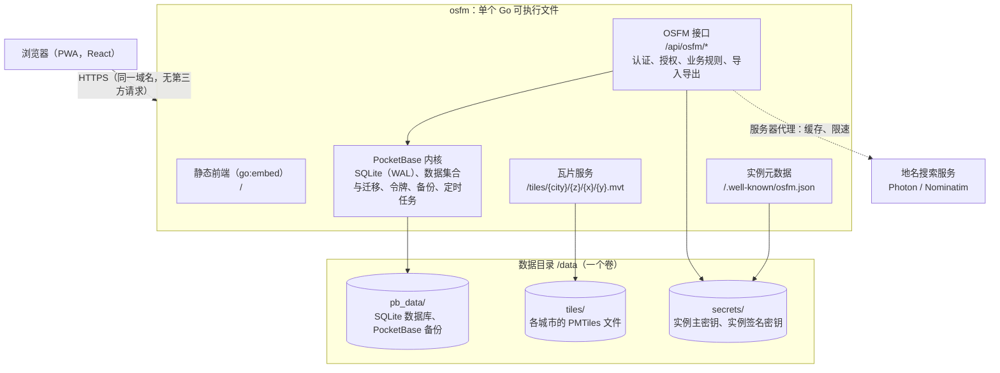
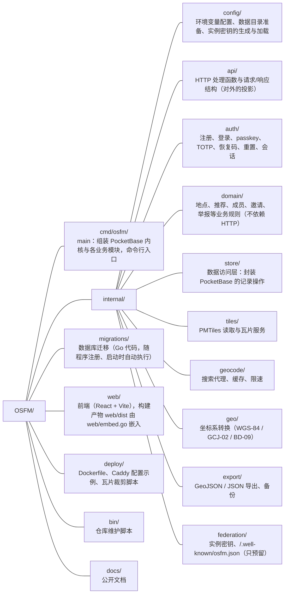
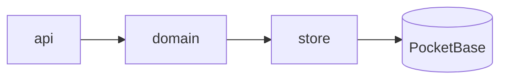
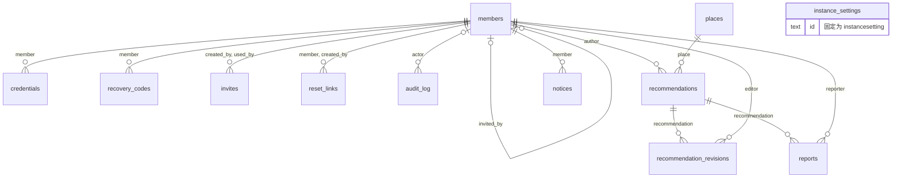

# OSFM 架构

> 版本：v0.1（2026-11-25），对应第一个里程碑（框架）开始之前的设计。需求编号（如 `D4`、`H2`）指产品需求文档中的条目；技术调研见 [research/tech-stack.md](research/tech-stack.md)。标「M1 验证」的内容需要在框架阶段用原型确认，确认后更新本文。

## 0. 概览

一个 OSFM 实例是**一个进程、一个数据目录**：

外部请求只有一类：服务器代理的地名搜索（Photon / Nominatim，`B7`），由服务器发出、缓存、限速，浏览器不直接访问任何第三方。

## 1. 设计约束

| 约束 | 来源 | 对架构的影响 |
| --- | --- | --- |
| 单文件交付，amd64 + arm64，小内存设备 | `G1` `G2` | Go + 纯 Go 的 SQLite 驱动（无 CGO，便于交叉编译）；前端打包后嵌入 |
| 浏览器不发出任何第三方请求 | `A1` `E5` `N3` | 底图、字形、图标、字体、脚本全部由实例提供；搜索走服务器代理 |
| 化名与主名的对应关系不能从任何接口推出 | `E2` `E3` | 客户端拿到的永远是投影后的数据，不含作者 ID；PocketBase 的自动数据接口对客户端关闭（§3.1） |
| 强制两步验证，不依赖邮件 | `D3` `D4` `D5` | passkey 与密码 + TOTP 自行实现；PocketBase 的内置登录方式全部关闭（§3.3） |
| 只显示城市级以上的缩放，不显示边界 | `H2` | 瓦片只需要各城市 z10 以上的切片，不需要全球低缩放数据（§3.6） |
| 联邦只预留 | `F5` | 对外 ID 一律 UUIDv7；软删除；实例签名密钥；导出格式带版本 |
| 地点层与推荐层分别授权 | `F1` `H5` | 两层分表存储、分别导出，地点层不含成员信息 |

## 2. 代码仓库结构

依赖方向（箭头表示"调用 / 依赖"）：

`domain` 不导入 PocketBase 的类型，业务规则可以脱离数据库做单元测试；替换 PocketBase 时只改 `store`。

## 3. 后端

### 3.1 PocketBase 的用法与边界

PocketBase 作为 Go 库嵌入（`pocketbase.New()`），版本在 `go.mod` 中锁定，升级单独开 PR。

| 用 | 不用 |
| --- | --- |
| SQLite 连接、事务、数据集合定义与 Go 迁移 | 自动生成的数据接口（`/api/collections/*`）：所有集合的访问规则都设为仅超级用户，客户端不可读写 |
| 认证集合与令牌签发（会话令牌由我们在两步验证通过后调用其接口签发） | 内置登录方式：密码、邮箱验证码、OAuth2、MFA 全部关闭（§3.3） |
| 备份（`app.CreateBackup`）、定时任务（清理过期邀请、营业状态提示） | 实时订阅（不需要） |
| 限速设置（覆盖自定义路由，M1 验证） | 管理后台 `/_/`：生产环境默认关闭，见 §5.4 |
| 请求日志（保留期缩短、不记录 IP，见 §3.9；M1 验证配置项） | 文件存储（照片是 `C10`，P2） |

这样做的代价是读写接口都要自己写；换来的是：客户端能拿到什么完全由 `internal/api` 里的结构体决定，作者 ID、化名映射、举报人这类字段从结构上就不会出现在响应里。

### 3.2 接口设计

- 前缀 `/api/osfm/`，JSON，按资源组织：`places`、`places/{uuid}/recommendations`、`me`、`members`（维护者）、`invites`、`reports`、`exports`、`geocode`、`auth/*`。
- **对外只用 UUIDv7**（`uuid` 字段，唯一索引）。PocketBase 自己的记录 ID 只在服务器内部使用，不出现在任何响应、链接或导出中。
- **响应是投影**，例如推荐的响应只有 `uuid`、`displayName`（主名或化名，由服务器决定）、`attitude`、正文字段、`editedByMaintainerAt`，没有 `authorId`；只有当请求者就是作者时才附加 `isMine: true`，以便显示编辑入口。
- 地点卡片里按态度统计的人数（`A4`）在服务器端按真实作者去重后只返回数字。
- 地图数据按城市与视野范围取：`GET /api/osfm/places?city=…&bbox=…`，返回地点的最小字段集（坐标、精度、类别、各态度人数、时段集合），详情按需取。
- 接口的 TypeScript 类型由 Go 结构体生成（工具在 M1 选定，如 tygo），前后端不手写两份。

### 3.3 认证与会话

使用的库：WebAuthn 用 `github.com/go-webauthn/webauthn`；TOTP 用 `github.com/pquerna/otp`（RFC 6238，30 秒、6 位）；密码哈希用 argon2id（`golang.org/x/crypto/argon2`）。

**数据**：凭据存在单独的 `credentials` 集合（`D3`）：passkey 的凭据 ID、公钥、签名计数；或密码哈希 + TOTP 密钥。TOTP 密钥用实例主密钥（`secrets/master.key`，AES-256-GCM）加密后存储，防止只拿到数据库文件的人生成验证码。恢复码、邀请码、重置链接只存哈希（`N5`）。PocketBase 认证集合自带的 `password` 字段填随机值且不使用。

**流程**：

**注册（`D3`）**

**登录（`D4`）**

任何分支都要两个因素都通过才签发会话；密码正确但第二步未完成时不签发任何令牌。

**重置（`D5`）**

**会话**：两步验证通过后签发 PocketBase 认证令牌，放在 `HttpOnly; Secure; SameSite=Lax` 的 cookie 中，前端不接触令牌。服务器中间件从 cookie 取令牌、校验并加载成员。会话有效期默认 30 天，成员被移出（`D7`）或重置凭据时，通过轮换该成员的令牌密钥使所有会话立即失效。

**防护**：所有改变状态的请求要求自定义请求头（`X-OSFM: 1`），配合 SameSite cookie 防 CSRF；登录、TOTP、恢复码、重置链接按 IP 和登录名分别限速；登录失败的提示不区分"登录名不存在"和"密码错误"。

### 3.4 授权

| 规则 | 实现位置 |
| --- | --- |
| 未登录只能访问登录、注册、重置相关接口（`E1`） | 中间件，默认拒绝 |
| 可见性：`private` 只有作者可见；`circle` 所有成员可见；`federated` 预留，按 `circle` 处理（`C4`） | `store` 层的查询条件，所有读取都经过同一个函数 |
| 隐藏的推荐只有作者和维护者可见（`C6` `D11`） | 同上 |
| 编辑：作者或维护者；每次编辑写一条修改记录（`C5`） | `domain`，与更新在同一事务 |
| 删除：只有作者；维护者只能在违规处理中删除并写原因（`C6` `H6`） | `domain` |
| 举报：每人每条一次；达到阈值（默认 3）自动隐藏（`D11`） | `domain`，事务内计数 |
| 邀请：有邀请权且已过冷静期（`D12`） | `domain` |
| 维护者操作写审计记录 | `domain` |

### 3.5 数据模型落地

实体与字段以产品需求文档的数据模型为准。集合由 `migrations/` 中的 Go 迁移创建，集合名与共用字段名定义在 `internal/store/names.go`：

| 集合 | 内容 | 里程碑 |
| --- | --- | --- |
| `members` | 成员（PocketBase 认证集合）：登录名、主名、化名、角色、邀请权与冷静期、邀请人、加入与离开时间 | M1 |
| `credentials` | passkey，或密码哈希 + 加密的 TOTP 密钥（`D3`） | M1 |
| `recovery_codes`、`invites`、`reset_links` | 恢复码、邀请码、重置链接，都只存哈希（`N5`） | M1 |
| `audit_log` | 维护者操作、地点的创建与营业状态确认（只追加） | M1 |
| `instance_settings` | 实例设置，只有一行 | M1 |
| `places`、`recommendations` | 地点层与推荐层（`F1`） | M2，字段现在就建好 |
| `recommendation_revisions`、`reports`、`notices` | 修改记录（只追加）、举报、给成员的通知 | M2，字段现在就建好 |

- **全部集合的访问规则都是 `nil`**（仅超级用户），客户端不能通过 `/api/collections/*` 读写任何集合（AD2）；测试以成员令牌和匿名身份逐一验证列表、查看、新建、修改、删除都被拒绝。
- **`members` 由 PocketBase 默认的 `users` 集合改名而来**，而不是另建一个认证集合：只保留一个认证集合，沿用 PocketBase 为它生成的令牌配置，已有记录（如果有人在管理后台建过）也随之保留，迁移为它们补上 `uuid`、登录名和主名。`users` 自带的 `name`、`avatar` 字段删除。内置登录方式在这里不动，由认证任务统一关闭（§3.3）。
- **不收集电子邮箱**：PocketBase 要求认证集合保留系统字段 `email`，但允许它不必填；它的唯一索引只覆盖非空值，所以全部留空没有问题。`password` 字段同样是系统字段，填随机值（§3.3）。
- **对外 ID**：可被外部引用的实体（`members`、`invites`、`places`、`recommendations`）有 `uuid` 字段：UUIDv7，唯一索引，字段格式只接受小写的 v7。新建记录时若为空，由 `internal/store` 的记录钩子生成；已有记录的 `uuid` 不能修改（AD4）。
- **软删除**：`members`、`places`、`recommendations` 有 `deleted_at` 字段，为空表示有效；所有读取默认过滤；导出与联邦预留中删除以墓碑形式出现。
- **两层分表**：`places` 不含任何成员字段（也没有任何指向 `members` 的关联）；谁创建了地点、谁确认了营业状态记在 `audit_log`（`F1`）。
- **只追加**：`audit_log` 与 `recommendation_revisions` 只有 `created` 时间，`internal/store` 的钩子拒绝修改它们的记录。修改记录保存修改前的快照、修改人角色与修改人。
- **单行设置**：`instance_settings` 的主键字段只接受固定值 `instancesetting`，因此第二行无论用什么 ID 都写不进去；这一行由迁移创建，带默认值（举报阈值 3、邀请冷静期 30 天）。
- **坐标**：只存 WGS-84，`internal/store` 的钩子在每次新建和修改时把 `lat`、`lon` 四舍五入到 5 位小数（`B12` `H3`）；原始输入坐标与坐标系另存于 `source_coord`。
- **地点类别**：`category` 的取值是 OpenStreetMap 的标签值（`amenity=restaurant`、`fast_food`、`cafe`、`food_court`、`ice_cream`、`bar`、`pub`、`biergarten`，`shop=bakery`、`pastry`，以及对应 `street_vendor=yes` 的 `street_vendor`），与 `osm_ref` 关联的地点不需要对照表。
- **索引**：每个 `uuid` 唯一；`places` 上建 `(lat, lon)` 组合索引，按城市范围和视野框查询，数据量过万后再评估 SQLite R*Tree；另有登录名、各类哈希、passkey 凭据 ID 的唯一索引，举报的 `(recommendation, reporter)` 唯一索引（每人每条一次），以及按成员、邀请人、地点、作者、推荐、`osm_ref`、审计对象和时间查找的普通索引。

**迁移与升级前备份**（`G6`）：迁移随程序注册，每次启动（`--help`、`--version` 除外）自动执行。PocketBase 在启动时打开数据库后立即执行它自己的系统迁移，中间没有可挂接的时机，所以备份在这之前进行：若 `pb_data/data.db` 已存在且有尚未执行的迁移（PocketBase 的或 OSFM 的），先用独立连接以 `VACUUM INTO` 复制数据库，与 `pb_data` 的其余文件一起打包为 `pb_data/backups/premigrate_<UTC 时间>.zip`。格式与 PocketBase 自己的备份相同，出现在它的备份列表中，可以照常恢复。随后 PocketBase 完成启动与系统迁移，紧接着执行 OSFM 的迁移；`serve` 开始监听前已没有待执行的迁移。新建的数据库不备份；如果数据库与最近一次迁移前备份完全相同（例如迁移失败后容器反复重启），不再重复备份。备份失败时程序不启动。

迁移可以重复执行：每个迁移把期望的状态应用到已有集合上（字段按名称、索引按名称替换），再执行一次不改变任何东西；每个迁移都有回退（down）。

### 3.6 地图瓦片

- 底图数据来自 Protomaps 的 OSM 构建，部署时用 `pmtiles extract` 按每个城市的范围裁剪出 **z10–z15** 的切片（更高的缩放由客户端放大显示），每个城市一个文件：`tiles/{city}.pmtiles`。`deploy/tiles.sh` 是裁剪脚本（`--dry-run` 只估算体积）；实测一个城市约 10–30 MB（T014）。
- **服务器把 PMTiles 解包成普通的 `z/x/y` 瓦片**（`/tiles/{city}/{z}/{x}/{y}.mvt`，另有 `/tiles/{city}.json` 的 TileJSON），而不是让浏览器对大文件发范围请求。这样每块瓦片都是一个普通的可缓存请求，离线缓存（`A9`）可以直接用 Service Worker 的常规缓存策略。
- 解包用**自带的本地 PMTiles v3 读取器**（`internal/tiles`，按规范实现），不用 `github.com/protomaps/go-pmtiles`：后者为远程存储链接了 AWS、Azure、Google Cloud 的 SDK 和 Prometheus，使可执行文件体积翻倍，且遇到损坏或截断的文件会 panic 导致整个进程退出。自带读取器只读本地文件，读取前检查每个偏移和长度，解压有上限，目录缓存有大小上限；损坏的文件返回 404 并记录一次警告。
- 样式基于 Protomaps basemaps 的样式，字形（只需要拉丁字符区段）和图标精灵图由实例提供；**中日韩文字由浏览器用本机字体渲染**（MapLibre 的本地表意文字渲染），不需要下载中文字形。
- 不使用影像图层，不加载任何边界或行政区图层（`H2` `H4`）。
- 地图署名 "© OpenStreetMap contributors" 写在样式的 attribution 中，始终显示（`A1`）。

### 3.7 地名搜索代理

- `GET /api/osfm/geocode?q=…&city=…`：服务器请求 Photon 公共实例，失败时回退 Nominatim；结果限制在当前城市范围内。
- 缓存：查询结果存在 SQLite 中，默认 30 天。
- 限速：整个实例对 Nominatim 不超过 1 次/秒；单个成员的请求也限速；不做逐字补全（Nominatim 政策禁止），前端在用户停止输入后再发请求。
- User-Agent 为 `OSFM/<版本>`，维护者可以在设置里补充联系方式（公共服务的使用政策要求可识别的来源）。
- 吸附附近 POI（`B8`，P1）用同样的方式代理 Overpass。

### 3.8 导出、备份与联邦预留

- **导出**（`F1`）：地点层与推荐层分别导出为 GeoJSON FeatureCollection；属性使用 `osfm:` 前缀，文件头部带 `osfm:schema` 版本号和许可声明（地点层 ODbL 1.0 + OSM 署名，推荐层 CC BY-SA 4.0）。署名只输出显示名或化名，不输出成员 ID。个人数据导出（`E6`）为 JSON。
- **备份**（`G5`）：维护者在管理页一键生成，内容为 PocketBase 备份（数据库）+ 两层 GeoJSON + `secrets/` 下的密钥；恢复时三者一起放回数据目录。缺少主密钥会导致 TOTP 无法验证，部署文档会强调备份要包含它。
- **联邦预留**（`F5`）：首次启动生成 Ed25519 实例密钥（`secrets/instance_ed25519`）；`/.well-known/osfm.json` 公布实例公钥、数据格式版本和软件版本，不含实例名称或成员信息；推荐的可见性字段包含 `federated`。订阅接口本身不实现。

### 3.9 日志与隐私

- 请求日志只用于排错：保留 7 天、不记录 IP（M1 核实 PocketBase 的对应配置）。
- 日志中不出现坐标、搜索词、推荐正文。
- 不做任何访问统计、不集成任何遥测。

## 4. 前端

### 4.1 技术栈

| 用途 | 选择 | 说明 |
| --- | --- | --- |
| 语言与构建 | TypeScript（strict）、Vite、pnpm | 构建产物为静态文件，嵌入 Go 程序 |
| 框架 | React | 单页应用；不使用服务器端渲染 |
| 路由 | React Router（单页模式，`createBrowserRouter` 数据路由） | 路由表在 `web/src/routes.tsx`（§4.2） |
| 服务器数据 | TanStack Query | 缓存、重试；离线时把查询缓存持久化到 IndexedDB（`A9`，P1） |
| 地图 | MapLibre GL JS + `@vis.gl/react-maplibre` | 与 MapLibre v6 的兼容性 M1 验证 |
| 样式 | Tailwind CSS v4（`@tailwindcss/vite`） | 移动优先；不加载网络字体，使用系统字体栈（`system-ui, -apple-system, "PingFang SC", "Hiragino Sans GB", "Noto Sans CJK SC", "Microsoft YaHei", sans-serif`） |
| 交互组件 | shadcn/ui（代码复制进仓库 `web/src/components/ui/`，基于 Radix） | 弹窗、底部抽屉、菜单、表单控件；可访问性由底层库保证；只加入实际用到的组件 |
| 图标 | lucide-react | 打包进产物，按需引入 |
| 多语言 | react-i18next | 中文优先，文案全部走翻译键（`N4`）：`zh-CN` 为默认语言与源语言，`en` 的键与之相同（类型检查与单元测试保证）；`pnpm run check:i18n` 检查 `web/src/` 下除语言文件（`web/src/i18n/locales/`）外的 `.ts`/`.tsx` 不含中日韩字符，在 `bin/gate.sh` 与 CI 中运行 |
| PWA | vite-plugin-pwa（Workbox） | 安装清单、离线缓存（§4.5） |
| passkey | 浏览器原生 WebAuthn 接口（配合 `@simplewebauthn/browser` 处理编码） | — |
| 坐标转换 | gcoord | 只用于导航跳转（§4.6） |
| 测试 | Vitest + Testing Library；Playwright 端到端 | Playwright 的虚拟认证器用于测试 passkey 流程 |

### 4.2 页面

| 页面 | 路径 | 内容 |
| --- | --- | --- |
| 地图（首页） | `/` | 全屏地图、城市切换、筛选、"定位到我"、"+"新建；点击地点从底部弹出地点卡片 |
| 列表 | `/list` | 当前视野内的地点按距离排序（`A6`），与地图共享筛选条件 |
| 地点卡片 / 详情 | 待定 | 店名、位置描述、参照物、态度人数、推荐列表、导航跳转、分享到群、举报 |
| 新建 / 编辑 | 待定 | 准星打点（`B1`）→ 店名与类别 → 推荐（态度、推荐语、时段、来源、署名方式、可见性）；附近同名提示（`B6`） |
| 我的 | `/me` | 资料、化名、外部链接、凭据管理与恢复码、个人数据导出、退出圈子 |
| 管理（维护者） | `/admin` | 邀请与邀请树、成员、举报与隐藏、审计记录、城市与底图设置、备份 |
| 注册 / 登录 / 重置 | `/register`、`/login`、待定 | §3.3 的流程 |

地图、列表、我的三个页面共用底部导航；未登录时只能访问登录与注册页（`E1`），其余路径（包括不存在的路径）先跳到登录页。管理页目前只要求登录，维护者身份的检查随成员管理加入。

### 4.3 地图组件

- 地点数据按城市与视野加载，转换成 GeoJSON 数据源，使用 MapLibre 内置的聚合（`A2`）。
- 精度不同的地点用不同图层表现：`exact` 为图钉，`approx` 和 `area` 为半透明圆（半径约 50 m / 按片区）。
- 地图限制：`minZoom = 10`、`maxBounds` 为当前城市范围（`H2`）；切换城市就是切换数据源与范围。
- 新建地点时地图中央显示固定准星，提交的是地图中心坐标，四舍五入到 5 位小数。

### 4.4 数据获取

- 全部请求经 `web/src/lib/api.ts` 发往同源的 `/api/osfm/*`：始终带 cookie（`credentials: 'same-origin'`）；改变状态的请求（POST、PUT、PATCH、DELETE）带 `X-OSFM: 1` 请求头（§3.3）。
- 查询键按城市与视野划分；新建、编辑后使相关查询失效，不做乐观更新（避免与修改记录、可见性规则不一致）。
- 未登录或会话失效时统一跳到登录页，并记住要返回的地址（`C7` 的分享链接依赖这一点）：
  - 会话状态由 `useSession()` 给出，背后是 TanStack Query 对 `GET /api/osfm/me` 的查询；200 返回当前成员（`uuid`、`displayName`、`role`），401 表示未登录。任何请求得到 401 时重新检查会话。
  - 受保护的路由在未登录时跳到 `/login?next=<原路径与查询串>`；登录后（以及已登录时打开登录页）回到 `next`。`next` 只接受本站路径：必须以单个 `/` 开头，不含反斜杠与控制字符，解析后仍在同一来源，且不是登录或注册页本身；否则回到 `/`。

### 4.5 PWA 与离线

- 应用外壳（HTML、JS、CSS、图标、字形）预缓存，版本更新时提示刷新。目前（T016）Service Worker 只预缓存应用外壳；新版本在应用的所有页面关闭后生效，刷新提示随离线功能加入。
- Service Worker 由构建生成的 `registerSW.js` 注册（不用内联脚本，§4.7）；对页面导航用缓存的 `index.html` 应答，但 `/api/`、`/tiles/`、`/_/` 与 `/.well-known/` 不在此列，始终走网络。
- 安装清单 `manifest.webmanifest`：名称 OSFM、`lang` 为 `zh-CN`、`display: standalone`、192/512 图标与可裁切（maskable）图标；`index.html` 另有 `theme-color`、`apple-touch-icon` 与 `apple-mobile-web-app-*` 标签，供 iOS 添加到主屏幕。
- 瓦片请求（`/tiles/…`）使用"缓存优先"，按城市设置条目上限；数据请求使用"网络优先、失败时用缓存"。
- 离线时只读（`A9` 为 P1）；新建与编辑需要联网，离线时给出提示。
- iOS 需要"添加到主屏幕"才能持久保存数据，首次使用时给出引导。

### 4.6 导航跳转与坐标转换

坐标在数据库里只有 WGS-84；跳转导航时按目标应用与地点所在区域转换：

| 目标 | 中国大陆境内的地点 | 其他地区 |
| --- | --- | --- |
| 高德 | 转换为 GCJ-02，或在链接中声明传入的是 WGS-84（由高德转换） | 原样 |
| Apple 地图 | M1 实测后确定 | 原样 |
| Google 地图 | M1 实测后确定 | 原样 |

是否在中国大陆境内用一个粗略的边界多边形判断。各目标在境内的实际偏差以 `A5` 的验收测试为准，实测结果补进本表。

### 4.7 安全相关的前端约束

- 内容安全策略：`default-src 'self'`；MapLibre 使用 Web Worker，需要 `worker-src 'self' blob:`（或使用 MapLibre 的 CSP 构建，M1 选定）；不允许内联脚本。
- 不使用任何 CDN 或外部字体；构建时检查产物中不含外部 URL。
- 用户输入的文本一律按纯文本显示，不渲染 HTML 或 Markdown。

## 5. 部署与运维

### 5.1 交付

- 一个 Docker 镜像（多架构：linux/amd64、linux/arm64），基础镜像为 distroless static，发布到 GitHub Container Registry；同时提供各平台的可执行文件。
- 构建顺序：前端构建 → Go 编译（嵌入 `web/dist`）→ 镜像。

### 5.2 配置

| 来源 | 内容 |
| --- | --- |
| 环境变量 `OSFM_*` | 监听地址 `OSFM_LISTEN`（默认 `127.0.0.1:8090`，`serve --http` 优先）、对外 URL `OSFM_PUBLIC_URL`、数据目录 `OSFM_DATA_DIR`（默认 `./data`，镜像中为 `/data`）、是否开启 PocketBase 管理后台 `OSFM_ADMIN_UI`（默认关闭）；由 `internal/config` 读取和校验，启动时打印生效的配置 |
| 首次启动向导（`G3`） | 第一个维护者（同样强制两步验证）、实例名称、关心的城市（名称、范围、对应的瓦片文件） |
| 维护者设置页 | 举报阈值、冷静期天数、搜索服务的联系方式 |

### 5.3 运行

- 反向代理与 HTTPS 由 Caddy 负责（`deploy/` 提供示例）；推荐部署在境外 VPS。国内家宽封 80/443 时使用 DNS 验证申请证书 + 高位端口（`G7`）。
- 升级：替换镜像后启动，迁移自动执行（`G6`）；迁移前自动生成一份备份。
- 资源目标：空闲常驻内存 ≤ 300 MB（`G2`），M1 在 2 核 ARM 设备上测量。

### 5.4 运维入口

- 维护者的日常操作都在应用内的管理页面完成。
- PocketBase 管理后台（`/_/`）能读取所有原始数据（包括化名对应关系），生产环境**默认关闭**；部署者需要时通过环境变量临时开启，且只监听本机地址，通过 SSH 端口转发访问。
- 命令行：`osfm` 可执行文件提供迁移、备份、恢复、重置维护者凭据等子命令。

## 6. 测试与 CI

| 层 | 内容 |
| --- | --- |
| Go 单元测试 | `domain` 的业务规则（可见性、编辑与修改记录、举报阈值、冷静期、去重计数）、坐标转换、认证流程的状态机 |
| Go 集成测试 | 使用 PocketBase 的测试应用，覆盖每个接口的权限：以"未登录 / 成员 / 作者 / 维护者"四种身份调用，断言响应中不含作者 ID 与化名映射（`E2`） |
| 前端单元测试 | Vitest + Testing Library |
| 前端文案检查 | `pnpm run check:i18n`：语言文件以外的源码不含中日韩字符（§4.1） |
| 端到端测试 | Playwright（移动端视口）：注册（passkey 用虚拟认证器、密码 + TOTP 用生成的验证码）、新建推荐、筛选、分享链接回跳 |
| 构建检查 | 前端产物中不含外部 URL；镜像能在 amd64 与 arm64 上启动 |

CI 在 GitHub Actions 上运行，顶层权限只读。代码进入仓库后，上述检查加入 `main` 的必过检查。

## 7. 架构决策记录

| # | 决策 | 理由 |
| --- | --- | --- |
| AD1 | 单个 Go 可执行文件 = PocketBase 内核 + OSFM 业务层 + 嵌入式前端 + 瓦片服务 | 单文件交付、小内存设备（`G1` `G2`） |
| AD2 | PocketBase 的自动数据接口与内置登录方式对客户端全部关闭；客户端只访问 `/api/osfm/*` | 化名保护要求响应结构由我们控制（`E2`）；强制两步验证不能留单因素入口（`D4`） |
| AD3 | 数据访问封装在 `internal/store`，业务规则在 `internal/domain` 且不依赖 PocketBase 类型 | 降低 PocketBase 0.x 版本变化的影响；便于测试 |
| AD4 | 对外 ID 只用 UUIDv7 | 联邦预留（`F5`）；不暴露内部 ID |
| AD5 | 两步验证自行实现：go-webauthn、pquerna/otp、argon2id；TOTP 密钥用实例主密钥加密 | PocketBase 不支持 passkey 与 TOTP |
| AD6 | 会话令牌放在 HttpOnly cookie，前端不接触令牌；状态变更请求要求自定义请求头 | 防止脚本窃取令牌；防 CSRF |
| AD7 | 底图为每个城市一个 PMTiles 文件（z10–z15），服务器用自带的本地 PMTiles v3 读取器解包为 z/x/y 瓦片 | 最小缩放限制在城市级（`H2`），不需要全球低缩放；普通瓦片请求便于离线缓存；不用 go-pmtiles 是因为它的依赖使可执行文件翻倍（`G1` `G2`），且遇到损坏文件会 panic |
| AD8 | 中日韩文字用浏览器本机字体渲染，只提供拉丁字形 | 中文字形体积巨大；不能用 CDN |
| AD9 | 前端：React + TypeScript + Vite，React Router、TanStack Query、Tailwind CSS + shadcn/ui、react-i18next | 生态与 AI 辅助开发的可靠性；地图有官方维护的 React 封装 |
| AD10 | PocketBase 管理后台生产环境默认关闭 | 它能读到化名对应关系等全部原始数据 |
| AD11 | 地名搜索只经服务器代理，带缓存与限速 | 浏览器不发第三方请求（`E5`）；遵守公共服务的使用政策 |

## 8. M1 需要验证的事项

1. PocketBase：关闭内置登录方式后，自行签发令牌的接口与令牌失效方式；限速设置能否覆盖自定义路由；请求日志不记录 IP 的配置。
2. `@vis.gl/react-maplibre` 与 MapLibre v6 的兼容性；MapLibre 在严格 CSP 下的 Worker 加载方式。
3. 每个城市 z10–z15 切片的文件体积：已在 T014 完成（约 10–30 MB）。
4. passkey 与密码 + TOTP 在 iOS、带谷歌服务的 Android、不带谷歌服务的国产 Android 上的表现（`N6`）。
5. Apple 地图与 Google 地图在中国大陆境内跳转时需要的坐标系（§4.6）。
6. 空闲内存占用是否满足 `G2`。
