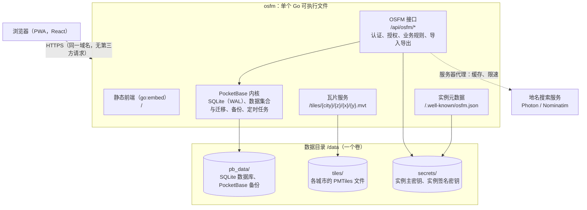
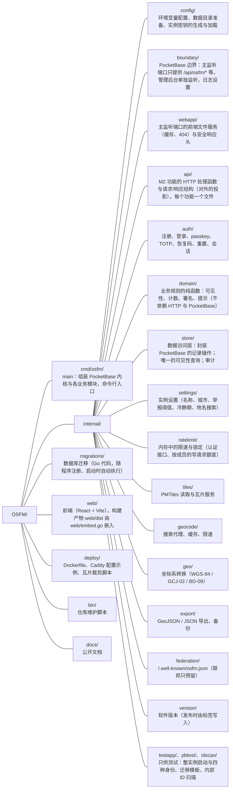
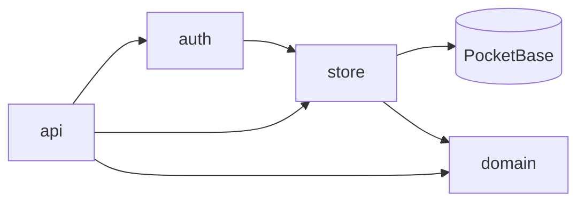
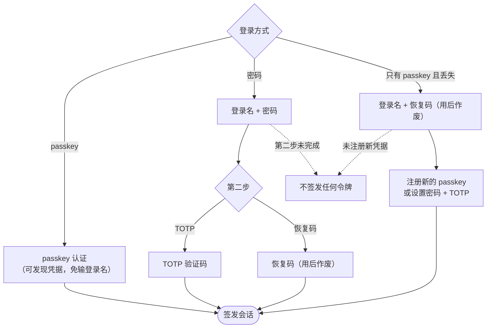
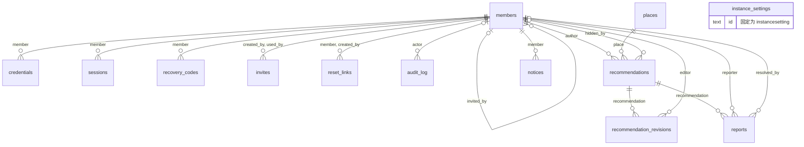

# OSFM 架构

> 版本：v0.1（2026-11-25），对应第一个里程碑（框架）开始之前的设计。需求编号（如 `D4`、`H2`）指产品需求文档中的条目；技术调研见 [research/tech-stack.md](research/tech-stack.md)。标「M1 验证」的内容需要在框架阶段用原型确认，确认后更新本文。

## 0. 概览

一个 OSFM 实例是**一个进程、一个数据目录**：



外部请求只有一类：服务器代理的地名搜索（Photon / Nominatim，`B7`），由服务器发出、缓存、限速，浏览器不直接访问任何第三方。

## 1. 设计约束

| 约束 | 来源 | 对架构的影响 |
| --- | --- | --- |
| 单文件交付，amd64 + arm64，小内存设备 | `G1` `G2` | Go + 纯 Go 的 SQLite 驱动（无 CGO，便于交叉编译）；前端打包后嵌入 |
| 浏览器不发出任何第三方请求 | `A1` `E5` `N3` | 底图、字形、图标、字体、脚本全部由实例提供；搜索走服务器代理 |
| 化名与主名的对应关系不能从任何接口推出 | `E2` `E3` | 客户端拿到的永远是投影后的数据，不含作者 ID；PocketBase 的自动数据接口对客户端关闭（§3.1） |
| 强制两步验证，不依赖邮件 | `D3` `D4` `D5` | passkey 与密码 + TOTP 自行实现；PocketBase 的内置登录方式全部关闭（§3.3） |
| 只显示城市级以上的缩放，不显示边界 | `H2` | 瓦片只需要各城市 z10 以上的切片，不需要全球低缩放数据（§3.6） |
| 联邦只预留 | `F5` | 对外 ID 一律 UUIDv7；软删除；实例签名密钥；导出格式带版本 |
| 地点层与推荐层分别授权 | `F1` `H5` | 两层分表存储、分别导出，地点层不含成员信息 |

## 2. 代码仓库结构



依赖方向（箭头表示"调用 / 依赖"）：



`domain` 是最内层：只有纯函数与普通值（`Viewer`、推荐的可见性状态、作者、提示），不导入 PocketBase，也不导入其他 OSFM 包，业务规则可以脱离数据库做单元测试（AD3）。`store` 用 `domain` 的规则写查询条件（同一条规则的 SQL 形式，测试对照两者），并实现 `domain` 声明的接口（如写提示的 `domain.NoticeWriter`）；`api` 调用两者，`auth` 只用 `store`。替换 PocketBase 时只改 `store`。（M1 的设想是 `api → domain → store`；可见性规则既要做纯函数单元测试、又要成为查询条件，`store` 必须能引用它，所以改为 `domain` 在最内层，T024。）

`cmd/osfm/main.go` 的 `bind` 组装各模块；M2 的接口全部经 `api.Bind(app, api.Options{…})` 一行注册（T024），各功能只改 `internal/api` 里自己的文件，见 §3.2。

## 3. 后端

### 3.1 PocketBase 的用法与边界

PocketBase 作为 Go 库嵌入（`pocketbase.New()`），版本在 `go.mod` 中锁定，升级单独开 PR。

| 用 | 不用 |
| --- | --- |
| SQLite 连接、事务、数据集合定义与 Go 迁移 | 自动生成的数据接口（`/api/collections/*`）：所有集合的访问规则都设为仅超级用户，客户端不可读写 |
| 认证集合 `members`（只作成员表；成员的会话是 OSFM 自己的 `sessions` 集合，不用 PocketBase 的认证令牌，见 §3.3） | 内置登录方式：密码、邮箱验证码、OAuth2、MFA 全部关闭，对应接口不提供（见下） |
| 备份（`app.CreateBackup`）、定时任务（清理过期会话、营业状态提示） | 实时订阅（不需要） |
| 限速设置：全局中间件，覆盖 `/api/osfm/*`，默认开启（见下） | 管理后台 `/_/` 与 PocketBase 自己的接口：主监听端口上不提供，见 §5.4 |
| 请求日志：保留 7 天、不记录 IP（§3.9） | 文件存储（照片是 `C10`，P2） |

这样做的代价是读写接口都要自己写；换来的是：客户端能拿到什么完全由 `internal/api` 里的结构体决定，作者 ID、化名映射、举报人这类字段从结构上就不会出现在响应里。

**边界**（T006 已验证，PocketBase v0.40.6；集成测试在 `internal/boundary`）：

- 主监听端口（反向代理转发的端口）只提供三类路径：已注册的 `/api/osfm/*` 路由、`/api/health`（容器与反向代理的健康检查），以及 `/api/`、`/_/` 以外的路径（前端、瓦片等）。其余 `/api/*`——记录增删改查、集合、各种登录与令牌刷新、找回密码、邮箱验证、OAuth2、模拟登录、实时订阅、文件、批量、设置、日志、备份、定时任务、SQL 接口，以及不存在的路径——和管理后台 `/_/` 一律返回 JSON 404，不论请求带的是成员令牌、超级用户令牌还是没有令牌。不存在的 `/api/*` 路径因此不再落到前端的 index.html。
- 实现是 `internal/boundary` 的全局中间件，排在 PocketBase 的请求日志与异常恢复之后、读取令牌与限速之前（被拒绝的请求照常记日志，但不读令牌、不占限额）。它同时检查请求路径和路由匹配到的模式，转义过的路径（如 `/api%2Fcollections…`）也拦得住。
- 放行的请求在进入后续处理前去掉 `Authorization` 请求头：主监听端口上唯一的凭据是会话 cookie（AD6），PocketBase 令牌（包括超级用户的）在这里不起作用，也就不能借超级用户身份绕过限速。
- 主监听端口不发送任何 CORS 响应头、也不应答跨源预检（T018）：前端与接口同源，用不到 CORS。PocketBase 默认对任何来源返回 `Access-Control-Allow-Origin: *`（`serve --origins` 的默认值），`internal/webapp` 让它的 CORS 中间件只在管理后台的监听地址上起作用，`--origins` 因此只影响那里。主监听端口的安全响应头同样由 `internal/webapp` 设置，替换 PocketBase 自己的默认值（§4.7）。
- 第二层在数据上：所有集合的访问规则为 `nil`（§3.5）；`members` 的密码、邮箱验证码、OAuth2、MFA 全部关闭，没有 OAuth2 提供方，新设备提醒关闭（它会保存由 IP 派生的指纹），认证规则（`authRule`）设为 `nil`——这样即使某个登录方式被重新打开，PocketBase 也不会为成员返回它自己的登录或刷新响应（只有超级用户的模拟登录例外）。迁移是 `1795600200_boundary`。

**限速**（T006 已验证）：PocketBase 的限速是挂在根路由上的全局中间件，自定义路由同样经过它，除非路由显式解除（PocketBase 自己的记录接口就解除了它，改用按集合的限速）。规则的标签与 `"方法 路径"` 或 `路径` 精确匹配，以 `/` 结尾的标签按前缀匹配；第一条匹配的规则生效，按客户端地址在固定窗口内计数，计数在内存中、修改设置时清零，超级用户不受限。PocketBase 默认关闭限速；迁移 `1795600200_boundary` 把它打开，沿用 PocketBase 的默认规则，其中 `/api/`（每个地址每 10 秒 300 次）覆盖 `/api/osfm/*`。维护者可以在管理后台调整规则，迁移只设初始值。局限：

- 客户端地址取自设置里的可信代理请求头（`trustedProxy.headers`），没有设置时取 TCP 对端地址。部署在同机反向代理后面而不设置时，所有客户端共用代理的地址，限额变成整个实例共享。这一项和部署方式有关，迁移不设置；部署者用环境变量 `OSFM_TRUSTED_PROXY_HEADERS` 设置（T011，每次启动写入，取最右边的有效地址，§5.2、§5.3），不设时保留管理后台里的值。OSFM 自己的认证限速用同一个地址（§3.3）。
- 不能按登录名计数、不能只计失败的尝试、没有临时锁定，所以登录、TOTP、恢复码、重置链接的限速（`N5`）由 OSFM 自己实现（T011，§3.3 "限速与锁定"）；PocketBase 的全局规则照常在它之前生效。

### 3.2 接口设计

- 前缀 `/api/osfm/`，JSON，按资源组织：`places`、`places/{uuid}/recommendations`、`me`、`members`（维护者）、`invites`、`reports`、`exports`、`geocode`、`auth/*`。
- **对外只用 UUIDv7**（`uuid` 字段，唯一索引）。PocketBase 自己的记录 ID 只在服务器内部使用，不出现在任何响应、链接或导出中。集成测试（`cmd/osfm`）按 `osfm serve` 的方式启动程序，往每个集合写入编造的记录，再调用所有已注册的路由，在每个响应的头部和正文（包括其中 JSON Web Token 解码后的内容）里查找这些记录与集合的内部 ID；路由从路由器中枚举，新增的 OSFM 路由没有对应的测试请求时测试失败（§6）。探测请求按功能分文件（`cmd/osfm/probes_<功能>_test.go`，各自在 `init` 里 `registerProbes`），公开路由与只限维护者的路由清单也在各自的文件里。
- **响应是投影**，例如推荐的响应只有 `uuid`、`displayName`（主名或化名，由服务器决定）、`attitude`、正文字段、`editedByMaintainerAt`，没有 `authorId`；只有当请求者就是作者时才附加 `isMine: true`，以便显示编辑入口。
- 地点卡片里按态度统计的人数（`A4`）在服务器端按真实作者去重后只返回数字。
- 地图数据按城市与视野范围取：`GET /api/osfm/places?city=…&bbox=…`，返回地点的最小字段集（坐标、精度、类别、各态度人数、时段集合），详情按需取。
- 接口的 TypeScript 类型由 Go 结构体生成（tygo，T024）：`internal/api` 导出的请求/响应类型与常量生成 `web/src/api/types.gen.ts`（配置 `tygo.yaml`，`go tool tygo generate`），生成文件提交进仓库，`bin/check-api-types.sh`（gate 与 CI）在它与 Go 类型不一致时失败。M1 的认证接口类型仍是前端手写，以后再迁。

**`internal/api` 的结构**（T024）：`api.Bind` 在 OnServe 中调用每个功能的注册函数，每个功能一个文件、一个预先放好的注册函数（`settings.go` 实例设置、`places.go` 新建地点与推荐、`map.go` 地图与卡片、`recommendations.go` 编辑与修改记录、`reports.go` 举报与复核、`notices.go` 站内提示、`profile.go` 资料与化名、`governance.go` 邀请与治理、`leave.go` 退出、`personal_export.go` 个人导出、`layer_export.go` 按层导出、`backups.go` 备份、`geocode.go` 地名搜索），功能之间不改同一个文件。每个接口共用的规则：

| 方面 | 做法 |
| --- | --- |
| 身份 | 会话中间件（`internal/auth`）先拦下无会话的请求（401）与缺 `X-OSFM` 的写请求（403）；处理函数用 `api.ViewerOf(e)` 取得 `domain.Viewer`（成员的内部 ID 与是否维护者，只在服务器内使用）；维护者接口挂 `api.MaintainersOnly()`（成员 403 `forbidden`），敏感操作另挂 `auth.RequireFresh()` |
| 错误 | `api.Error`：与 `auth.AuthError` 同一形状 `{status, message, data, code}`，`code` 是机器可读的稳定字符串（共用的 `invalid_request`、`body_too_large`、`not_found`、`forbidden`、`rate_limited`，功能自己的如 `already_recommended`）；别人不可见的对象与不存在的对象同为 404 |
| 请求体 | 一律带上限读取（默认 64 KiB），超出 413 `body_too_large`，格式不对 400；路径里的对象只按 `uuid` 指定，不是 UUIDv7 的一律 404 |
| 额度 | 写接口挂按成员的写请求额度（`WriteBudget`：键为成员 `uuid`，令牌桶，默认一次 60 个、每 2 秒补 1 个，所有写接口共用；超出 429 `rate_limited` + `Retry-After`）；需要别的速率的接口（地名搜索）用 `MemberBudget` 另建一份。计数只在内存中（`internal/ratelimit`），不写日志。PocketBase 按地址的全局限速照常在前面生效（§3.1） |
| 缓存 | 成员与管理类响应 `Cache-Control: no-store`（地图数据另定，T027） |
| 推荐的投影 | `api.RecommendationView`：`uuid`、`displayName`、`authorLeft`、`externalLinks`、`attitude`、`text`、`dishes`、`timeSlots`、`season`、`sources`、`visitedOn`、`createdAt`、`updatedAt`、`editedByMaintainerAt`、`isMine`，作者本人另有 `visibility`，作者与维护者看到被隐藏的推荐时另有 `hidden: {kind, reason}`（举报隐藏不带原因，任何时候都不带维护者与举报人）。只能经 `api.RecommendationViews` 生成：它再按可见性过滤一次（第二道防线），一次查询取作者 |
| 署名 | 只在 `domain.ResolveSignature` 一个函数里决定：主名推荐显示主名并附外部链接（只取 https，最多 5 条）；化名推荐显示化名、从不附外部链接（`E3`）；作者已退出或被删除时主名推荐只有 `authorLeft: true`（由客户端按语言显示"已退出成员"），化名推荐照常显示化名（M2-Q10）；没有化名的化名推荐显示空名，绝不退回主名。署名方式本身不出现在任何响应里 |

**实例设置**（`internal/api/settings.go`）：`GET /api/osfm/instance` 对成员返回 `name`、`cities`、`geocoderEnabled`（前端据此隐藏搜索框），对维护者另返回 `reportThreshold`、`inviteCooldownDays`、`geocoderContact`；`POST`（只限维护者、写额度）只修改请求里带的字段，没带的（或为 `null` 的）保留已存的值——管理页的"名称与城市"表单与"举报、邀请与地名搜索"表单各自只发自己的字段。校验：名称与城市同向导（`instance_name_invalid`、`cities_invalid`），举报阈值 1–100（`report_threshold_invalid`），冷静期 0–3650 天（`invite_cooldown_invalid`），联系方式去首尾空白后 ≤ 200 字符且无控制字符（`geocoder_contact_invalid`）；保存与审计 `settings.update` 在同一事务，审计记录名称、城市标识与各项数值，联系方式只记是否设置。各功能用 `settings.LoadCircle` 读取当前值（改设置立即生效）。

**地点与推荐：写入**（`internal/api/places.go`，T026）：

- `POST /api/osfm/places`（写额度）：请求体 `CreatePlaceRequest` 是地点字段加上第一条推荐 `recommendation`（`RecommendationInput`），两者在同一个事务里写入，再写审计 `places.create`（操作人是新建者，目标是地点的 `uuid`；地点层本身没有任何成员字段，§3.5）。201 返回 `{place, recommendation}` 两个 `uuid`。地点没有单独新建的入口：地点只在有一条请求者可见的推荐时存在（§3.4）。
- `POST /api/osfm/places/{uuid}/recommendations`（写额度）：请求体是同一个 `RecommendationInput`。地点经 `store.VisiblePlaces` 查找，看不到的与不存在的同为 404；请求者在这个地点已有未删除的推荐时返回 409 `already_recommended`，`data.recommendation` 是他自己那条的 `uuid`（只告诉作者本人，客户端转去编辑）。检查与写入在同一事务里（SQLite 只有一个写连接，事务依次执行）；`(place, author)` 部分唯一索引是最后一道防线，写入失败时再查一次，同样答 409。
- `GET /api/osfm/places/nearby?lat=&lon=&name=`（重名提示，`B6`）：先按 `(lat, lon)` 索引取约 100 m 的外接框内、经 `store.VisiblePlaces` 过滤的地点，再按大圆距离保留 100 m 以内、店名或别名与 `name` 相似的，按距离排序，最多 5 个，只返回 `uuid`、店名、类别与取整到 10 m 的距离（`H3`），不返回坐标。名称比较用 `domain.PlaceNameKey`（NFKC、转小写、去掉空白与标点）：相等、较短的（至少 2 个字符）包含在较长的里面，或编辑距离不超过 1（3–5 个字符）/ 2（6 个字符以上）。
- **校验**都在 `internal/domain` 的纯函数里（`NormalizePlace`、`NormalizeRecommendation`）：店名 1–200 个字符、单行；别名最多 10 个；坐标必须落在实例某个城市的范围内（`outside_cities`）；精度默认 `exact`；类别为空或在白名单内，菜系只接受列表值；位置描述 ≤ 500；参照物是请求者看得到的地点（`{type: "place", place}`）或一段文字（`{type: "text", text}`，≤ 200）；推荐的态度必选，推荐语去首尾空白后非空、≤ 5000；推荐的菜最多 20 个；时段只接受五个取值；季节 ≤ 100；来源最多 10 条，链接只接受带主机名的 http(s)，摘录 ≤ 500；到店日期不晚于地球上最晚时区的"今天"；署名默认主名，选化名而成员没有化名时 `no_pseudonym`；可见性只接受 `private` 与 `circle`（默认），`federated` 只是预留值，写入时拒绝。其余不合规的字段答 400 `invalid_request`，`data.field` 是请求里的字段路径（如 `recommendation.sources[1].url`）。文本去首尾空白，多行文本的换行统一为 `\n`，单行字段不接受控制字符；列表去掉空项与重复项。
- **固定取值**（类别、菜系、时段、精度、来源类型、可见性、署名方式）以 `internal/domain` 的列表为准；前端的 `web/src/lib/enums.ts` 列出相同的值、相同的顺序，`domain` 的 Go 测试解析这个文件并逐一比较，两边不一致时失败（tygo 只生成常量，不生成列表，前端又需要它们作为字面量类型）。
- **坐标**：`lat`、`lon` 照收到的值交给 `store`，由钩子取 5 位小数；`source_coord` 保存未取整的原值、坐标系与来源：`{"lat", "lon", "crs": "wgs84", "source": "crosshair" | "search"}`（请求里的 `sourceCoord` 只带 `crs` 与 `source`，缺省为 WGS-84 的准星）。M2 只有 WGS-84，其他坐标系随分享链接的坐标换算（`B10`）再加。参照地点存为 `{"type": "place", "place_uuid"}`，文字参照物为 `{"type": "text", "text"}`。

**地图数据与地点卡片**（`internal/api/map.go`、`map_query.go`，T027）：

- `GET /api/osfm/places?city=<标识>&bbox=<minLon,minLat,maxLon,maxLat>`：返回地点数组 `[{uuid, name, lat, lon, precision, category, counts: {mustTry, good, ok, avoid}, timeSlots}]`，按店名、再按 `uuid` 排序，从不按态度排序。`city` 必填（不是实例的城市时 400 `unknown_city`）；`bbox` 可省略（取整个城市），给出时裁到城市范围之内，与城市不相交时 400 `outside_city`，格式不对 400 `invalid_request`。可选筛选：`slots`、`category`、`cuisine`（可重复，也可逗号分隔）、`by`（署名，可重复，不按逗号拆分）、`mustTry=1`、`noAvoid=1`；不同条件之间为"且"，同一条件的多个值为"或"，空值忽略。
- **哪些推荐参与计数**只在一处决定（`countedOn`）：请求者可见（`store.RecommendationVisibleTo`）、未隐藏（`store.Shown`，维护者也不例外）、态度有效，并且每个作者在每个地点只取最新的一条——即 `domain.CountAttitudes` 的 SQL 形式。人数、时段集合、"有人强推"（`counts.mustTry > 0`）、"排除有人避雷"（`counts.avoid == 0`）、时段与推荐人筛选、署名候选都基于这同一组推荐，所以筛选结果与人数一致，也不随请求者的角色变化。地点是否出现另由 `store.HasVisibleRecommendation` 决定（M2-Q3）：作者与维护者能看到只有一条被隐藏推荐的地点，人数为 0。
- 人数与时段在一次分组查询里算出：`places` 按 `(lat, lon)` 索引取范围，左连接参与计数的推荐，`GROUP BY` 地点；"每个作者只取最新一条"用部分唯一索引 `(place, author)` 查找。类别与菜系是地点上的条件，强推、避雷、时段、推荐人是分组后的条件。
- **推荐人筛选**按署名字符串精确匹配：哪个"（作者，署名方式）"对应哪个名字只由 `domain.ResolveSignature` 决定，再把匹配的组合作为查询条件。因此主名不命中同一成员的化名推荐；已退出成员的主名推荐没有名字，任何名字都不命中它，空名不构成筛选。
- `GET /api/osfm/signatures?city=<标识>`：该城市里参与计数的推荐的署名，去重，按名称（不区分大小写）排序，只是字符串数组，不标注主名或化名、不带 `uuid`，不含空名。
- `GET /api/osfm/places/{uuid}`：地点卡片 `{uuid, name, aliases, lat, lon, precision, positionNote, landmark?, category, cuisine, status?, statusConfirmedAt?, city, counts, recommendations}`。请求者看不到的地点与不存在的地点同为 404。`landmark` 为 `{type: "place", place: {uuid, name}}` 或 `{type: "text", text}`；参照地点对请求者不可见时整个 `landmark` 省略。`city` 是第一个范围包含该地点的城市标识，没有时为空。推荐按创建时间倒序，经 `api.RecommendationViews` 投影（被隐藏的推荐只给作者与维护者，带 `hidden`）；人数用 `domain.CountAttitudes` 计算，与地图的分组查询一致（集成测试以随机数据逐条重算对照）。
- **缓存**：地点数组与署名候选 `Cache-Control: private, no-cache`、`Vary: Cookie`，带按响应内容计算的 `ETag`，`If-None-Match` 相同时 304（配合前端的"网络优先"）；卡片与错误响应 `no-store`。
- 路由：`GET /api/osfm/places/nearby`（新建地点的重名提示）与卡片的 `GET /api/osfm/places/{uuid}` 并存时，PocketBase 的路由（Go 的 `ServeMux`）按"字面量优先于通配段"选择，与注册顺序无关（`TestPlaceRoutesPrecedence`）。
- 耗时（开发机 Apple M4，1000 个地点、50 名成员的 5000 条推荐，经完整的会话中间件，`internal/api` 的 `BenchmarkMap`）：整个城市约 20 ms（响应约 238 KB），一个视野约 5 ms，带筛选约 17 ms，署名候选约 11 ms，卡片约 0.4 ms。

### 3.3 认证与会话

使用的库：WebAuthn 用 `github.com/go-webauthn/webauthn`；TOTP 用 `github.com/pquerna/otp`（RFC 6238，30 秒、6 位）；密码哈希用 argon2id（`golang.org/x/crypto/argon2`）。

**数据**：凭据存在单独的 `credentials` 集合（`D3`）：passkey 的凭据 ID、公钥、签名计数及认证器的标志（见下面的"passkey"）；或密码哈希 + TOTP 密钥。TOTP 密钥用实例主密钥（`secrets/master.key`，AES-256-GCM）加密后存储，防止只拿到数据库文件的人生成验证码（格式见下面"密码 + TOTP"）。恢复码、邀请码、重置链接只存哈希（`N5`）。PocketBase 认证集合自带的 `password` 字段填随机值且不使用。

**流程**：

**注册（`D3`）**


**登录（`D4`）**



任何分支都要两个因素都通过才签发会话；密码正确但第二步未完成时不签发任何令牌。只有 passkey 的成员用恢复码时，恢复码换来的不是会话，而是只能注册新凭据的恢复票据（见下面的"只有 passkey 的成员的恢复"）。

**重置（`D5`）**


细节见下面的"重置链接"。

**会话**（AD6，T007，`internal/auth`）：两步验证通过后，服务器建一条会话，把一个随机令牌放在 cookie 里交给浏览器。

- **cookie 里只有一个不透明的随机值**：`osfm_session`（实例以 https 在公网主机名上提供时为 `__Host-osfm_session`，见下），256 位随机数（`crypto/rand`）的 base64url 编码（43 个字符），不含成员 ID、PocketBase 记录 ID、有效期或任何可解码的内容。属性为 `HttpOnly; Secure; SameSite=Lax; Path=/`，不设 `Domain`（只发给本主机，瓦片请求也带上）；`Max-Age` 到会话过期为止。前端脚本读不到它。
- **服务器只存令牌的哈希**：`sessions` 集合（§3.5）每条会话一行：成员、令牌的 SHA-256（十六进制，唯一索引）、过期时间、最近一次使用的日期（只记 UTC 日期，不记时刻，每天最多写一次）、最近一次在这个会话上证明身份的时间（`verified_at`：登录或再次验证，见下面的"凭据管理与再次验证"）、创建时间；不记 IP、不记 User-Agent。令牌本身有 256 位随机性，不需要加盐或慢哈希；只拿到数据库文件的人得不到可用的 cookie。
- **有效期**：从登录起 30 天，使用不延长；到期后需要重新登录。过期的行在下次出现时删除，另有每日定时任务清理。
- **校验**：每个需要登录的请求按 cookie 令牌的哈希查一次 `sessions`（唯一索引），再经 `store.Query` 查一次成员（自动排除已软删除的）。会话有效的条件是：行存在、未过期、成员存在且可以登录——`left_at` 为空（离开或被维护者移出，`D7` `D9`）且未被软删除。不满足时删除这行会话，并在响应里让浏览器删掉 cookie。不加缓存：两次走索引的 SQLite 查询远小于一次请求的其他开销，而缓存会让撤销不再立即生效。
- **撤销就是删除行**，从下一个请求起生效：
  - 退出登录（`POST /api/osfm/logout`）只删当前这一条，成员的其他设备不受影响；
  - 重置凭据（`D5`，T012）和只有 passkey 的成员恢复后注册新凭据时调用 `auth.RevokeSessions`，删除该成员的全部会话，并写一条审计记录（`sessions.revoke_all`：操作人、目标成员的 uuid、原因 `credentials_reset` 或 `recovery`、条数）；
  - 成员在"我的"页删除凭据、修改密码、更换 TOTP 时，结束他的其他会话（保留当前这一条），审计记录 `sessions.revoke_others`；
  - 成员的 `left_at` 被设置或记录被软删除时，`members` 集合的记录钩子立即删除其全部会话并写同样的审计记录；即使有代码绕过钩子直接改库，上面的校验也会拒绝这个成员。
- **为什么不把 PocketBase 的认证令牌放进 cookie**（T006 验证过可以自行签发）：PocketBase 令牌是 JWT，载荷里有成员的内部记录 ID，直接放进 cookie 违反 AD4（内部 ID 扫描会解码 JWT 并失败）；它的失效靠轮换成员的 `tokenKey`，只能让这个成员的所有设备同时失效，做不到"只退出这台设备"——退出登录只能清掉浏览器里的 cookie，令牌本身在 30 天内仍然有效。用主密钥加密后再放进 cookie 能藏住内部 ID，但仍然做不到单设备撤销，还要自己设计加密格式。服务器端会话简单、能逐条撤销，以后"我的设备"列表（按 `sessions.uuid` 逐个退出）也不需要改数据模型；代价是每个需要登录的请求多一次索引查询。
- 因此 OSFM 不为成员签发任何 PocketBase 令牌；`members` 集合的 `authToken.duration` 等令牌设置不起作用，T006 的 `IssueToken`、`MemberByToken`、`RevokeTokens` 已删除，只保留 `NewMemberRecord`。主监听端口去掉 `Authorization` 请求头（§3.1），所以即便有人拿到 PocketBase 令牌，在这里也不起作用。

**中间件**（`internal/auth`，按执行顺序；数字是 PocketBase 中间件的优先级，小的先执行）：

| 中间件 | 优先级 | 作用 |
| --- | --- | --- |
| 边界（`internal/boundary`） | −1025 | 见 §3.1；被拒绝的请求不会去查会话 |
| 读取会话 `osfmLoadSession` | −1022 | 对 `/api/osfm/*` 与 `/tiles/*` 读取 cookie；会话有效时记下会话与成员，并把成员设为 `e.Auth`。排在 PocketBase 的令牌读取（−1020）和限速（−1000）之前：限速因此把成员算作已登录者，受众为 `@auth` 的限速规则对成员生效（计数仍按客户端地址，见 §3.1） |
| 要求登录 `osfmRequireSession` | −999 | `/api/osfm/*`（标为公开的路由除外）与 `/tiles/*` 没有会话时返回 401（JSON，与边界的 404 同一格式）。排在限速之后，被拒绝的请求也占限额 |
| CSRF `osfmCSRF` | −998 | `/api/osfm/*` 的 POST、PUT、PATCH、DELETE 没有 `X-OSFM: 1` 请求头时返回 403，公开路由也一样（登录同样不能被跨站伪造） |
| 认证限速 `osfmRateLimit` | −997 | 只挂在公开的认证路由上（`auth.RateLimit`，见下面的"限速与锁定"）；被前面几层拒绝的请求不占这里的额度 |

- 判断路径时与边界一样同时检查请求路径和路由匹配到的模式。要求登录的检查看的是会话，不是 `e.Auth`：管理后台的单独监听地址上，PocketBase 会按 `Authorization` 头把 `e.Auth` 设为超级用户，那不是会话。处理函数用 `auth.CurrentMember(e)` 取当前成员。
- **公开路由**：登录、注册、重置相关的接口注册后用 `auth.Public(route)` 标记（从该路由上解除"要求登录"中间件，这是 PocketBase 按路由排除全局中间件的机制）。CSRF 检查和会话读取不受影响，所以公开接口里也能拿到当前成员。其余路由默认要求登录；内部 ID 扫描的测试另有一份公开路由清单，两者不一致时失败（§6）。
- 没有会话也能访问的只有：前端的静态文件、`/api/health`、`/.well-known/osfm.json`（§3.8）和标为公开的接口。
- **登录接口**（T009、T010）在两个因素都通过后调用 `auth.SignIn(e, member)`：建会话、设置 cookie，并结束这个请求原来带着的会话（换号登录时不留下旧会话）；已离开或已删除的成员返回 `auth.ErrCannotSignIn`。
- **CSRF**：跨站的表单加不了自定义请求头；跨源脚本要带 cookie 并加自定义请求头必须先通过预检，而主监听端口对预检不返回任何 CORS 响应头（§3.1），预检失败、请求不会发出。`SameSite=Lax` 另外挡住跨站的子请求与表单 POST。
- **`__Host-` 前缀**（T018）：`OSFM_PUBLIC_URL` 是 `https://` 且主机不是 localhost 或回环地址时（`config.PublicHTTPS`），会话 cookie 叫 `__Host-osfm_session`。带这个前缀的 cookie 浏览器只在 `Secure`、`Path=/`、没有 `Domain` 时接受，同级子域名（例如同一个上级域名下别人的站点）也就无法为上级域名写入同名 cookie，把成员带进攻击者的会话或遮住成员自己的会话（cookie tossing）。本地开发不用前缀：WebKit（Safari）在 `http://localhost`、`http://127.0.0.1` 上拒绝 `__Host-` cookie，却接受同样属性、不带前缀的 `Secure` cookie（T018 用 Playwright 的 WebKit 27.2 与 Chrome 158 实测；Chrome 两种都接受；Firefox 未能在测试环境中启动，未测）。前缀开启时只读带前缀的 cookie，不带前缀的同名 cookie 不被当作会话。
- **Secure 与本地开发**：cookie 始终带 `Secure`。浏览器把 `localhost`、`127.0.0.1` 当作安全上下文，接受它们通过 http 设置的 Secure cookie（T018 实测 Chrome 158 与 WebKit 27.2 都接受；T009 用 Playwright 的 Chromium 159 与 WebKit 27.2 在 `http://127.0.0.1` 与经 Vite 代理的 `http://localhost` 上完成了注册与两种登录，cookie 被保存、会话可用、没有 CSP 违规；Firefox 在测试环境中仍无法启动，未测），所以 `http://127.0.0.1:8090` 和 Vite 开发服务器（`http://localhost:5173`，代理到后端）都能登录。其他主机名通过 http 访问时浏览器不保存这个 cookie、谁也登录不了，所以 `OSFM_PUBLIC_URL` 只接受 `https://`，或主机为 `localhost`、`*.localhost`、回环地址的 `http://`，否则拒绝启动（§5.2）。
- **接口**：`GET /api/osfm/me` 返回当前成员 `{"uuid", "displayName", "role"}`（`displayName` 为主名，`role` 为 `member` 或 `maintainer`），`Cache-Control: no-store`；没有会话时 401。`POST /api/osfm/logout` 删除当前会话、让浏览器删掉 cookie，返回 204；会话已失效时同样是 401 并清掉 cookie。

**邀请**（`D1` `D2`，T008，`internal/auth`）：没有邀请不能注册。M1 只有维护者能创建邀请；成员邀请、冷静期（`D12`）与邀请树（`D10`）在 M2。

- **邀请码**：256 位随机数（`crypto/rand`）的 base64url 编码（43 个字符），与会话令牌同一形式。`invites` 集合（§3.5）只存它的 SHA-256（十六进制，唯一索引），另有邀请人（`created_by`）、过期时间、使用者与使用时间（`used_by`、`used_at`）、撤销时间（`revoked_at`）。邀请码只在创建的响应里出现一次，之后谁也看不到（维护者也不能），丢了就撤销再建一个。随机性足够，普通哈希即可：猜中一个有效邀请码不可行，只拿到数据库也得不到可用的邀请码。
- **查找**：按邀请码的哈希走唯一索引查一行，邀请码本身从不参与比较，查找时间与邀请码的内容无关；查到的哈希再用恒定时间比较核对一次。
- **有效**：未使用、未撤销、未过期，而且邀请人还能登录（未离开、未被移出或删除）。有效期由维护者创建时选择，1–30 天，默认 7 天。邀请人离开、被移出或删除时，`members` 的记录钩子撤销他所有未使用的邀请并写审计记录（`invites.revoke_all`）；绕过钩子时上面的有效性检查同样拒绝。
- **链接**：`/register#invite=<邀请码>`。邀请码在 URL 的片段（`#` 之后）里：浏览器不会把片段发给服务器，所以它不会出现在 OSFM、反向代理或任何中间代理的请求日志里，也不会进入 `Referer` 请求头。注册页从片段读出邀请码，随即把它从地址栏和这条历史记录中去掉（只在当前标签页的 `sessionStorage` 里保留，刷新页面仍能继续），再放在 POST 请求的正文里发给服务器。
- **检查接口**：`POST /api/osfm/invites/check`（公开，`auth.Public`，同样要求 `X-OSFM: 1`），正文 `{"code"}`，返回 `{"valid": true|false}`。从未存在、格式不对、已过期、已使用、已撤销、邀请人已离开的邀请码，得到的状态码、正文和响应头完全相同，否则这个接口就成了打听"这个链接后来怎样了"的工具。它不消耗邀请；注册时服务器再检查一次。它受认证限速约束（见下面的"限速与锁定"）：无效的邀请码算作一次失败的尝试；邀请码的随机性本来就使枚举不可行。
- **维护者接口**（`auth.RequireMaintainer`：没有会话 401，不是维护者 403）：`GET /api/osfm/invites` 列出全部邀请（新的在前），每条有 `uuid`、状态（`active`、`used`、`expired`、`revoked`）、创建与过期时间、邀请人与使用者（`uuid` 与主名）、使用与撤销时间，不含哈希；`POST /api/osfm/invites`（正文 `{"days"}`，可省略）返回新邀请和邀请码，`201`；`POST /api/osfm/invites/{uuid}/revoke` 撤销，已撤销的再撤销不变，已使用的返回 409。创建与撤销各写一条审计记录（`invites.create`、`invites.revoke`，操作人、邀请的 uuid）。所有响应 `Cache-Control: no-store`。
- **注册时消耗**：`auth.RegisterWithInvite(app, 邀请码, 注册函数)` 是通过接口创建成员的唯一途径（T009、T010 的注册接口都用它；首次启动向导创建第一个维护者是唯一的例外，T013）。它在一个事务里：按上面的规则找到有效邀请（否则 `auth.ErrInvalidInvite`，不区分原因）→ 准备新成员记录（角色 `member`、`invited_by` 为邀请人、`joined_at`）→ 调用注册函数，由它填写登录名、主名并保存成员与凭据（只能用事务的 `tx`）→ 核对成员确已保存、角色和邀请人未被改动 → 用条件更新消耗邀请（只在仍未使用、未撤销、未过期时写入 `used_by`、`used_at`）。任何一步失败都回滚整个事务：不留下成员和凭据，邀请保持原样。PocketBase 的写事务共用一个连接、依次执行，条件更新又保证只有一次能写入，所以两个同时用同一邀请码注册的请求只有一个成功；撤销用同样的条件更新，与注册不会同时成功。耗时的计算（argon2id、WebAuthn 验证）放在调用之前，不占着写连接。

**passkey**（`D3` `D4` `N5`，T010，`internal/auth`）：WebAuthn 用 `github.com/go-webauthn/webauthn`，浏览器端直接调用 WebAuthn 接口（`navigator.credentials`，二进制字段的 base64url 转换自己做，不依赖较新浏览器才有的 `parseCreationOptionsFromJSON`/`toJSON`）。

- **依赖方（relying party）**：ID 与允许的来源（origin）由 `OSFM_PUBLIC_URL` 得出（`config.PasskeyRP`，启动日志里打印）。公网主机名时 ID 就是这个主机名，只接受 `OSFM_PUBLIC_URL` 这一个来源（去掉默认端口）。本地开发（`OSFM_PUBLIC_URL` 为 localhost、`*.localhost`、回环地址，或未设置）：浏览器不接受 IP 地址作 ID，所以回环地址换成 `localhost`，passkey 只能在 `http://localhost:<端口>` 上用，在 `http://127.0.0.1:<端口>` 上浏览器会拒绝（页面提示改用 localhost）；未设置时端口取 `OSFM_LISTEN` 的端口；ID 为 `localhost` 时另外接受 Vite 开发服务器的来源 `http://localhost:5173`（它把接口代理到本机实例）。生产实例不会多出任何来源。配置不可用时（例如 `OSFM_PUBLIC_URL` 是一个 IP 地址），passkey 接口返回 503，实例照常启动，可以用"密码 + TOTP"。
- **每次仪式都要求用户验证**（`userVerification: required`：认证器验证指纹、面容或 PIN，所以一个 passkey 本身就是两个因素）**和可发现凭据**（`residentKey: required`，登录时不用输登录名）。**证明（attestation）为 `none`**：不限制认证器型号，也不让认证器透露设备型号；因此不保存原始证明数据，也不接 FIDO 元数据服务。
- **用户句柄**（WebAuthn 的 `user.id`）：每个成员一个，32 字节随机数（`members.passkey_user_handle`，base64url），在第一次注册 passkey 时生成，该成员所有 passkey 共用。它既不是 PocketBase 记录 ID（AD4），也不是成员的 `uuid`：认证器和同步 passkey 的服务商（Apple、Google、密码管理器）会保存这个值，它不应告诉它们任何东西，也不应把 passkey 与出现在接口响应、导出以及以后的联邦里的标识联系起来（UUIDv7 还带着注册时间）。随机句柄也可以在重置凭据时更换而不改变成员身份。认证器另外保存登录名和显示名，用于在系统的 passkey 选择界面里区分账号。
- **仪式状态**：一次仪式有两个请求，第一个返回带新挑战（challenge）的选项，第二个带回认证器的签名；注册和登录都发生在有会话之前。服务器把第一个请求决定的内容（挑战、依赖方、要求的用户验证；注册时还有邀请码的哈希、登录名、显示名、用户句柄）用 AES-256-GCM 加密后交给浏览器（`state`），第二个请求原样带回。密钥是进程启动时生成、只在内存里的随机密钥（不是实例主密钥）；仪式类型作为附加认证数据，注册的状态不能用于登录，反之亦然；状态 6 分钟后过期（浏览器的超时为 5 分钟）；**只能用一次**：打开时把它的随机 ID 记在内存里直到过期，不论这次验证成功与否，再用就失败。密钥与这份记录同生同灭，所以重启后旧状态全部失效（只是需要重新开始仪式）。OSFM 是单进程（AD1），第一步不写数据库，未登录的请求不会让数据库增长。
- **注册**：`POST /api/osfm/passkey/register/options`（正文 `{"invite", "loginName", "displayName"}`）先检查登录名格式与显示名（规则与"密码 + TOTP"相同，见下），，再检查邀请（不消耗），最后检查登录名是否已被使用（只告诉持有有效邀请的人），返回创建选项与状态。`POST /api/osfm/passkey/register`（正文 `{"invite", "state", "credential"}`）先在事务外验证认证器的响应（挑战、来源、依赖方 ID 的哈希、用户验证、签名），邀请码必须与第一步相同；再经 `auth.RegisterWithInvite` 在一个事务里创建成员（登录名、显示名、用户句柄）、保存 passkey、生成 10 个恢复码并消耗邀请，然后签发会话，返回 `201 {"recoveryCodes": […]}`。恢复码只出现在这个响应里；前端要求成员勾选"已保存"后才进入地图。会话在这一步就签发：两个因素此时都已验证，恢复码只是备用手段；成员中途关掉页面也已经能用 passkey 登录。
- **登录**：`POST /api/osfm/passkey/login/options` 返回请求选项（不列出凭据，由浏览器在本实例的 passkey 中选择）与状态；`POST /api/osfm/passkey/login`（正文 `{"state", "credential"}`）按凭据 ID 找到 passkey，核对响应里的用户句柄就是该 passkey 所属成员的句柄，验证签名、来源、依赖方、用户验证、备份资格标志不变，成员必须可以登录（未离开、未删除），然后 `auth.SignIn`，返回 204。失败一律 `401 {"code": "passkey_failed"}`，不区分未知 passkey、签名错误、状态已用或过期、成员已离开。
- **签名计数**：新计数不大于已存的计数、且两者不都是 0 时拒绝登录（WebAuthn §7.2 第 17 步：认证器可能被复制），并写审计记录 `credentials.passkey_counter_regression`（目标为成员的 uuid）；同步型 passkey 一直报告 0，照常通过。新的计数用条件更新写入（只有存储的计数仍是验证时读到的那个才写），两个同时用同一计数的登录只有一个成功。
- 错误响应与"密码 + TOTP"的格式和 `code` 相同（`auth.AuthError`：`invalid_request`、`invite_invalid`、`login_name_invalid`、`display_name_invalid`、`login_name_taken`），另有 passkey 自己的 `passkey_failed`、`passkeys_unavailable`。所有响应 `Cache-Control: no-store`；四个接口都是公开路由（`auth.Public`），同样要求 `X-OSFM: 1`。
- **响应头**：主监听端口的 `Permissions-Policy`（§4.7）不列 `publickey-credentials-create`、`publickey-credentials-get`，它们按浏览器默认只对本站开放；T010 在真实响应头与 `default-src 'self'` 下用 Chrome 实测注册与登录都不受影响。
- **添加更多 passkey**（T012）：见下面的"凭据管理与再次验证"。登录页的自动填充（`mediation: "conditional"`，登录名输入框加 `autocomplete="username webauthn"`）待做。限速与审计见下面的"限速与锁定""审计"。

**密码 + TOTP**（`D3` `D4`，T009，`internal/auth`）：注册与登录各两步，所有接口都是公开的 POST（`auth.Public`，仍要求 `X-OSFM: 1`），响应 `Cache-Control: no-store`，错误响应在 PocketBase 的错误格式上多一个机器可读的 `code`（`auth.AuthError`），前端按它显示文案。

- **密码哈希**：argon2id（`golang.org/x/crypto/argon2`，RFC 9106），64 MiB 内存、2 遍、2 路并行、16 字节随机盐、32 字节输出，以 PHC 字符串（`$argon2id$v=19$m=65536,t=2,p=2$<盐>$<哈希>`）存在 `credentials.password_hash`：每个哈希自带参数，以后提高参数时旧哈希仍可验证（登录成功时再按新参数重算，待做）。参数按最小的目标设备（2 核 ARM）选：2 路并行时一次计算用满两个核，那里约 100–300 毫秒（开发机 Apple M 系列实测约 40 毫秒；2 核 ARM 上的实测随 T021）。同时最多 2 个 argon2id 计算（其余请求排队，请求取消即放弃），内存上限因此是 128 MiB，一阵登录尝试也压不垮小机器。密码先做 Unicode NFKC 规范化（不同设备输入的同一密码得到同一哈希）；规则只有长度（规范化后 8–128 个字符）和不能等于登录名，不设字符组合要求（两步验证是强制的）。
- **TOTP**（`github.com/pquerna/otp`，RFC 6238）：HMAC-SHA1、30 秒、6 位、160 位密钥（服务器用 `crypto/rand` 生成）。接受当前时间步与前后各一步（±30 秒，手机时钟偏差和输入时间）；每次接受的时间步用条件更新写进 `credentials.totp_last_step`（只在新时间步大于已记录的时才写入），所以同一个验证码不能用两次，两个同时到达的请求也只有一个成功，用过较新的验证码之后较旧的也失效。注册时确认用的那个验证码的时间步同样记为已用。
- **主密钥派生与加密格式**：主密钥不直接使用，按用途用 HKDF-SHA256 派生三把子密钥（TOTP 密钥存储、待完成的注册、登录票据），一种用途的密文不能冒充另一种。每个密文用 AES-256-GCM、各自随机的 96 位 nonce（`cipher.NewGCMWithRandomNonce`），编码为 base64url（nonce ‖ 密文 ‖ 标签）。`totp_secret_enc` 为 `v1.` 前缀加上述编码（前缀留给以后换格式或换密钥），附加数据是成员的 `uuid`：密文只能为这个成员解开，不能被挪到别人的凭据上。主密钥丢失则所有 TOTP 密钥失效，只能重置（`D5`）；备份要同时包含 `secrets/`（§3.8）。
- **注册**：
  1. `POST /api/osfm/register/password/start`，正文 `{"invite", "loginName", "displayName", "password"}`：先检查邀请（任何无效邀请都是同一个 403 `invite_invalid`），再检查登录名（去掉首尾空白并转小写后须为 3–32 个小写字母、数字、`_`、`-`；400 `login_name_invalid`；已被占用——包括已删除成员的登录名，登录名不复用——是 409 `login_name_taken`）、显示名（可空，空时用登录名；最多 64 个字符，不能有控制字符）和密码规则。登录名是否被占用只告诉持有有效邀请的人，所以这不是登录接口那种"登录名是否存在"的探测口。然后计算密码哈希、生成 TOTP 密钥，返回 `{"secret", "otpauthUri", "enrolment", "expiresAt"}`：密钥（base32，手动输入用）、`otpauth://` 地址（二维码与"在本设备的验证器中添加"链接用；发行方是实例名称，没有名称时为 `OSFM`，账户是登录名），以及**待完成的注册**：登录名、显示名、密码哈希、TOTP 密钥、邀请码的哈希和 15 分钟的过期时间，用主密钥封装。这一步什么都不写入数据库，邀请也不消耗。
  2. `POST /api/osfm/register/password/confirm`，正文 `{"invite", "enrolment", "code"}`：解开待完成的注册（被改动、过期或用别的邀请码开始的都是 400 `enrolment_expired`，前端回到第一步），核对验证码（400 `code_invalid`），然后经 `auth.RegisterWithInvite` 在一个事务里创建成员（`uuid` 事先生成，作为 TOTP 密文的附加数据）、`password_totp` 凭据和 10 个恢复码，并消耗邀请；最后 `auth.SignIn` 建会话，返回 201 `{"me", "recoveryCodes"}`。事务里再查一次登录名（期间被占用则 409，邀请不消耗）。同一份待完成的注册第二次确认时邀请已用，得到 403。
  - **为什么把中间状态交给客户端保管，而不是建一条"待定"记录**：不提前创建成员，也不需要新集合、迁移和清理任务；放弃的注册不留下任何东西；客户端看不到、改不了里面的内容（认证加密），跳过 TOTP 确认就拿不到成员；里面的密码哈希与 TOTP 密钥没有主密钥解不开。代价是 15 分钟内同一份数据可以重复提交确认，但邀请只能消耗一次。
  - **会话在恢复码确认之前签发**：确认验证码的请求创建成员时，两个因素都已绑定，两步验证已经完成（`D3`），所以同一个请求就签发会话；前端随即显示恢复码，勾选"已保存"之后才进入地图。若等"已保存"再签发，需要一个已有成员却没有会话的中间状态，而成员此时已经能用密码 + TOTP 登录，延后签发挡不住什么；恢复码是否保存只有成员自己知道，确认只能是界面上的。
- **登录**：
  1. `POST /api/osfm/signin/password`，正文 `{"loginName", "password"}`（登录名同样去空白、转小写）：成功时返回 `{"ticket", "expiresAt"}`，**不设置 cookie、不建会话**。失败时，登录名不存在、密码错误、成员没有密码凭据（只有 passkey）、成员已离开或被删除，得到的状态码（401）、正文（`credentials_invalid`）和响应头完全相同；没有可验证的哈希时用一个固定的假哈希（同样参数）计算一次 argon2id，耗时与密码错误相同。
  2. `POST /api/osfm/signin/totp` 或 `POST /api/osfm/signin/recovery`，正文 `{"ticket", "code"}`：验证码（见上）或恢复码（用掉，见下）通过后才 `auth.SignIn`，返回 `{"me"}`；用恢复码时另返回剩下的个数 `recoveryCodesLeft`，前端提示成员。验证码错误、已用过是 401 `code_invalid`；票据无效或过期是 401 `ticket_expired`，前端回到第一步。
  - **登录票据**不是会话：只证明密码那一步已通过，只能用于这两个接口，5 分钟过期。内容是成员的 `uuid`、当时密码哈希的指纹（SHA-256 的前 16 字节）和过期时间，用主密钥封装；改了密码（指纹不同）或成员已不能登录时作废。它是无状态的，有效期内可以再试别的验证码——这与重新提交一次密码等价；能挡住在一张（或多张）票据里反复猜验证码的，是按成员计数的第二步锁定（见下面的"限速与锁定"）。
- **审计**：见下面的"审计"；无论何处都不记录密码、验证码、恢复码、TOTP 密钥或票据。

**恢复码**（`D3` `D4`，T009，`internal/auth`；passkey 注册同样使用）：`auth.NewRecoveryCodes(tx, 成员)` 生成 10 个新码，删除该成员原有的全部恢复码，只存哈希，明文只在返回值里出现一次。

- 每个码 80 位随机数（`crypto/rand`），用 Crockford base32 写成 16 个字符（0–9 与 A–Z，去掉 I、L、O、U），四个一组显示（`XXXX-XXXX-XXXX-XXXX`）；输入时不分大小写、忽略空格与连字符，O 当作 0、I 与 L 当作 1。
- `recovery_codes` 只存规范形式的 SHA-256（十六进制，唯一索引）：80 位随机性下离线穷举不可行，与邀请码同理不需要慢哈希。
- 使用是条件更新（只在 `used_at` 为空时写入），两个同时提交同一个码的请求只有一个成功。
- 前端（`web/src/register/RecoveryCodes.tsx`）列出恢复码，可复制、可下载为文本文件（`blob:` 地址的下载，不是 `data:` 地址），必须勾选"已保存"才能继续。

**凭据管理与再次验证**（`D3` `D5`，T012，`internal/auth` 的 `credentials.go`、`stepup.go`、`enrol.go`）：已登录的成员在"我的"页管理自己的凭据。所有接口都需要会话（不是公开路由），写请求同样要 `X-OSFM: 1`，响应 `Cache-Control: no-store`，错误格式是 `auth.AuthError`。

- **列表**：`GET /api/osfm/me/credentials` 返回 `{"passkeys": [{"uuid", "deviceName", "createdAt", "lastUsedAt"}], "passwordTotp": {"createdAt", "lastUsedAt"} 或 null, "recoveryCodesLeft", "verifiedUntil"}`。passkey 按 `credentials.uuid` 列出（不含凭据 ID、公钥等）；`lastUsedAt` 是最近一次用它登录或再次验证的 UTC 日期（`credentials.last_used_at`，只记日期，与会话的最近使用日期同理；passkey 登录、TOTP 登录与再次验证时随同一条更新写入）。`verifiedUntil` 是当前会话的再次验证何时到期，没有时为 null。下面所有修改接口成功时都返回同样的列表（重新生成恢复码除外）。
- **接口**：`POST /api/osfm/me/passkeys/options` 与 `POST /api/osfm/me/passkeys`（正文 `{"state", "credential", "deviceName"}`，201）添加 passkey：创建选项沿用成员的用户句柄（用"密码 + TOTP"注册、还没有句柄的成员生成一个新的，随 passkey 一起保存），`excludeCredentials` 列出成员已有的 passkey，认证器不会为同一账号再建一个。`POST /api/osfm/me/passkeys/{uuid}/rename`（`{"deviceName"}`，最多 64 个字符、不能有控制字符，可以为空）重命名，`POST /api/osfm/me/passkeys/{uuid}/remove` 删除；别人的 passkey 一律 404。`POST /api/osfm/me/password-totp/start`（`{"password"}`）与 `/confirm`（`{"enrolment", "code"}`，201）为还没有密码的成员设置密码 + TOTP，与注册相同的两步：密码规则、argon2id、新的 TOTP 密钥封进待完成的设置（绑定成员的 uuid 与登录名，专用的附加数据），第二步核对一个验证码后保存；已有密码时 409 `password_exists`。`POST /api/osfm/me/password`（`{"password"}`）修改密码（TOTP 密钥不变，旧密码的登录票据随即失效）；`POST /api/osfm/me/totp/start` 与 `/confirm` 更换 TOTP 密钥：新密钥核对一个验证码后替换旧的，旧密钥的验证码随即失效；没有密码时两者都是 409 `no_password`。`POST /api/osfm/me/password-totp/remove` 删除密码 + TOTP。`POST /api/osfm/me/recovery-codes` 生成 10 个新恢复码（201 `{"recoveryCodes"}`，只出现这一次），原有的全部作废。
- **不能删掉最后一种登录方式**：两步验证始终是强制的（`D3`），成员至少要保留一个 passkey 或密码 + TOTP。删除 passkey 时，如果它是唯一的 passkey 而成员没有密码，返回 409 `last_credential`；没有 passkey 时不能删除密码 + TOTP。计数在删除的同一事务里进行，两个同时进行的删除不会一起越过这条规则（测试）。
- **结束其他会话**：删除凭据、修改密码、更换 TOTP 时，成员往往是丢了设备或怀疑泄露，所以删除该成员的其他会话，保留当前会话。添加凭据和重新生成恢复码不影响其他会话。
- **再次验证**（step-up）：会话只证明成员在登录时（可能是几周前）通过了两个因素，这台设备之后可能没锁屏就被别人拿到。会让成员失去账号或把账号交给别人的操作——添加或删除凭据、设置或修改密码、更换 TOTP、重新生成恢复码，以及维护者生成重置链接——还要求最近证明过一次身份。实现：`sessions.verified_at` 记录这个会话最近一次证明身份的时间，登录时写入（登录本身就证明了所有因素），再次验证时更新；10 分钟内（`auth.StepUpWindow`）算作"刚验证过"，否则这些接口返回 403 `reauth_required`（中间件 `auth.RequireFresh`），前端随即请成员再次验证并重发请求。再次验证与登录用同样的因素：`POST /api/osfm/me/verify/passkey/options` 与 `/verify/passkey` 用成员自己的某个 passkey（选项列出成员的 passkey，要求用户验证；签名计数检查与登录相同，别人的 passkey 不行）；或 `POST /api/osfm/me/verify`（`{"password", "code"}`）用密码加一个 TOTP 验证码或一个恢复码（按格式区分：6 位数字是验证码，其余按恢复码；TOTP 时间步、恢复码都照样用掉）。成功返回 `{"verifiedUntil"}` 并写审计 `sessions.verify`。验证只属于当前会话：在一台设备上再次验证不会让成员的其他会话也算"刚验证过"。密码或验证码错误计入该成员第二步的锁定计数（TOTP 或恢复码，与登录共用，见"限速与锁定"），有会话的人不会因此多得到猜测次数。窗口取 10 分钟：一次操作（包括 5 分钟的 passkey 仪式或 15 分钟内有效的待完成设置）中途过期时，前端再要一次验证即可。
- **审计**：见下面的"审计"（`credentials.add`、`credentials.remove`、`credentials.password_change`、`credentials.totp_replace`、`recovery_codes.regenerate`、`sessions.verify`、`sessions.revoke_others`）；重命名不记录。

**只有 passkey 的成员的恢复**（`D3` `D5`，T012，`recover.go`）：用"密码 + TOTP"登录的成员丢了验证器时，在密码之后用恢复码代替验证码（见上面的"登录"）。只有 passkey 的成员没有密码这一步，他们的恢复码用于"恢复后重设凭据"：

1. `POST /api/osfm/recover`（公开），正文 `{"loginName", "code"}`：恢复码通过时用掉它，返回 `{"ticket", "expiresAt"}`——**恢复票据不是会话**：不设 cookie，除下面的注册接口外什么都打不开（其余接口都需要会话，返回 401；它也不能当登录票据或重置令牌用，测试）。票据内容是成员的 uuid 与所用恢复码的哈希，用主密钥按单独的用途封装，15 分钟过期。
2. 用票据注册新凭据：`POST /api/osfm/recover/passkey/options` 与 `/recover/passkey`（沿用成员的用户句柄，排除已有的 passkey），或 `POST /api/osfm/recover/password/start` 与 `/recover/password/confirm`（与注册相同的两步）。在一个事务里：再确认票据里的恢复码仍在记录中、保存新凭据、生成 10 个新恢复码（旧的连同刚用的那个全部作废，所以一张票据只能注册一次）、`auth.RevokeSessions` 删除该成员的全部会话（原因 `recovery`）；随后签发新会话，返回 201 `{"me", "recoveryCodes", "otherPasskeys"}`。直到这一步成员才能进入地图。

- **不泄露**：没有有效恢复码的人分不出登录名不存在、成员已离开、恢复码错误或已用、成员其实有密码：状态码（401）、正文（`recovery_failed`）和响应头完全相同（测试），而且不论有没有这个成员都执行同样的查询（没有成员时按空的成员 ID 查，什么也查不到）。只有持有该成员有效恢复码的人会被告知"这个成员有密码，请用密码 + 恢复码登录"（409 `recovery_use_password`），这时恢复码不会被用掉。
- **旧 passkey 保留**：成员可能只丢了一台设备，其余 passkey 还在自己信任的设备上，只有成员自己知道。恢复之后"我的"页列出每个 passkey 和最近使用日期；恢复刚签发的会话算作"刚验证过"，可以立即删除丢失的那个，不必再次验证。前端在 `otherPasskeys` 大于 0 时把成员带到"我的"页并提示检查。
- **限速**：`recover` 用单独的计数（`auth.LimitRecover`）：按"客户端 + 登录名"5 次、按登录名（所有客户端）30 次，阈值与密码一步相同但计数分开，密码一步的锁定不会挡住恢复；`recovery_failed` 与 `recovery_expired`（票据无效）计为失败。恢复码有 80 位随机性，猜中不可行；按登录名的计数主要挡住噪音。
- **审计**：`recovery.start`（目标成员，剩下的恢复码个数）、`credentials.add`（`via: recovery`）、`sessions.revoke_all`（原因 `recovery`）、`sessions.signin`（方式 `recovery`）。
- 票据只在页面内存里：恢复中途刷新页面需要再用一个恢复码。

**重置链接**（`D5`，T012，`reset.go`）：成员丢了全部凭据和恢复码时，请维护者生成一次性的重置链接。

- **令牌**：256 位随机数的 base64url 编码，与邀请码同一形式；`reset_links`（§3.5）只存它的 SHA-256，另有成员、生成它的维护者、过期时间（24 小时）、使用时间与撤销时间。链接为 `/reset#token=<令牌>`（在片段里，不进服务器与代理日志、不进 `Referer`），只在生成的响应里出现一次；重置页读出令牌后从地址栏去掉，只在当前标签页的 `sessionStorage` 里保留。
- **有效**：未使用、未撤销、未过期，而且成员还能登录。无效的令牌——从未存在、格式不对、已用、已过期、已撤销、被新链接替换、成员已离开——在所有公开的重置接口上得到完全相同的回答（测试）。
- **维护者接口**（`auth.RequireMaintainer`）：`GET /api/osfm/reset-links`（新的在前，每条有 `uuid`、状态 `active`/`used`/`expired`/`revoked`、成员与生成者的 `uuid` 与主名、时间，不含哈希）；`POST /api/osfm/reset-links`（`{"member": "<成员的 uuid>"}`，成员取自下面的成员列表；201 `{"resetLink", "token"}`，需要再次验证：它能把成员的账号交给打开链接的人；不接受登录名）；`POST /api/osfm/reset-links/{uuid}/revoke`（重复撤销不变，已用的 409 `reset_link_used`）。为同一成员生成新链接时，他未使用的旧链接被撤销。
- **谁可以被重置**：维护者可以为任何能登录的成员生成链接，**包括其他维护者**（一个圈子只有一两个维护者，另一位维护者是唯一能帮忙的人；每次生成都有审计记录）；不能为自己生成（409 `reset_self`，自己的凭据在"我的"页管理）；已离开或被移出（`left_at`）、已删除的成员不行（404 `member_not_found`，他们本来就不能登录，重置也不会让他们回来），链接生成之后成员离开的，链接随即无效。不存在的 uuid 或格式不对的值同样是 404 `member_not_found`。
- **成员列表**（`auth.RequireMaintainer`，`member_routes.go`）：`GET /api/osfm/members` → `{"members": [...]}`，按加入时间排列（未软删除的全部成员，包括已离开的），每人：`uuid`、主名 `displayName`、`role`、`joinedAt`、`canInvite`、邀请人 `invitedBy`（`uuid` 与主名，第一个维护者为 `null`）、`leftAt`（还在圈子里为 `null`）、登录方式 `passkeys`（个数）与 `passwordTotp`（有没有），以及待使用的重置链接 `pendingResetLink`（`uuid` 与 `expiresAt`，没有时为 `null`；成员已不能登录时也为 `null`）。成员只按 `uuid` 标识，不含内部 ID（AD4）；**不含登录名**：登录名是密码登录与恢复的一半，维护者区分成员靠主名、加入时间与邀请人，生成重置链接用 `uuid`，都用不到登录名，成员打开重置链接时会看到自己的登录名；也不含化名与凭据本身的任何信息。管理页的重置链接就在这个列表的每一行上生成。
- **公开接口**（`auth.Public` + `auth.RateLimit`）：`POST /api/osfm/reset/check`（`{"token"}` → `{"valid": true, "loginName", "displayName"}` 或 `{"valid": false}`，告诉成员要重置的是哪个账号）；`POST /api/osfm/reset/passkey/options` 与 `/reset/passkey`，或 `POST /api/osfm/reset/password/start` 与 `/reset/password/confirm`。待完成的设置与仪式状态绑定令牌的哈希与成员。无效令牌是 403 `reset_invalid`，与 `{"valid": false}` 一样计为失败的尝试。
- **使用**（一个事务）：条件更新消耗链接（两个同时的重置只有一个成功，测试）→ 删除该成员全部凭据 → 保存新凭据 → 生成新恢复码（旧的全部删除）→ 审计 `reset_links.use` 与 `credentials.add`（`via: reset_link`）→ `auth.RevokeSessions(…, auth.RevokeCredentialsReset)`。**用户句柄更换**：设置新 passkey 时用新的随机句柄，设置密码 + TOTP 时清空（以后添加 passkey 再生成），旧 passkey 留在认证器里的句柄不再对应任何人。之后签发新会话，返回 201 `{"me", "recoveryCodes", "otherPasskeys"}`。重置后旧 passkey、旧密码与 TOTP（包括之前拿到的登录票据）、旧恢复码都不能登录，旧会话全部失效（测试）。
- **审计**：`reset_links.create`、`reset_links.revoke`（维护者撤销，或被新链接替换）、`reset_links.use`、`sessions.revoke_all`（原因 `credentials_reset`）、`sessions.signin`（方式 `reset_link`）。

**首次启动与设置码**（`G3`，T013，`internal/auth` 的 `setup.go`、`internal/settings`）：实例里还没有任何维护者时（角色为 `maintainer` 的成员一个都没有建过；已离开或已删除的维护者也算，所以设置只发生一次），实例处于"未设置"状态。前端此时把每个页面都引到设置向导 `/setup`（§4.2）。

- **向导的步骤**：① 输入设置码（服务器检查后才进入下一步）；② 实例名称；③ 创建第一个维护者：与邀请注册相同的两种方式（先列"密码 + TOTP"并默认选中，再列 passkey）、同样强制两步验证、同样得到 10 个恢复码，完成时签发会话；④ 城市（至少一个），由已登录的维护者完成（`POST /api/osfm/setup/complete`），这一步成功后设置完成。
- **实例名称随维护者一起保存**：没有单独保存名称的公开接口。名称只保留在页面里，由创建维护者的请求带上（`setup/password/start` 与 `setup/passkey/options` 的 `instanceName`），服务器按 §3.5 的规则检查（1–100 个字符、不能有控制字符），封进待完成的注册或 passkey 仪式状态（第二步的请求改不了它），并在创建维护者的同一个事务里写入 `instance_settings.name`：不会出现"有名称、没有维护者"的中间状态，创建失败时名称也不保存。名称同时是维护者 TOTP 条目的发行方（`otpauth://` 地址的 `issuer` 参数与标签前缀；冒号会把标签里的发行方截断，所以换成空格，连续空白合并；中日韩等字符按 URL 规则编码）。维护者在 ③ 之后关掉页面，下次登录时被带回 ④，名称已填好，可以在这一步修改。
- **第一个维护者是唯一不经邀请创建的成员**（`D1`）。它不用 `auth.RegisterWithInvite`，而是 `registerFirstMaintainer`：在一个事务里先检查"还没有维护者"和设置码，再准备成员记录（角色 `maintainer`、可以邀请、`joined_at`，没有邀请人）→ 调用与邀请注册相同的注册函数（保存登录名、主名、凭据与恢复码）→ 核对角色与邀请人未被改动 → 写审计记录 `setup.first_maintainer`（目标为新维护者的 uuid，细节只有凭据类型）→ 保存实例名称并写审计记录 `settings.update`（新名称，操作人为新维护者）。"还没有维护者"在创建成员的同一事务里检查：PocketBase 的写事务依次执行，两个同时进行的设置只有一个能建出维护者，另一个看到它已存在而失败（测试）。`RegisterWithInvite` 仍然拒绝建出维护者。密码 + TOTP 与 passkey 的注册逻辑与邀请注册共用：检查完"有权注册"之后的步骤（登录名、密码规则、TOTP 密钥、待完成的注册；passkey 的选项与仪式状态；凭据与恢复码的保存）拆成了两条路径共用的函数；待完成的注册与仪式状态绑定的是设置码的哈希而不是邀请码的哈希，并用不同的附加数据与仪式类型封装，设置的状态不能拿到邀请注册里用，反之亦然。
- **设置码**：新部署的实例在有人设置之前就能从公网访问，没有额外检查时谁先打开谁就成了维护者。所以创建第一个维护者需要一个只有运行服务器的人才能看到的设置码：服务器在未设置状态下启动时生成一个（80 位随机数，与恢复码同一写法 `XXXX-XXXX-XXXX-XXXX`），打印到服务器日志（`setup_code=…`），并写入 `<数据目录>/secrets/setup_code`（权限 0600），`osfm setup-code` 子命令把它再打印一次（在容器里：`docker exec <容器> osfm setup-code`）。每次启动生成新的设置码，只有最近一次的有效；内存里只保留它的哈希，输入的设置码按恢复码的规则规范化后用恒定时间比较。创建维护者的每一步都需要它。第一个维护者建成后，设置码从内存中删除，文件也被删除。不需要改任何配置文件。
- **接口**（`auth.AuthError` 的错误格式与 `code`；所有响应 `Cache-Control: no-store`）：
  - `GET /api/osfm/setup`（公开）：未设置时返回 `{"step": "maintainer"}`（设置码、名称与维护者三步）；对已登录、实例还没有城市的维护者返回 `{"step": "cities"}`；其余情况 404 `setup_done`。
  - `POST /api/osfm/setup/check`（公开，正文 `{"code"}`）：`{"valid": true|false}`，与邀请检查一样不区分错误原因。
  - `POST /api/osfm/setup/password/start`、`/setup/password/confirm`、`/setup/passkey/options`、`/setup/passkey`（公开）：与 `register/password/*`、`passkey/register*` 相同，只是正文里用 `setupCode` 代替 `invite`，`setup/password/start` 与 `setup/passkey/options` 另带 `instanceName`（不合规时 400 `instance_name_invalid`；第二步的请求不带，带了也不用）；设置码不对时 403 `setup_code_invalid`。
  - `POST /api/osfm/setup/complete`（只限维护者，`auth.RequireMaintainer`）：正文与响应都是 `{"name", "cities": [{"slug", "name", "bbox", "center"}]}`（规则见 §3.5）；`name` 为空时保留创建维护者时保存的名称，否则改为新的名称；不合规时 400 `instance_name_invalid` 或 `cities_invalid`。在一个事务里检查实例还没有城市、保存名称与城市，并写审计记录 `settings.update`（名称与城市的标识）与 `setup.complete`，操作人为该维护者。
  - **设置完成后都返回 404**（`setup_done`）：有了维护者，公开的设置接口在读请求正文之前就返回 404，不论带什么设置码；实例有了城市，`setup/complete` 与 `GET /setup` 也返回 404。设置页随之不可再进入（前端跳回地图）。
- **限速**：公开的设置接口（`setup/check`、`setup/password/start`、`setup/password/confirm`、`setup/passkey/options`、`setup/passkey`）挂 T011 的认证限速（`auth.LimitPublic`，见下），设置码错误（`setup_code_invalid`）与无效的 `setup/check` 计为失败。设置码有 80 位随机性，猜中不可行；限速主要是挡住 `setup/password/start` 每次一次的 argon2id。

**限速与锁定**（`N5`，T011，`internal/ratelimit` 与 `internal/auth/limits.go`）：PocketBase 的全局限速只按地址、固定窗口计数（§3.1），OSFM 在所有公开的认证路由上另加一层：

| 计数 | 键 | 适用 | 阈值与锁定 |
| --- | --- | --- | --- |
| 请求额度 | 客户端 | 全部受限路由合计，成功与失败都算 | 令牌桶：一次最多 30 个，每 10 秒补 1 个 |
| 客户端失败 | 客户端 | 全部受限路由合计 | 20 次失败后锁定 |
| 登录名失败（单个客户端） | 客户端 + 登录名 | 密码一步 | 5 次失败后锁定 |
| 登录名失败（所有客户端） | 登录名 | 密码一步 | 30 次失败后锁定，最长 15 分钟 |
| 第二步失败 | 成员（票据里的 uuid） | TOTP 一步 | 5 次失败后锁定 |
| 恢复码失败 | 成员 | 恢复码一步 | 10 次失败后锁定 |
| 第二步失败（再次验证） | 已登录的成员 | `me/verify`：按所给的码计入上面的 TOTP 或恢复码计数（与登录共用） | 同上 |
| 恢复失败（单个客户端） | 客户端 + 登录名 | 只有 passkey 的成员的恢复 `recover` | 5 次失败后锁定 |
| 恢复失败（所有客户端） | 登录名 | 同上 | 30 次失败后锁定，最长 15 分钟 |

- **锁定方式**：达到阈值的那次失败锁定 1 分钟；之后每一次失败都重新锁定，时长翻倍（1、2、4……分钟），最长 1 小时（所有客户端的登录名计数最长 15 分钟）。锁定结束后一次只放行一个尝试。失败在最后一次失败 24 小时后忘掉（比最长锁定长，等完一次锁定不会清零）。成功会清零账号一级的计数（登录名、成员），不清零客户端的计数（否则一个成员可以用自己的账号替同一地址上的猜测"洗白"）。知道密码的人每天对一个成员最多能试约 34 个 TOTP 码（6 位、±1 步，每个约 3/10⁶），且每次失败都写审计记录。
- **"失败"是什么**：处理函数以这些错误码回答——`credentials_invalid`、`code_invalid`、`ticket_expired`、`enrolment_expired`、`invite_invalid`、`passkey_failed`、`setup_code_invalid`、`recovery_failed`、`recovery_expired`、`reset_invalid`、`invalid_request`——或邀请检查、设置码检查、重置链接检查回答 `{"valid": false}`。2xx 是成功；其余（登录名已被占用、500 等）不计。
- **并发**：一个尝试在处理之前就占用名额：只有未锁定、且"进行中的尝试数"小于"距下次锁定还剩的失败次数"时才放行，结果出来后再计入。同时发出的请求不能靠抢在计数之前越过阈值（测试：同一张票据并发 40 个错误验证码，到达验证的不超过 5 个）。
- **超限的响应**：429，`auth.AuthError` 格式，`code` 为 `rate_limited`，`Retry-After` 为需要等待的秒数（向上取整），`Cache-Control: no-store`。前端据此显示"尝试次数太多，请 N 分钟后再试"。
- **不泄露登录名是否存在**：登录名按输入规范化后计数（去空白、转小写），不论有没有这个成员；格式不合法的登录名不可能存在，只按客户端计。限速在处理函数之前判断，拒绝时不查数据库、不算 argon2id，存在与不存在的登录名得到逐字节相同的 429（状态码、正文、响应头，测试）。密码错误本身的响应已经相同（假哈希，见上），所以两者的计数也完全一样。
- **锁住受害者的问题**：只按登录名计数时，任何人都能用错误密码把某个成员挡在门外。所以密码一步主要按"客户端 + 登录名"计数：单个攻击者只锁住自己；按登录名（所有客户端）的计数阈值高得多（30 次，至少要 6 个客户端），只用来限制分布式猜测，锁定最长 15 分钟。代价是分布式猜测每天每个账号约能试一百多个密码——而密码只换来登录票据，第二步另有按成员的锁定。第二步按成员计数：能在这里失败的人已经知道密码，此时锁住成员（并写审计）是应该的。**passkey 登录不受密码与验证码失败的影响**：它没有登录名，只按客户端计数，签名无法猜；**恢复码与 TOTP 分开计数**：恢复码 80 位无法猜，知道密码的攻击者锁住 TOTP 后，成员仍能用恢复码登录。剩下的风险：有至少 6 个地址的攻击者能让一个已知登录名的密码登录保持锁定（之后约每 15 分钟一次失败即可），只有密码的成员这期间登录不了（恢复码也要先过密码一步），只能等攻击停止或改用 passkey；同一 NAT 后的成员可能被同一地址上的攻击者连累（客户端计数），阈值按小圈子的正常使用留了余量。需要时可以再加"已登录过的设备不受登录名锁定"的设备 cookie，M1 不做。
- **客户端**：PocketBase 的 `RealIP`，即可信代理请求头（`OSFM_TRUSTED_PROXY_HEADERS`，§5.2）中最右边的有效地址，没有设置时是 TCP 对端地址；IPv6 地址按 /64 网段计（一台主机通常能随意使用整个 /64）。在反向代理后面却没有设置可信代理头时，所有人共用代理的地址，客户端额度变成整个实例共享——请求带着 `X-Forwarded-For` 等代理头到达而没有设置时，日志里警告一次。
- **内存**：计数只在内存里，重启清零。每种计数最多 10000 个键，满了丢掉最久没用的（正在进行中的尝试除外）；不再携带信息的条目（额度已满、没有失败）随时删除，所以表里基本只有最近失败过的键。丢掉的可能是锁定中的键：要把某个锁定挤出去，需要在受限的速率下制造上万个新键，客户端计数先会锁住这样做的地址。
- **用到的路由**：`signin/password`、`signin/totp`、`signin/recovery`、`passkey/login/options`、`passkey/login`、`register/password/start`（每次一次 argon2id）、`register/password/confirm`、`passkey/register/options`、`passkey/register`、`invites/check`，首次启动向导的 `setup/check`、`setup/password/start`、`setup/password/confirm`、`setup/passkey/options`、`setup/passkey`，恢复的 `recover`（`auth.LimitRecover`）与 `recover/*`，重置链接的 `reset/check`、`reset/password/*`、`reset/passkey*`（T012）；需要会话的 `me/verify`（`auth.LimitStepUp`）、`me/verify/passkey*` 以及计算 argon2id 的 `me/password-totp/start`、`me/password` 也挂上请求额度。新的公开认证路由同样挂上：`auth.Public(se.Router.POST(path, h)).Bind(auth.RateLimit(auth.LimitPublic))`，创建成员并登录的那一步用 `auth.LimitRegistration(auth.MethodPasswordTOTP)` 等（成功时写注册审计）。PocketBase 自己的全局规则（每个地址每 10 秒 300 次）仍在前面。

**审计**（T011）：认证事件写入 `audit_log`（§3.5），目标都是成员（`target_type` 为 `members`、`target_uuid` 为成员的 uuid）：

| 事件 | 操作人 | 内容 |
| --- | --- | --- |
| `members.register` | 新成员 | 方式（`password_totp`、`passkey`）、所用邀请的 uuid |
| `sessions.signin` | 成员 | 方式（`password_totp`、`recovery_code`、`passkey`）；用恢复码时另记剩下的个数（恢复码的使用记录） |
| `sessions.signout` | 成员 | — |
| `sessions.signin_failed` | — | 第二步失败（密码正确、验证码或恢复码错误）：`factor`（`totp`、`recovery`） |
| `sessions.signin_locked` | — | 成员被锁定：`factor`（`totp`、`recovery`、`password`）、失败次数、锁定秒数 |
| `sessions.verify` | 成员 | 再次验证（T012）：方式（`passkey`、`password_totp`、`recovery_code`）；失败计入 `sessions.signin_failed`（另记 `verify: true`） |
| `sessions.revoke_others` | 成员 | 删除凭据、修改密码、更换 TOTP 时结束的其他会话：原因、条数 |
| `credentials.add`、`credentials.remove` | 成员 | 凭据类型（`passkey`、`password_totp`）、凭据的 uuid；添加时另记来源 `via`（`settings`、`recovery`、`reset_link`） |
| `credentials.password_change`、`credentials.totp_replace`、`recovery_codes.regenerate` | 成员 | — |
| `recovery.start` | — | 只有 passkey 的成员用恢复码开始恢复：剩下的恢复码个数 |
| `reset_links.create`、`reset_links.revoke`、`reset_links.use` | 维护者（使用时为成员） | 目标为重置链接（`target_type` 为 `reset_links`）：生成时记成员的 uuid，撤销时记原因（被替换时），使用时记方式 |
| `settings.update` | 维护者 | 实例名称与城市的标识（首次启动向导与"管理"页） |

- **不刷屏**：密码一步的失败不逐条记录（任何人都能对任意登录名制造，而且记下来就要先查登录名是否存在）。第二步的失败逐条记录：能走到这一步的人知道密码，这是成员和维护者应该看到的信号，而锁定使它每天每个成员最多几十条。锁定按成员记录（第二步的每次锁定；所有客户端的登录名锁定只记第一次，且只在登录名属于现有成员时——这一步只有多个客户端的失败才会触发，判断在响应确定之后）。按客户端的锁定只在应用日志里写一条警告，不含地址与登录名。
- **不记录**：密码、验证码、恢复码、TOTP 密钥、票据（登录票据与恢复票据）、待完成的注册、邀请码、重置令牌、会话令牌、输入的登录名，以及客户端地址（§3.9）。测试检查所有审计记录都不含这些值。
- 写审计失败只写日志、不让请求失败（响应已经确定）。

**防护**：所有改变状态的请求要求自定义请求头（`X-OSFM: 1`），配合 SameSite cookie 防 CSRF；登录、TOTP、恢复码、恢复与重置链接按客户端与账号分别限速并临时锁定（见上）；敏感的凭据修改要求再次验证（见上）；登录失败的提示不区分"登录名不存在"和"密码错误"。

### 3.4 授权

| 规则 | 实现位置 |
| --- | --- |
| 未登录只能访问登录、注册、重置相关接口（用 `auth.Public` 标记）、前端静态文件、`/api/health`，以及给其他实例读的 `/.well-known/osfm.json`（§3.8）；其余 `/api/osfm/*` 与 `/tiles/*`（包括城市列表与 TileJSON）返回 401（`E1`） | `internal/auth` 的中间件，默认拒绝（§3.3） |
| 改变状态的请求带 `X-OSFM: 1`，否则 403 | 同上 |
| 可见性：`private` 只有作者可见（维护者也看不到）；`circle` 所有成员可见；`federated` 预留，按 `circle` 处理（`C4`）；软删除的推荐、已删除地点的推荐谁都看不到 | 规则是 `domain.CanSeeRecommendation`（纯函数）；所有读取都经过同一组查询：`store.VisibleRecommendations(app, viewer)`、`store.VisiblePlaces(app, viewer)`，手写查询（分组计数、联表）用同一个条件 `store.RecommendationVisibleTo(viewer, 表名或别名)`，地点上的筛选用 `store.HasVisibleRecommendation(viewer, 条件)`。卡片、地图、人数、筛选、重名提示、修改记录、导出、分享都从这里开始；集成测试 `TestVisibility` 以四种身份对照查询结果与纯函数 |
| 隐藏的推荐只有作者和维护者可见（`C6` `D11`）；`hidden` 或 `hidden_kind` 任一为真即算隐藏 | 同上 |
| 地点只在至少有一条对请求者可见的推荐时存在（M2-Q3）：只有他人私密推荐的地点对其他成员不存在；推荐全部删除后地点保留但不出现 | `domain.CanSeePlace`；`store.VisiblePlaces` |
| 人数：只算请求者可见且未隐藏的推荐（维护者也不算隐藏的），每个作者只算一次 | `domain.CountAttitudes`（地图的分组查询须与它一致，T027） |
| 站内提示：只写成员、类型与对象的 `uuid`，不写操作人与举报人；与引起它的修改在同一事务 | `domain.Notify(store.NoticesIn(tx), 成员, 类型, 对象)` |
| 编辑：作者或维护者；每次编辑写一条修改记录（`C5`） | `domain`，与更新在同一事务 |
| 删除：只有作者；维护者只能在违规处理中删除并写原因（`C6` `H6`） | `domain` |
| 举报：每人每条一次；达到阈值（默认 3）自动隐藏（`D11`） | `domain`，事务内计数 |
| 邀请：M1 只有维护者能创建、查看与撤销邀请（`auth.RequireMaintainer`，否则 403）；M2 起成员有邀请权且已过冷静期（`D12`）也可以邀请 | M1 在 `internal/auth`（§3.3）；M2 在 `domain` |
| 注册：必须消耗一个有效邀请，经 `auth.RegisterWithInvite` 在创建成员的同一事务里完成（`D1`）；唯一的例外是首次启动向导创建第一个维护者：需要服务器打印的设置码，并在创建成员的同一事务里确认还没有维护者 | `internal/auth`（§3.3） |
| 首次启动向导：实例名称只随第一个维护者在同一事务里保存（需要设置码）；城市（以及对名称的修改）只能由维护者保存，且只在实例还没有城市时（之后 404） | `internal/auth`（§3.3） |
| 实例设置：设置完成后，维护者在"管理"页修改实例名称与城市，以及举报阈值、冷静期与地名搜索（`POST /api/osfm/instance`，`api.MaintainersOnly`，只改请求带的字段，写审计 `settings.update`，§3.2）；改名只影响显示，已加进验证器 App 的条目的发行方不变 | `internal/api` |
| 凭据：成员只能管理自己的凭据；不能删掉最后一种登录方式；敏感修改要求 10 分钟内再次验证过（`auth.RequireFresh`） | `internal/auth`（§3.3） |
| 重置链接：只有维护者能生成、查看、撤销；按成员的 `uuid` 生成，要求再次验证；不能为自己、不能为已离开的成员生成；可以为其他维护者生成 | `internal/auth`（§3.3） |
| 成员列表：只有维护者能查看（`GET /api/osfm/members`）；只含 `uuid`、主名、角色、加入时间、邀请人、邀请权、离开时间、登录方式的个数与待使用的重置链接，不含登录名与化名 | `internal/auth`（§3.3） |
| 维护者操作写审计记录 | `store.WriteAudit`，与操作在同一事务（`auth` 与 `api` 共用） |

### 3.5 数据模型落地

实体与字段以产品需求文档的数据模型为准。集合由 `migrations/` 中的 Go 迁移创建，集合名与共用字段名定义在 `internal/store/names.go`：

| 集合 | 内容 | 里程碑 |
| --- | --- | --- |
| `members` | 成员（PocketBase 认证集合）：登录名、主名、化名、角色、邀请权与冷静期、邀请人、加入与离开时间；passkey 的用户句柄（§3.3）；主名与化名的规范化键（`display_name_key`、`pseudonym_key`，T023） | M1 |
| `credentials` | passkey，或密码哈希（argon2id，PHC 字符串）+ 加密的 TOTP 密钥 + 最近一次接受的时间步（`D3`，§3.3）。每行有 `uuid` 与最近一次使用的日期（`last_used_at`，只记 UTC 日期，T012）；passkey 一行：凭据 ID 与 COSE 公钥（base64url）、签名计数、认证器型号 AAGUID、传输方式、备份资格与备份状态、用户验证标志、证明类型与格式、设备名称（由成员填写，T012） | M1 |
| `recovery_codes`、`invites`、`reset_links` | 恢复码、邀请码、重置链接，都只存哈希（`N5`）；邀请另有邀请人、过期、使用者与使用时间、撤销时间；重置链接另有 `uuid`、成员、生成它的维护者、过期、使用时间与撤销时间（§3.3） | M1 |
| `audit_log` | 维护者操作、认证事件（注册、登录、退出、第二步失败、锁定，§3.3）、地点的创建与营业状态确认（只追加） | M1 |
| `instance_settings` | 实例设置，只有一行：实例名称、城市列表（首次启动向导写入，之后维护者在"管理"页修改，§3.3）、举报阈值、邀请冷静期、地名搜索的开关（`geocoder_enabled`，默认开启，T023）与联系方式 | M1 |
| `sessions` | 登录会话：成员、cookie 令牌的 SHA-256、过期时间、最近一次使用的日期、最近一次证明身份的时间（`verified_at`，再次验证，T012）；不记 IP 与 User-Agent（§3.3） | M1 |
| `places`、`recommendations` | 地点层与推荐层（`F1`）；推荐另有隐藏状态：`hidden`、隐藏类型 `hidden_kind`、`hidden_reason`、`hidden_at`、`hidden_by`（T023） | M1 建结构，M2 补字段 |
| `recommendation_revisions`、`reports`、`notices` | 修改记录（只追加）、举报（原因代码与说明、处理结果）、给成员的通知；三者都有 `uuid`（T023） | M1 建结构，M2 补字段 |



- **全部集合的访问规则都是 `nil`**（仅超级用户），客户端不能通过 `/api/collections/*` 读写任何集合（AD2）；测试以成员令牌和匿名身份逐一验证列表、查看、新建、修改、删除都被拒绝。
- **`members` 由 PocketBase 默认的 `users` 集合改名而来**，而不是另建一个认证集合：只保留一个认证集合，沿用 PocketBase 为它生成的令牌配置，已有记录（如果有人在管理后台建过）也随之保留，迁移为它们补上 `uuid`、登录名和主名。`users` 自带的 `name`、`avatar` 字段删除。内置登录方式由后面的迁移 `1795600200_boundary` 关闭（§3.1）。
- **不收集电子邮箱**：PocketBase 要求认证集合保留系统字段 `email`，但允许它不必填；它的唯一索引只覆盖非空值，所以全部留空没有问题。`password` 字段同样是系统字段，填随机值（§3.3）。
- **对外 ID**：可被外部引用的实体（`members`、`invites`、`reset_links`、`credentials`（只对成员本人列出）、`places`、`recommendations`、`recommendation_revisions`、`reports`、`notices`，以及目前还没有对外的 `sessions`）有 `uuid` 字段：UUIDv7，唯一索引，字段格式只接受小写的 v7。新建记录时若为空，由 `internal/store` 的记录钩子生成（`store.NewUUID`）；已有记录的 `uuid` 不能修改（AD4）。接口收到的 ID 先用 `store.IsUUID` 检查格式。
- **软删除**：`members`、`places`、`recommendations`（`store.SoftDeleted`）有 `deleted_at` 字段，为空表示有效。约定：
  - 删除只写 `deleted_at`（`store.SoftDelete`），记录作为墓碑留下，带着它的 `uuid`；导出与以后的联邦据此得知删除，而不是对象悄悄消失。这些集合的硬删除被 `internal/store` 的钩子拒绝，不论哪段代码发起。
  - 读取经 `store.Query(app, 集合)` 与 `store.FindByUUID`，默认过滤已删除的记录；需要墓碑的代码（导出、维护）显式调用 `.IncludeDeleted()`。查询条件一律以 AND 组合，无法用 `Where` 或 `OrWhere` 意外替换或绕过过滤条件；联表查询用 `store.NotDeleted(表名)`（列名带表名）。直接用 PocketBase 的查找函数会跳过过滤，只留给自己处理墓碑的代码。
  - 墓碑保留还是抹去正文（成员退出、作者删除推荐时的隐私要求）由做删除的业务规则决定，不在 `store` 层。
- **地点必填项**：只有店名、坐标和精度必填；`category` 与 `status` 可以为空（T023）：未分类的地点在按类别筛选时不出现，没人确认过的营业状态为空，而不是"营业中"。
- **两层分表**：`places` 不含任何成员字段（也没有任何指向 `members` 的关联）；谁创建了地点、谁确认了营业状态记在 `audit_log`（`F1`）。
- **只追加**：`audit_log` 与 `recommendation_revisions` 只有 `created` 时间，`internal/store` 的钩子拒绝修改它们的记录。修改记录保存修改前的快照、修改人角色与修改人。
- **单行设置**：`instance_settings` 的主键字段只接受固定值 `instancesetting`，因此第二行无论用什么 ID 都写不进去；这一行由迁移创建，带默认值（举报阈值 3、邀请冷静期 30 天、地名搜索开启）。
- **实例名称与城市**（`internal/settings`，T013）：`name` 为 1–100 个字符、不能有控制字符；`cities` 是 JSON 列表，每个城市 `{"slug", "name", "bbox": [最小经度, 最小纬度, 最大经度, 最大纬度], "center": [经度, 纬度]}`，1–32 个。`slug` 是 1–64 个小写字母、数字或 `-`，各城市不同，**同时也是城市底图文件的名字**（`tiles/<slug>.pmtiles`，§3.6）；`name` 为显示名称（1–64 个字符）；`bbox` 必须最小值小于最大值且在经纬度范围内，`center` 在 `bbox` 之内。城市可以在底图文件放好之前就录入。不新增迁移：字段在 T005 就已建好。成员通过 `GET /api/osfm/instance`（需要登录，`no-store`）读取名称与城市，不合规的城市（例如在管理后台改坏的）被略去。设置完成的判断是"有维护者且城市列表不为空"，不另设标记。
- **坐标**：只存 WGS-84，`internal/store` 的钩子在每次新建和修改时把 `lat`、`lon` 四舍五入到 5 位小数（`B12` `H3`）；原始输入坐标与坐标系另存于 `source_coord`。
- **地点类别**：`category` 的取值是 OpenStreetMap 的标签值（`amenity=restaurant`、`fast_food`、`cafe`、`food_court`、`ice_cream`、`bar`、`pub`、`biergarten`，`shop=bakery`、`pastry`，以及对应 `street_vendor=yes` 的 `street_vendor`），与 `osm_ref` 关联的地点不需要对照表。
- **一人一地一条推荐**：`recommendations` 上有部分唯一索引 `(place, author) WHERE deleted_at = ''`：每个成员在每个地点最多一条未删除的推荐，不论用主名还是化名署名（这样按作者去重的人数不会透露两个署名是同一个人）。条件与软删除的约定一致（未删除即 `deleted_at` 为空字符串），软删除之后可以再写一条。已有数据违反这一点时迁移失败并说明原因，不会只执行一半。
- **隐藏**：`hidden` 为真时 `hidden_kind` 说明原因类型：`maintainer`（维护者隐藏，`C6`）、`reports`（未处理的举报达到阈值后自动隐藏，`D11`）、`member_removed`（维护者移出作者并选择隐藏，`D7`）；未隐藏时为空。`hidden_by` 是隐藏它（或移出作者）的维护者，自动隐藏时为空；`hidden_at` 是隐藏时间，`hidden_reason` 是维护者写的原因。取值常量在 `internal/store/names.go`。
- **举报**：`reason` 是原因代码，只接受 `advertising`（广告或利益相关）、`abuse`（人身攻击或歧视）、`political_illegal`（政治或违法内容）、`unverified_claim`（未经证实的指控）、`false_or_duplicate`（明显不实或重复）、`other`（其他，须写说明；由业务层检查）；`note` 是可选说明（≤ 500 字符）。`resolved_at`、`resolved_by`、`resolution`（`restored` 恢复、`kept_hidden` 维持隐藏、`deleted` 违规删除）在维护者处理后填写，为空表示未处理；只有未处理的举报计入自动隐藏的阈值。`reason` 仍是文本字段（带只接受这些代码的格式），因为 PocketBase 不能修改字段类型。举报人只在这里，任何响应都不带（§3.4）。
- **站内提示**：`notices.kind` 是自由文本，目前的取值（常量在 `internal/store/names.go`）：`maintainer_edited`（维护者修改了推荐）、`hidden_by_maintainer`、`hidden_by_reports`、`restored`、`violation_deleted`；`ref` 是对象的 uuid。客户端按翻译键显示。
- **名称键**：`members.display_name_key`、`pseudonym_key` 是主名与化名经 `store.NameKey` 规范化后的形式：NFKC、大小写折叠后再 NFKC，去掉不可见字符（格式字符如零宽空格与连接符、控制字符、变体选择符、韩文填充符），连续空白合并为一个空格，去掉首尾空白；空名称的键为空。`internal/store` 的钩子在每次新建和修改成员时按名称重算（直接写 SQL 的代码要自己维护）。主名与化名要在全体成员的主名和化名之间唯一，跨两列的唯一性无法用单列唯一索引表达（一人的主名等于另一人的化名），M1 时期的成员也可能已经重名，所以两个键只建普通索引（化名键只覆盖非空值），唯一性由修改资料的代码在事务中检查。改变 `NameKey` 的规则需要一个重算这两列的迁移。
- **索引**：每个 `uuid` 唯一；`places` 上建 `(lat, lon)` 组合索引，按城市范围和视野框查询，数据量过万后再评估 SQLite R*Tree；另有登录名、各类哈希、passkey 凭据 ID、passkey 用户句柄（只覆盖非空值）的唯一索引，举报的 `(recommendation, reporter)` 唯一索引（每人每条一次，处理之后也不能再举报同一条），推荐的 `(place, author)` 部分唯一索引（见上），以及按成员、邀请人、地点、作者、推荐、`osm_ref`、审计对象、时间与名称键查找的普通索引。

**迁移与升级前备份**（`G6`）：迁移随程序注册，每次启动（`--help`、`--version` 除外）自动执行。PocketBase 在启动时打开数据库后立即执行它自己的系统迁移，中间没有可挂接的时机，所以备份在这之前进行：若 `pb_data/data.db` 已存在且有尚未执行的迁移（PocketBase 的或 OSFM 的），先用独立连接以 `VACUUM INTO` 复制数据库，与 `pb_data` 的其余文件一起打包为 `pb_data/backups/premigrate_<UTC 时间>.zip`。格式与 PocketBase 自己的备份相同，出现在它的备份列表中，可以照常恢复。随后 PocketBase 完成启动与系统迁移，紧接着执行 OSFM 的迁移；`serve` 开始监听前已没有待执行的迁移。新建的数据库不备份；如果数据库与最近一次迁移前备份完全相同（例如迁移失败后容器反复重启），不再重复备份。备份失败时程序不启动。

迁移 `1795600500_passkeys`（T010）给 `members` 加 `passkey_user_handle`，给 `credentials` 加 `uuid` 与上表的 passkey 字段，并为已有的凭据补上 `uuid`。

迁移 `1795600600_credential_management`（T012）给 `credentials` 加 `last_used_at`，给 `sessions` 加 `verified_at`，给 `reset_links` 加 `uuid`（为已有的行补上，再建唯一索引）与 `revoked_at`。

迁移 `1795602300_m2_model`（T023）补上 M2 业务需要的字段：`recommendations` 的 `hidden_kind`、`hidden_at`、`hidden_by` 与 `(place, author)` 部分唯一索引；`reports` 的 `uuid`、原因代码与 `note`、`resolved_at`、`resolved_by`、`resolution`；`recommendation_revisions` 与 `notices` 的 `uuid`；`members` 的两个名称键；`places` 的 `category`、`status` 改为非必填；`instance_settings` 的 `geocoder_enabled`（新加时设为开启，再次执行时保留维护者的设置）。已有的行补上 `uuid` 与名称键（用 SQL 写入，修改记录的只追加钩子不受影响）；已有的自由文本举报原因变为 `other` 加说明（截到 500 字符）；已经隐藏的推荐记为 `maintainer`。回退时举报原因变回文本（代码加说明）。

迁移可以重复执行：每个迁移把期望的状态应用到已有集合上（字段按名称、索引按名称替换），再执行一次不改变任何东西；每个迁移都有回退（down）。

### 3.6 地图瓦片

- 底图数据来自 Protomaps 的 OSM 构建，部署时用 `pmtiles extract` 按每个城市的范围裁剪出 **z10–z15** 的切片（更高的缩放由客户端放大显示），每个城市一个文件：`tiles/{city}.pmtiles`。`deploy/tiles.sh` 是裁剪脚本（`--dry-run` 只估算体积）；实测一个城市约 10–30 MB（T014）。
- **服务器把 PMTiles 解包成普通的 `z/x/y` 瓦片**（`/tiles/{city}/{z}/{x}/{y}.mvt`，另有 `/tiles/{city}.json` 的 TileJSON；`/tiles/` 列出瓦片目录中可用的城市及其范围、中心与缩放级别；地图页的城市列表由它与实例设置中的城市合并而成，见 §4.3），而不是让浏览器对大文件发范围请求。这样每块瓦片都是一个普通的可缓存请求，离线缓存（`A9`）可以直接用 Service Worker 的常规缓存策略。
- 解包用**自带的本地 PMTiles v3 读取器**（`internal/tiles`，按规范实现），不用 `github.com/protomaps/go-pmtiles`：后者为远程存储链接了 AWS、Azure、Google Cloud 的 SDK 和 Prometheus，使可执行文件体积翻倍，且遇到损坏或截断的文件会 panic 导致整个进程退出。自带读取器只读本地文件，读取前检查每个偏移和长度，解压有上限，目录缓存有大小上限；损坏的文件返回 404 并记录一次警告。
- 样式基于 Protomaps basemaps 的样式，字形和图标精灵图由实例提供（随前端构建嵌入可执行文件，路径 `/map/`，见 §4.3）；字形只有 Noto Sans 三种字重的 0–255 区段（基本拉丁与 Latin-1），**其余字符（包括中日韩文字）由浏览器用本机字体渲染**（MapLibre 的本地字形渲染），不需要下载中文字形。
- 不使用影像图层，不画任何边界，也不显示国家与省级行政区的名称（样式去掉 `boundaries` 数据层以及 `places_country`、`places_region` 图层；`H2` `H4`）。
- 成功的瓦片请求不写入请求日志：成员"定位到我"之后加载的瓦片会暴露其位置（`A8` `E4`）。
- 地图署名 "© OpenStreetMap contributors" 写在样式的 attribution 中，始终显示（`A1`）。

### 3.7 地名搜索代理

- `GET /api/osfm/geocode?q=…&city=…`：服务器请求 Photon 公共实例，失败时回退 Nominatim；结果限制在当前城市范围内。
- 缓存：查询结果存在 SQLite 中，默认 30 天。
- 限速：整个实例对 Nominatim 不超过 1 次/秒；单个成员的请求也限速；不做逐字补全（Nominatim 政策禁止），前端在用户停止输入后再发请求。
- User-Agent 为 `OSFM/<版本>`，维护者可以在设置里补充联系方式（公共服务的使用政策要求可识别的来源）。
- 吸附附近 POI（`B8`，P1）用同样的方式代理 Overpass。

### 3.8 导出、备份与联邦预留

- **导出**（`F1`）：地点层与推荐层分别导出为 GeoJSON FeatureCollection；属性使用 `osfm:` 前缀，文件头部带 `osfm:schema` 版本号和许可声明（地点层 ODbL 1.0 + OSM 署名，推荐层 CC BY-SA 4.0）。署名只输出显示名或化名，不输出成员 ID。个人数据导出（`E6`）为 JSON。
- **备份**（`G5`）：维护者在管理页一键生成，内容为 PocketBase 备份（数据库）+ 两层 GeoJSON + `secrets/` 下的密钥；恢复时三者一起放回数据目录。缺少主密钥会导致 TOTP 无法验证，部署文档（[self-hosting.md](self-hosting.md)「Backups」）强调备份要包含它。在应用内的一键备份实现之前，部署文档给出停机打包与 `VACUUM INTO` 两种手动方式。
- **联邦预留**（`F5`）：首次启动生成 Ed25519 实例密钥（`secrets/instance_ed25519`）；推荐的可见性字段包含 `federated`；删除留墓碑（§3.5）。订阅接口本身不实现。
- **`/.well-known/osfm.json`**（`internal/federation`）只有三项：

  ```json
  {
    "dataFormatVersion": 1,
    "softwareVersion": "1.2.3",
    "publicKey": {"kty": "OKP", "crv": "Ed25519", "x": "11qYAYKxCrfVS_7TyWQHOg7hcvPapiMlrwIaaPcHURo"}
  }
  ```

  - 公钥用 JSON Web Key 表示（RFC 8037：`kty` 为 `OKP`，`crv` 为 `Ed25519`，`x` 为 32 字节公钥的 base64url，无填充），其他实例可以直接用 JOSE 库解析。这个编码是格式的一部分，不随意更改。
  - `dataFormatVersion` 是数据格式（导出与以后实例之间交换的对象）的版本，不兼容的修改时加一；`softwareVersion` 见 §5.1。
  - 不含实例名称、城市、成员、地点或任何数量统计：实例以密钥而不是名称识别。
  - **不需要登录**：它是给其他实例读的，它们没有会话；内容不涉及圈子本身，公开不会泄露成员或位置。代价是外界能看出这是 OSFM 实例及其版本（首页与 `/api/health` 本来也能看出是哪种程序）。会话中间件的默认拒绝必须放行这一路径（§3.4）。
  - `Content-Type: application/json`，`Cache-Control: public, max-age=3600`，带 `ETag`，支持 `If-None-Match`（304）。密钥只在丢失后重新生成时才变，软件版本只在升级时变。

### 3.9 日志与隐私

- 请求日志只用于排错：保留 7 天、不记录 IP。对应 PocketBase 的日志设置 `logs.maxDays = 7`、`logs.logIP = false`、`logs.logAuthId = false`（不记录记录 ID），由 `internal/boundary` 在每次启动时重新应用，在管理后台改了也只维持到下次启动。PocketBase 每 6 小时删除一次过期日志，所以一条日志最多保留约 7 天 6 小时（T006 已验证）。
- 一条请求日志含方法、路径、状态码、耗时、User-Agent、Referer 和认证集合名（有会话的请求记为 `members`，不记是哪个成员）。查询字符串在写入日志前去掉（`internal/boundary`），搜索词、坐标不会经由 URL 进入日志。
- 日志中不出现坐标、搜索词、推荐正文。
- 会话表（§3.3）不记 IP 与 User-Agent，最近一次使用只记日期。
- 认证限速（§3.3）的客户端地址与登录名只在内存里，最多保留到最后一次失败后 24 小时，重启即清空；不写入日志、审计记录或数据库。审计记录不含 IP。
- 不做任何访问统计、不集成任何遥测。

## 4. 前端

### 4.1 技术栈

| 用途 | 选择 | 说明 |
| --- | --- | --- |
| 语言与构建 | TypeScript（strict）、Vite、pnpm | 构建产物为静态文件，嵌入 Go 程序 |
| 框架 | React | 单页应用；不使用服务器端渲染 |
| 路由 | React Router（单页模式，`createBrowserRouter` 数据路由） | 路由表在 `web/src/routes.tsx`（§4.2） |
| 服务器数据 | TanStack Query | 缓存、重试；离线时把查询缓存持久化到 IndexedDB（`A9`，P1） |
| 地图 | MapLibre GL JS v6 + `@vis.gl/react-maplibre` | 封装 8.1 已支持 MapLibre v6（T015 验证，§4.3）；底图样式来自 `@protomaps/basemaps` |
| 样式 | Tailwind CSS v4（`@tailwindcss/vite`） | 移动优先；不加载网络字体，使用系统字体栈（`system-ui, -apple-system, "PingFang SC", "Hiragino Sans GB", "Noto Sans CJK SC", "Microsoft YaHei", sans-serif`） |
| 交互组件 | shadcn/ui（代码复制进仓库 `web/src/components/ui/`，基于 Radix） | 弹窗、底部抽屉、菜单、表单控件；可访问性由底层库保证；只加入实际用到的组件 |
| 图标 | lucide-react | 打包进产物，按需引入 |
| 多语言 | react-i18next | 中文优先，文案全部走翻译键（`N4`）：`zh-CN` 为默认语言与源语言，`en` 的键与之相同（类型检查与单元测试保证）。语言文件按命名空间分开（T025，`web/src/i18n/locales/<语言>/<命名空间>.json`，在 `web/src/i18n/resources.ts` 中登记）：`common` 放外壳文字与全部枚举标签（态度、时段、精度、类别、菜系、来源类型、可见性、署名方式、举报原因、提示类型，取值列表在 `web/src/lib/enums.ts`），其余每个功能一个命名空间（`auth`、`setup`、`map`、`place`、`create`、`edit`、`share`、`me`、`profile`、`invites`、`notices`、`leave`、`personalExport`、`layerExport`、`admin`、`members`、`reports`、`backup`、`search`），组件用 `useTranslation('<命名空间>')`，需要 `common` 时写 `t('common:…')`；`pnpm run check:i18n` 检查 `web/src/` 下除语言文件（`web/src/i18n/locales/`）外的 `.ts`/`.tsx` 不含中日韩字符，在 `bin/gate.sh` 与 CI 中运行 |
| PWA | vite-plugin-pwa（Workbox） | 安装清单、离线缓存（§4.5） |
| passkey | 浏览器原生 WebAuthn 接口（配合 `@simplewebauthn/browser` 处理编码） | — |
| TOTP 二维码 | qrcode.react（`QRCodeSVG`） | 在本机生成内联 SVG，不请求外部服务，内容安全策略不需要 `img-src data:`（§4.7） |
| 坐标转换 | gcoord | 只用于导航跳转（§4.6） |
| 测试 | Vitest + Testing Library；Playwright 端到端 | Playwright 的虚拟认证器用于测试 passkey 流程 |

### 4.2 页面

| 页面 | 路径 | 内容 |
| --- | --- | --- |
| 地图（首页） | `/` | 全屏地图、城市切换、筛选、"定位到我"、"+"新建；点击地点从底部弹出地点卡片 |
| 列表 | `/list` | 当前视野内的地点按距离排序（`A6`），与地图共享筛选条件 |
| 地点卡片 / 详情 | `/p/:place`（也是分享链接，单条推荐加 `?r=<推荐 uuid>`） | 店名、位置描述、参照物、态度人数、推荐列表、导航跳转、分享到群、举报 |
| 新建 / 编辑 | `/new`、`/p/:place/recommend`（在已有地点下添加推荐）、`/p/:place/edit`、`/p/:place/r/:rec/edit`、修改记录 `/p/:place/r/:rec/history` | 准星打点（`B1`）→ 店名与类别 → 推荐（态度、推荐语、时段、来源、署名方式、可见性）；附近同名提示（`B6`） |
| 我的 | `/me` | 资料、化名、外部链接、凭据管理与恢复码、个人数据导出、退出圈子 |
| 管理（维护者） | `/admin/invites`、`/admin/members`、`/admin/tree`、`/admin/reports`、`/admin/settings`、`/admin/backup`（`/admin` 转到邀请） | 邀请与邀请树、成员、举报与隐藏、审计记录、城市与底图设置、备份 |
| 注册 / 登录 / 重置 | `/register`、`/login`、`/reset` | §3.3 的流程 |
| 首次启动向导 | `/setup` | 设置码 → 实例名称 → 第一个维护者（与注册页相同的两种方式与组件）→ 城市（§3.3） |

首次启动向导（T013，`web/src/setup/`）：`GET /api/osfm/setup` 说明当前访问者要做的设置步骤。实例还没有维护者时，登录、注册页和所有需要登录的页面都先跳到 `/setup`；维护者已建好、但实例还没有城市时，这个维护者打开任何页面都回到 `/setup` 的城市一步；设置完成后 `/setup` 跳回地图。第一步输入设置码（服务器检查通过才继续），第二步填实例名称（只留在页面里），第三步选择方式创建维护者，用的是注册页的 `PasswordTotpRegistration`、`PasskeyRegistration` 组件（它们接收"凭什么注册"：邀请码，或设置码加实例名称，`web/src/lib/entitlement.ts`；创建维护者之前可以回去改名称）；保存恢复码之后进入城市。城市一步上方是已保存的实例名称，可以修改（不改就不发送）；它列出瓦片目录里已有的底图文件（默认都选中，显示名称由文件名生成、可以改），另可手动添加城市：显示名称、标识与范围；手动添加的城市没有底图文件时，页面给出在服务器上裁剪底图的命令（`deploy/tiles.sh <标识> <范围>`）和"重新检查底图"按钮；没有底图也可以完成设置，地图上这个城市显示"还没有底图"，直到部署者把文件放进瓦片目录。

地图、列表、我的三个页面共用底部导航；未登录时只能访问登录与注册页（`E1`），其余路径（包括不存在的路径）先跳到登录页。管理页要求登录；不是维护者的成员只看到"只有维护者可以使用"的提示（服务器端的维护者接口另有 403）。维护者在"我的"页有进入管理页的链接。全部 M2 路径都在 `web/src/routes.tsx` 中登记（T025），每个页面与"我的"页的每个区块是一个文件（`web/src/place/`、`web/src/create/`、`web/src/edit/`、`web/src/me/`、`web/src/admin/`），功能完成之前显示"即将推出"；地址由 `web/src/lib/paths.ts` 生成，地点与推荐的参数不是 UUIDv7 时显示"这个地址不正确"。管理页分成子路由，上方是各分区的链接，不是维护者的成员在每个分区都只看到提示。管理页（T012 起）有四部分（T025 起分在子路由中：邀请在 `/admin/invites`，成员与重置链接在 `/admin/members`，实例设置在 `/admin/settings`）：邀请（选择有效期创建邀请链接，只显示这一次，带复制按钮；邀请列表与状态、撤销）；成员（`web/src/admin/Members.tsx`：按加入时间列出主名、角色、加入日期与邀请人、能否邀请、登录方式——"密码 + 验证器 App"与 passkey 个数——以及待使用的重置链接，不显示登录名；已离开的成员另列在"已离开的成员"下；除自己与已离开的成员外，每一行有"生成重置链接"，按成员的 uuid 生成，需要时先在原处展开再次验证的面板，链接只显示这一次，带复制按钮）；重置链接（列表与状态、撤销）；实例设置（实例名称与城市，用首次启动向导的城市组件 `web/src/setup/CitiesStep.tsx`：已保存的城市预先列出，可以改名、取消或新增）。`/admin/settings` 另有"举报、邀请与地名搜索"（T025，`web/src/admin/CircleSettings.tsx`，接口调用只在 `circleSettingsApi.ts`）：自动隐藏需要的举报数（≥ 1）、新成员的邀请冷静期天数（≥ 0）、地名搜索的开关（写明搜索词会经本实例服务器发给 Photon、失败时发给 Nominatim）与发给搜索服务的联系方式；它们是维护者 `GET/POST /api/osfm/instance` 的 `reportThreshold`、`inviteCooldownDays`、`geocoderEnabled`、`geocoderContact` 字段（服务器端在 T024），保存时连同当前的名称与城市一起提交；服务器的响应里没有这些字段时，页面只显示"这个服务器还不支持这些设置"。

"我的"页（T012，`web/src/credentials/`）的"登录方式"一节先列"密码 + 验证器 App"（已设置：修改密码、更换验证器、删除；未设置：设置），再列 passkey（名称、添加日期、最近使用日期；重命名、删除、添加），只剩一种登录方式时删除按钮不可用并说明原因；"恢复码"一节显示剩余个数，可以重新生成（新码只显示一次，与注册时同一组件）。需要再次验证的操作收到 `reauth_required` 时，页面在原处展开验证面板（有 passkey 时可以用 passkey，有密码时用密码加验证码或恢复码，密码方式在前），验证通过后自动重做这个操作。登录页在方式选择下方有"我只用 passkey，设备丢了"的入口：登录名与恢复码 → 选择新凭据的方式（密码 + 验证器 App 在前）→ 保存新恢复码 → 有旧 passkey 时进入"我的"页（提示删除丢失的设备），否则进入地图。重置页 `/reset` 从片段读令牌、从地址栏去掉，检查后显示要重置的账号，选择新凭据的方式，保存恢复码后进入地图；无效的链接只显示一句"链接无效或已过期"。注册页检查邀请链接（§3.3），有效时让成员选择注册方式；登录页同样只提供方式的选择（先列"密码 + 验证器 App"，再列 passkey），每种方式是单独的组件（`web/src/register/`、`web/src/login/`）。passkey 的注册是登录名、显示名 → 创建 passkey → 保存恢复码 → 进入地图，登录是一个按钮、不用输登录名；浏览器不支持 passkey 时，页面说明改用"密码 + TOTP"。密码 + TOTP 的注册依次是登录名、显示名与密码 → 绑定验证器 App（二维码是内联 SVG，`qrcode.react` 在本机生成，不请求任何外部服务；另有在本设备的验证器 App 中添加的链接和可复制的密钥，在同一部手机上注册时扫不了自己的屏幕）→ 输入一个验证码 → 保存恢复码 → 进入地图；登录是登录名与密码 → 验证码，或改用恢复码，成功后回到登录前想去的页面。

### 4.3 地图组件

- 地点数据按城市与视野加载，转换成 GeoJSON 数据源，使用 MapLibre 内置的聚合（`A2`）。
- 精度不同的地点用不同图层表现：`exact` 为图钉，`approx` 和 `area` 为半透明圆（半径约 50 m / 按片区）。
- 地图限制：`minZoom = 10`、`maxBounds` 为当前城市范围（`H2`；城市较小、屏幕较大时，范围限制使最小缩放实际高于 10）；切换城市就是切换数据源与范围。
- 实现（T015）：MapLibre GL JS v6 + `@vis.gl/react-maplibre` 8.1（其 8.1 版已按 v6 去掉的 `map.transform` 等接口适配，实测可用）。地图代码单独成块（`web/src/map/`），只在打开地图时加载，应用外壳不含 MapLibre。
- 城市列表（T013）：先是实例设置中的城市（`GET /api/osfm/instance`，按设置的顺序、用设置中的显示名称），再是瓦片目录里有文件、但设置中没有的城市（`GET /tiles/`，显示名称由文件名生成，例如 `example-town` 显示为 "Example Town"），所以只放一个文件仍然能让地图切换到它。设置中有、但还没有底图文件的城市可以选，地图位置显示"还没有底图"的提示，直到文件放好。地图的范围、中心与缩放级别始终取自底图文件。当前城市记在地址的 `?city=` 参数中，并在本机记住上次的选择。顶栏显示实例名称。
- 样式在浏览器中生成：`@protomaps/basemaps` 的 `light` 图层（标注语言随界面：中文界面用 `zh-Hans`），数据源直接写瓦片地址、范围与署名，不另取 TileJSON。字形、图标精灵图放在 `web/public/map/`，随前端构建嵌入可执行文件：它们必须与样式版本一致，体积小（约 300 KB），且这样部署者不需要另外下载。来源为 `protomaps/basemaps-assets`，字形为 SIL OFL 1.1，图标为 MIT（来自 tangrams/icons），许可文本在同一目录。
- 所有地图请求都由样式中的同源绝对地址发出，并带 `credentials: 'same-origin'`，瓦片要求登录之后也能继续工作。
- 署名 "© OpenStreetMap contributors" 用展开的署名控件，始终可见，不被底部导航遮挡（`A1`）。
- "定位到我"只用浏览器的定位接口：位置只在页面里用于移动地图（不在当前城市时切换到所在城市，不在任何城市时给出提示），不发给服务器、不保存（`A8`）。
- 缩放与定位按钮是自己的组件，不用 MapLibre 自带的控件：后者的图标是 `data:` 地址的 SVG，在 §4.7 的 CSP 下会被拦截。
- 新建地点时地图中央显示固定准星，提交的是地图中心坐标，四舍五入到 5 位小数。

### 4.4 数据获取

- 全部请求经 `web/src/lib/api.ts` 发往同源的 `/api/osfm/*`：始终带 cookie（`credentials: 'same-origin'`）；改变状态的请求（POST、PUT、PATCH、DELETE）带 `X-OSFM: 1` 请求头（§3.3）。
- 查询键按城市与视野划分；新建、编辑后使相关查询失效，不做乐观更新（避免与修改记录、可见性规则不一致）。
- 未登录或会话失效时统一跳到登录页，并记住要返回的地址（`C7` 的分享链接依赖这一点）：
  - 会话状态由 `useSession()` 给出，背后是 TanStack Query 对 `GET /api/osfm/me` 的查询；200 返回当前成员（`uuid`、`displayName`、`role`），401 表示未登录；其他状态与非 JSON 的响应是错误（显示重试），不当作未登录——服务器对 `/api/` 下的一切路径都返回 JSON。任何请求（包括瓦片城市列表）得到 401 时重新检查会话。
  - 退出登录在"我的"页面：`POST /api/osfm/logout`，成功（或会话本已失效的 401）后清空查询缓存，回到 `/login`（不带 `next`）。
  - 受保护的路由在未登录时跳到 `/login?next=<原路径与查询串>`；登录后（以及已登录时打开登录页）回到 `next`。`next` 只接受本站路径：必须以单个 `/` 开头，不含反斜杠与控制字符，解析后仍在同一来源，且不是登录或注册页本身；否则回到 `/`。

### 4.5 PWA 与离线

- 应用外壳（HTML、JS、CSS、图标、字形）预缓存，版本更新时提示刷新。目前（T016）Service Worker 只预缓存应用外壳；新版本在应用的所有页面关闭后生效，刷新提示随离线功能加入。
- Service Worker 由构建生成的 `registerSW.js` 注册（不用内联脚本，§4.7）；对页面导航用缓存的 `index.html` 应答，但 `/api/`、`/tiles/`、`/_/` 与 `/.well-known/` 不在此列，始终走网络。
- 安装清单 `manifest.webmanifest`：名称 OSFM、`lang` 为 `zh-CN`、`display: standalone`、192/512 图标与可裁切（maskable）图标；`index.html` 另有 `theme-color`、`apple-touch-icon` 与 `apple-mobile-web-app-*` 标签，供 iOS 添加到主屏幕。
- 瓦片请求（`/tiles/…`）使用"缓存优先"，按城市设置条目上限；数据请求使用"网络优先、失败时用缓存"。
- 目前（T015）地图代码块与图标精灵图（PNG）随应用外壳预缓存；MapLibre 的 Worker（`.mjs`）、字形与瓦片尚未缓存，始终走网络，随离线功能（`A9`）一起处理。
- 离线时只读（`A9` 为 P1）；新建与编辑需要联网，离线时给出提示。
- iOS 需要"添加到主屏幕"才能持久保存数据，首次使用时给出引导。
- **服务器端的缓存与类型**（T018，`internal/webapp`）：Vite 按内容命名的 `/assets/*` 文件 `Cache-Control: public, max-age=31536000, immutable`；其余文件——`index.html`（以及所有前端路由）、`sw.js`、`registerSW.js`、`manifest.webmanifest`、图标、`/map/` 下的字形与图标精灵图——`no-cache`，配合按内容计算的 `ETag` 每次向服务器确认（未变时 304），新版本前端在下次加载时就能被发现。Content-Type 按扩展名显式设置，不依赖系统的 MIME 表（distroless 镜像里没有）：清单为 `application/manifest+json`，JS 与 Worker 为 `text/javascript`，字形为 `application/x-protobuf`。T018 在无头 Chrome 中验证了更新流程：换一版前端重启后，`registration.update()` 找到新的 Service Worker 并进入等待；关闭所有页面再打开，新版本生效。
- **不存在的文件返回 404**：路径命中前端的某个目录（`/assets/`、`/map/` 及其子目录，目录本身也算）或最后一段带点（`favicon.ico`、缺失的字形区段）而文件不存在时返回 404，不再回退成 `index.html`；其余路径（`/`、`/list`、`/me`、`/admin`、`/login`、`/register` 以及未知的前端路径）返回 `index.html`。因此**前端路由的最后一段不能带点，也不能落在这些目录下**（例如 `/map` 是静态目录）。MapLibre 对 404 的字形区段只给一条警告并改用本机字体绘制这些字符（T018 实测：测试瓦片里一个带 `ğ` 的地名请求了 256–511 区段，得到 404 后正常显示）。

### 4.6 导航跳转与坐标转换

坐标在数据库里只有 WGS-84；跳转导航时按目标应用与地点所在区域转换：

| 目标 | 中国大陆境内的地点 | 其他地区 |
| --- | --- | --- |
| 高德 | 转换为 GCJ-02，或在链接中声明传入的是 WGS-84（由高德转换） | 原样 |
| Apple 地图 | M1 实测后确定 | 原样 |
| Google 地图 | M1 实测后确定 | 原样 |

是否在中国大陆境内用一个粗略的边界多边形判断。各目标在境内的实际偏差以 `A5` 的验收测试为准，实测结果补进本表。

### 4.7 安全相关的前端约束

主监听端口的每个响应（页面、静态文件、接口、错误与 404）都带同一组安全响应头，由 `internal/webapp` 的全局中间件在所有其他中间件之前设置（T018）。管理后台的监听地址不加这些头：PocketBase 的管理后台自带一份内容安全策略（需要内联样式、OpenStreetMap 瓦片等），保持原样。

| 响应头 | 值 | 理由 |
| --- | --- | --- |
| `Content-Security-Policy` | `default-src 'self'; base-uri 'self'; form-action 'self'; frame-ancestors 'none'; object-src 'none'` | 一切资源只来自实例本身；不允许内联脚本与样式属性；不回退到 `default-src` 的几项单独写明：`<base>` 不能指向别处，表单只提交给本实例，不能被任何页面嵌入（点击劫持），不加载插件 |
| `Referrer-Policy` | `no-referrer` | 成员点开外部链接（OSM 署名、导航应用）时不带出实例地址与当前路径 |
| `X-Content-Type-Options` | `nosniff` | 浏览器按声明的类型处理响应；脚本、模块 Worker 与样式必须是正确的类型（§4.5） |
| `X-Frame-Options` | `DENY` | 与 `frame-ancestors 'none'` 相同，给不支持后者的旧浏览器；替换 PocketBase 默认的 `SAMEORIGIN` |
| `Permissions-Policy` | `geolocation=(self), camera=(), microphone=(), display-capture=(), payment=(), usb=(), serial=(), hid=(), bluetooth=(), midi=(), browsing-topics=()` | 只有"定位到我"需要的定位对本站开放；用不到的能力全部关闭。只列 Chromium 认识的特性（不认识的会在控制台报错）；passkey（WebAuthn）与剪贴板保持默认（只允许本站），T010 实测 passkey 注册与登录不受影响 |
| `Cross-Origin-Opener-Policy` | `same-origin` | 应用打开的其他来源页面拿不到它的窗口句柄，反之亦然 |
| `Cross-Origin-Resource-Policy` | `same-origin` | 其他来源（包括同一上级域名下的别人的子域名）不能把实例的响应当作子资源加载，即使浏览器带上了成员的 cookie |
| `Strict-Transport-Security` | `max-age=31536000`（只在 `OSFM_PUBLIC_URL` 为 https 且主机不是本机时） | 见下 |

- PocketBase 默认的 `X-XSS-Protection: 1; mode=block` 在主监听端口上去掉：现在的浏览器忽略它，旧浏览器里它反而可被利用。
- **HSTS**：只在实例以 https 在公网主机名上提供时（`OSFM_PUBLIC_URL`，`config.PublicHTTPS`）发送，一年，不带 `includeSubDomains` 与 `preload`——实例常在别人的上级域名下，其他子域名不该被它钉成 https。浏览器只认 https 响应里的 HSTS，所以经由反向代理（TLS 在代理上）时生效，直接用 http 访问监听端口时不起作用，本地开发与 `localhost` 不受影响。反向代理也设置 HSTS 时浏览器只处理第一个；需要 `includeSubDomains` 或 `preload` 的部署者在代理上设置（Caddy 默认不发 HSTS）。
- **CORS**：主监听端口不发送任何 CORS 响应头（§3.1）。
- 内容安全策略的依据：MapLibre v6 不再有单独的 CSP 构建，它的 Worker 是独立的模块文件，同源时直接用 `new Worker(url, {type: 'module'})` 加载，不需要 `blob:`；前端用 `setWorkerUrl` 指向构建产物中的 Worker 文件。地图的缩放与定位按钮是自己的组件（MapLibre 自带控件的图标是 `data:` 地址，§4.3），所以也不需要 `img-src data:`。T018 在无头 Chrome（Playwright，系统 Chrome 158）中用真实的响应头、真实的会话验证：地图（含"定位到我"与放大）、列表、我的、管理、未知路径，以及未登录时的登录、注册页，都没有 CSP 违规、没有对外请求，Service Worker 正常注册；管理后台的监听地址上 PocketBase 管理后台能打开并登录，没有 CSP 违规。
- 不使用任何 CDN 或外部字体。**构建检查**（`pnpm run check:urls`，`web/scripts/check-external-urls.ts`，在 `bin/gate.sh` 与 CI 中构建之后运行）扫描 `web/dist/app` 的文本文件，找出 `http(s)://`、`ws(s)://` 的绝对地址，以及 HTML 属性与 CSS `url()` 里的协议相对地址（`//host/…`），出现非同源地址即失败。第三方库里有一些永远不会被请求的地址，逐条精确列在脚本的白名单里并写明理由：XML 命名空间名、解析用的基准地址（`http://localhost`、保留顶级域 `.invalid`）、报错信息里的文档链接、许可证横幅，以及只作为链接目标的 OSM 署名与 MapLibre 自带控件的链接；字形与图标精灵图附带的许可证与 NOTICE 文件不扫描。CI 另在构建产物的副本里加入一个外部地址，确认检查会失败。
- 用户输入的文本一律按纯文本显示，不渲染 HTML 或 Markdown。ESLint 规则（`web/scripts/lint-plain-text.ts`）在 `web/src` 中禁止所有把字符串当作 HTML 写进页面的写法：`dangerouslySetInnerHTML`、`srcDoc`，对 `innerHTML`、`outerHTML`、`srcdoc` 赋值，`insertAdjacentHTML`、`createContextualFragment`、`setHTMLUnsafe`，以及 `document.write`。需要保留换行时用 CSS（`white-space: pre-line`），链接用元素构造。

## 5. 部署与运维

### 5.1 交付

- 一个 Docker 镜像（多架构：linux/amd64、linux/arm64），基础镜像为 distroless static，发布到 GitHub Container Registry；同时提供各平台的可执行文件。
- 构建顺序：前端构建 → Go 编译（嵌入 `web/dist`）→ 镜像。
- **软件版本**（`osfm --version`、`/.well-known/osfm.json`，`internal/version`）：发布时由标签经 `-ldflags -X` 写入（发布工作流；镜像用构建参数 `VERSION`），读出时去掉开头的 `v`。没有写入时取 Go 工具链记在可执行文件里的构建信息：`go install …@v1.2.3` 的模块版本，或在 Git 仓库中构建时按提交生成的伪版本；两者都没有（例如构建上下文里没有 `.git` 的镜像构建）时为 `dev`。同一标签、同一提交构建出的版本字符串相同，不影响可复现构建。

### 5.2 配置

| 来源 | 内容 |
| --- | --- |
| 环境变量 `OSFM_*` | 监听地址 `OSFM_LISTEN`（默认 `127.0.0.1:8090`，`serve --http` 优先）、对外 URL `OSFM_PUBLIC_URL`（必须是 `https://`，主机为 `localhost`、`*.localhost` 或回环地址时可以是 `http://`：会话 cookie 带 `Secure`，见 §3.3；是公网主机名的 `https://` 时，另外发送 HSTS、会话 cookie 加 `__Host-` 前缀，见 §3.3、§4.7；passkey 的依赖方 ID 与允许的来源也由它得出，见 §3.3。生产部署应当设置它，主机名不能是 IP 地址，否则 passkey 不可用）、数据目录 `OSFM_DATA_DIR`（默认 `./data`，镜像中为 `/data`）、是否开启 PocketBase 管理后台 `OSFM_ADMIN_UI`（默认关闭）、管理后台的单独监听地址 `OSFM_ADMIN_LISTEN`（默认 `127.0.0.1:8091`，见 §5.4）、反向代理传递客户端地址的请求头 `OSFM_TRUSTED_PROXY_HEADERS`（逗号分隔，通常是 `X-Forwarded-For`；每次启动写入 PocketBase 的 `trustedProxy` 设置并取最右边的有效地址，限速按它计数，见 §3.1、§3.3；不设时保留管理后台里的值）；由 `internal/config` 读取和校验，启动时打印生效的配置 |
| 首次启动向导（`G3`，§3.3） | 实例名称、第一个维护者（同样强制两步验证；需要服务器日志里的设置码）、关心的城市（显示名称、标识即底图文件名、范围）；底图文件本身仍由部署者用 `deploy/tiles.sh` 放进 `tiles/` |
| 维护者设置页 | 举报阈值、冷静期天数、搜索服务的联系方式 |

### 5.3 运行

- 反向代理与 HTTPS 由 Caddy 负责，已有 nginx（或宝塔等面板）的服务器用 nginx（示例 `deploy/Caddyfile.example`、`deploy/nginx.conf.example`、`deploy/compose.example.yml`、`deploy/osfm.service.example`；操作步骤见部署文档 [self-hosting.md](self-hosting.md)，初稿，尚未在真实服务器上验证）；推荐部署在境外 VPS。安全响应头由 OSFM 自己发送（§4.7），代理不需要再加；代理不要改写或删除 `Content-Security-Policy`、`Set-Cookie` 等响应头，也不要另加 CORS 头。HSTS 在设置了 https 的 `OSFM_PUBLIC_URL` 时由 OSFM 发送（只覆盖本主机）；要 `includeSubDomains` 或 `preload` 时在代理上设置。国内家宽封 80/443 时使用 DNS 验证申请证书 + 高位端口（`G7`）。域名在 Cloudflare 时实例的记录用“仅 DNS”：代理模式下 Cloudflare 解开 TLS、看到全部流量（与默认不向第三方发送数据相悖），其注入脚本的功能也会被 CSP 拦下；必须代理时的设置见部署文档。
- **首次启动**（`G3`）：用空的数据目录启动后，程序生成密钥，并在日志里打印设置码（`setup_code=XXXX-XXXX-XXXX-XXXX`；也可以运行 `osfm setup-code`）。在浏览器中打开实例，页面自动进入设置向导：输入设置码、填写实例名称、创建第一个维护者、填写城市，完成后已登录并进入地图。不需要编辑任何配置文件。部署者仍需自己做的只有把每个城市的底图文件放进 `tiles/`（`deploy/tiles.sh`，向导会给出每个城市的命令）；可以在设置之前或之后放，放好后刷新地图即可。每次在未设置状态下重启都会换一个设置码。
- **客户端地址**：反向代理必须设置 `X-Forwarded-For`（Caddy 的 `reverse_proxy` 默认追加），OSFM 设 `OSFM_TRUSTED_PROXY_HEADERS=X-Forwarded-For`；否则所有人共用代理的地址，认证限速与锁定变成整个实例共享（§3.3）。设置之后 OSFM 的监听端口只能让代理访问（监听 `127.0.0.1`，或容器端口只发布到宿主机回环地址）：能直接连上的人可以在这个请求头里写任意地址，绕过按客户端的限速（按账号的限速不受影响）。
- 升级：替换镜像后启动，迁移自动执行（`G6`）；迁移前自动生成一份备份。
- 资源目标：空闲常驻内存 ≤ 300 MB（`G2`），M1 在 2 核 ARM 设备上测量。

### 5.4 运维入口

- 维护者的日常操作都在应用内的管理页面完成。
- PocketBase 管理后台（`/_/`）能读取所有原始数据（包括化名对应关系），**默认关闭**。部署者需要时设 `OSFM_ADMIN_UI=true` 临时开启：管理后台和 PocketBase 自己的全部接口在一个**单独的监听地址**上提供（`OSFM_ADMIN_LISTEN`，默认 `127.0.0.1:8091`），主监听端口上仍然一律 404（§3.1）。反向代理只转发主端口；部署者通过 SSH 端口转发访问，例如 `ssh -L 8091:127.0.0.1:8091 <服务器>` 后打开 `http://127.0.0.1:8091/_/`（T006）。
  - 为什么不在主端口上判断"请求是否来自本机"：反向代理与 OSFM 在同一台机器上时，每个请求的 TCP 对端都是 127.0.0.1，整个互联网看起来都是本机。PocketBase 自带的超级用户 IP 白名单（`superuserIPs`）同样取决于对端地址或代理请求头，配错一项就等于对公网开放，而且管理后台页面和超级用户登录接口仍然对外可见。单独的监听地址不依赖这些：反向代理不知道这个端口，它就到不了。
  - 容器里的 127.0.0.1 是容器自己的回环地址，从宿主机访问不到。用镜像部署时设 `OSFM_ADMIN_LISTEN=0.0.0.0:8091`，并只把端口发布到宿主机的回环地址（`-p 127.0.0.1:8091:8091`），再从宿主机做 SSH 端口转发。监听地址不是回环地址时，启动日志会给出警告。
  - 首次启动、还没有超级用户时，PocketBase 会建一个占位超级用户并打印进入管理后台安装页的链接（还会尝试在本机打开浏览器）。管理后台关闭时 OSFM 不做这件事；开启时链接指向单独的监听地址，只写进日志，不打开浏览器。PocketBase 的启动横幅（会把管理后台显示在主端口上）关闭，改为日志里写明两个地址。
  - 超级用户随时可以用 `osfm superuser upsert EMAIL PASS` 创建或修改，这个命令直接操作数据库，与管理后台是否开启无关。
- 命令行：`osfm` 可执行文件提供迁移、备份、恢复、重置维护者凭据等子命令。已有：`osfm superuser`、`osfm setup-code`（未设置的实例打印当前设置码；已有维护者时报错退出，T013）。

## 6. 测试与 CI

| 层 | 内容 |
| --- | --- |
| Go 单元测试 | `domain` 的业务规则（可见性、编辑与修改记录、举报阈值、冷静期、去重计数）、坐标转换、认证流程的状态机 |
| Go 集成测试 | 使用 PocketBase 的测试应用，覆盖每个接口的权限：以"未登录 / 成员 / 作者 / 维护者"四种身份调用，断言响应中不含作者 ID 与化名映射（`E2`）。辅助包 `internal/testapp`（T019，只供测试使用）：`testapp.Start` 在新的数据目录上按 `osfm serve` 的方式启动程序（传入 `cmd/osfm` 的 `bind`，引导与迁移、OnServe 注册路由，不监听端口），预置编造的维护者、成员、作者、实例名称与一个城市，作者有化名与一条外部链接，并在三个地点各有一条推荐：主名圈内（`Recommendation`）、化名圈内（`PseudonymRecommendation`）、私密（`PrivateRecommendation`，它的地点只对作者存在），或以 `Unconfigured` 从未设置状态开始（`SetupCode` 读设置码）；`SeedPlace`、`SeedRecommendation` 经 store 的钩子写入更多编造的地点与推荐（可设化名、私密、隐藏、删除等状态）；每个应用的数据目录是 `internal/pbtest` 迁移模板的副本（T024 起，启动一个应用不再执行全部迁移，用到 testapp 的包在 `TestMain` 里调 `pbtest.RemoveTemplate`）；`As(identity)` 返回某种身份的客户端（成员身份每次一个新会话），`Get`/`Post` 像浏览器一样带 cookie 与 `X-OSFM: 1`，响应设置或清除的会话 cookie 会被记住，每个客户端用自己的 IPv6 文档地址（各在不同的 /64，不共用认证限速）；`Invite`、`RegisterPasswordTOTP`、`RegisterPasskey` 经真实接口创建邀请与成员（密码 + TOTP 用生成的验证码，passkey 用 `passkeytest`），`SignIn` 再次登录（TOTP 只用尚未用过的时间步，必要时等待）；`CheckNoInternalIDs` 检查目前为止的全部响应不含任何记录或集合的内部 ID。辅助包 `internal/pbtest`（只供测试使用）：`pbtest.NewApp` 返回 PocketBase 的测试应用，数据目录是一份已执行全部迁移的模板目录的副本（每个测试进程只迁移一次，用完由该包的 `TestMain` 调 `pbtest.RemoveTemplate` 删除）：竞态检测下每次执行全部迁移要几秒，`internal/auth` 的测试要建几十个应用（T023 起用它）；迁移本身的测试仍从空数据目录开始。`cmd/osfm` 的 `TestIdentities` 以四种身份调用现有接口（作者在 M2 有推荐接口之前与成员相同），`TestVisibility`、`TestVisiblePlaceFilters`、`TestRecommendationViews` 以四种身份检查唯一的可见性查询与推荐的投影，`TestInstanceSettings` 检查管理页两个设置表单所依赖的接口约定，`TestMembersRegisterAndSignIn` 用两种方式注册、退出、再登录，并确认在服务器上结束的会话被拒绝。密码 + TOTP（T009）：用生成的验证码完成注册与登录的端到端测试（只过密码一步时没有会话 cookie；同一验证码、较旧的验证码、用过的恢复码都被拒绝；并发提交同一验证码或恢复码只有一个成功；无效邀请一律被拒；登录名不存在、密码错误、没有密码凭据、已离开的成员得到完全相同的响应；票据在过期、改密码、离开后作废；响应中没有内部 ID）。passkey 用 `internal/auth/passkeytest` 的软件认证器（ES256、可发现凭据、证明 `none`，可以改来源、依赖方 ID、签名计数与标志）：带邀请注册、免登录名登录、计数回退、来源或依赖方错误、状态重放、无有效邀请、成员已离开。限速（T011）：超过阈值后 429，存在与不存在的登录名响应逐字节相同；单个客户端锁不住其他地址上的成员；同一张票据里反复试 TOTP 被锁定、换票据或换地址无效、恢复码仍可用；并发请求不能越过阈值；可信代理头与 IPv6 /64；计数表在大量不同键下不超过容量（`internal/ratelimit`）；审计事件齐全且不含密码、验证码、密钥、票据、邀请码、登录名与地址。凭据管理（T012）：再次验证窗口与过期后的 `reauth_required`，用密码加验证码或恢复码、用自己的 passkey 再次验证（别人的 passkey 不行），失败计入与登录共用的第二步锁定；不能删掉最后一种登录方式（包括并发删除）；添加 passkey 的选项带 `excludeCredentials` 与成员的用户句柄；设置、修改密码与更换 TOTP 后旧密码、旧票据、旧密钥失效、其他会话结束；重新生成恢复码后旧码失效。只有 passkey 的成员的恢复：恢复票据不是会话（不设 cookie，其他接口 401，不能当登录票据或重置令牌），注册新 passkey 或密码 + TOTP 后才签发会话，旧会话结束、旧恢复码作废、票据只能用一次、旧 passkey 保留；登录名不存在、成员已离开、恢复码错误、成员有密码的回答逐字节相同，有密码的成员的有效恢复码得到 409 且不被用掉；按客户端 + 登录名锁定。成员列表（T012 后续）：未登录 401、成员 403、维护者 200，按加入时间排列，含已离开的成员、不含已删除的，登录方式的个数、邀请人与待使用的重置链接正确，响应中没有登录名、化名、设备名与内部 ID（`internal/auth` 与 `cmd/osfm` 的 `TestMemberList`）。重置链接：按成员的 uuid 生成（不存在、格式不对、按登录名的请求都是 404）；只能用一次（包括并发）；重置后旧 passkey、旧密码与 TOTP（及旧登录票据）、旧恢复码都不能登录，旧会话失效，用户句柄更换；各种无效令牌在所有公开重置接口上回答相同；新链接替换旧链接；不能为自己或已离开的成员生成；生成要求再次验证；无效令牌计为失败。审计记录不含密码、验证码、恢复码、票据与令牌。首次启动向导（T013）：两种方式建出第一个维护者、设置码错误或缺失被拒、设置的待完成注册与仪式状态不能用于邀请注册、并发设置只有一个成功、设置完成后所有设置接口 404、名称与城市的校验与审计；实例名称在创建维护者时必填且按规则检查，与维护者在同一事务里保存（创建失败时不保存），是 TOTP 地址的发行方（含冒号与中文的名称的编码），确认请求改不了封进待完成注册的名称；`cmd/osfm` 另按 `osfm serve` 的方式从空数据目录走完整个向导（设置码取自服务器写的文件），检查响应中没有内部 ID |
| 内部 ID 扫描 | `cmd/osfm` 的测试按 `osfm serve` 的方式启动程序（同一个注册函数），`internal/idscan` 往每个集合写入编造的记录（含已软删除的；有集合没写入时失败），枚举路由器上的全部路由：OSFM 的每条路由必须在测试的探测表里有请求，PocketBase 自己的路由按占位符代入各集合名后逐一请求；任何响应的头部或正文（含 gzip 解码后、JSON Web Token 解码后，以及其中每个 base64 或 base64url 值解码后，例如 WebAuthn 选项里的用户句柄与凭据 ID）出现记录或集合的内部 ID 即失败（AD4）。passkey 注册与登录的成功响应另由一个测试用软件认证器走完整个仪式后检查（包括仪式中新建的成员、凭据、恢复码与会话的 ID）。每个请求按匿名、成员、维护者三种身份各发一次（成员与维护者每个请求用一个新会话，退出登录的探测不影响后面的请求），会话 cookie 本身也在被检查的请求里；同时检查会话规则：匿名访问需要登录的路径必须得到 401，公开路由必须在测试的清单里，只限维护者的路由（另一份清单）成员访问必须得到 403，带 `X-OSFM` 的写请求去掉这个头后必须得到 403。每个请求用自己的客户端地址（IPv6 文档地址段，各在不同的 /64），认证限速因此不会用 429 挡住扫描 |
| 前端单元测试 | Vitest + Testing Library |
| 前端文案检查 | `pnpm run check:i18n`：语言文件以外的源码不含中日韩字符（§4.1） |
| 端到端测试 | Playwright（`web/e2e/`，TypeScript，配置 `web/playwright.config.ts`），Chromium、移动端视口（Pixel 7），对真实的可执行文件运行（T019）：全局设置在空数据目录上启动 `osfm serve`（`OSFM_LISTEN=127.0.0.1:<空闲端口>`，浏览器打开 `http://localhost:<端口>`，即本机实例的 passkey 依赖方），从服务器日志读设置码并与 `osfm setup-code` 的输出核对；瓦片目录里放一个测试时用代码生成的极小底图（`web/e2e/support/archive.ts`：编造城市范围内 z10–z12 每块瓦片都是同一个编造的矢量瓦片——陆地、湖与一条路，几 KB，输出只取决于参数，不提交任何 `.pmtiles` 文件）。一个按顺序执行的流程，每人一个浏览器上下文：维护者用设置码、实例名称、密码 + TOTP（从页面 `<code>` 读密钥、用 TOTP 库生成验证码）与城市完成向导并看到地图；在管理页创建两个邀请；一个成员用密码 + TOTP 注册，一个用 passkey 注册（CDP 虚拟认证器：internal、可发现凭据、用户验证）；两人退出后再登录（TOTP 等到下一个 30 秒时间步）并看到地图（地图画布显示、至少一块瓦片 200、城市切换显示设置的名称、顶栏显示实例名称）；会话在服务器上结束（用同一 cookie 从别处退出）后打开 `/list` 被带到 `/login?next=%2Flist`，登录后回到 `/list`。凭据流程（T012）：passkey 成员在"我的"页看到唯一的登录方式不能删除，用第二个 passkey 提供方（换一个虚拟认证器）添加第二个 passkey、删除第一个，只有被删除的 passkey 时登录失败；重新生成恢复码；换一部新手机，在登录页"我只用 passkey，设备丢了"输入登录名与恢复码（重新生成之前的码被拒绝），恢复票据没有会话 cookie，注册新 passkey 后进入"我的"页并删除丢失的 passkey，旧手机的会话随之结束；维护者在管理页的成员列表里看到三人的角色与登录方式（页面上没有登录名），会话过了再次验证的窗口后在成员的一行上生成重置链接，服务器回答 `reauth_required`，页面在原处展开验证面板，用密码与验证码验证后再生成；成员在另一部手机上打开链接，重置为密码 + TOTP 并进入地图，之后恢复时那部手机的会话结束、它的 passkey 与恢复码都不能再用，同一链接再打开只显示"链接无效或已过期"，维护者的列表显示新的登录方式与"已使用"。再次验证窗口（10 分钟，`auth.StepUpWindow`）不可配置，测试也不等 10 分钟：测试拥有实例的数据目录，像运维人员一样直接把这个会话在 `sessions` 表里的 `verified_at` 往前改 11 分钟（`web/e2e/support/session.ts`，SQLite 的 WAL 模式允许另一个进程写入，服务器每个请求都从数据库读会话），产品代码里没有为测试加的开关或设置；Go 测试另用可调的时钟覆盖窗口本身。全程记录 CSP 违规（`securitypolicyviolation` 事件与浏览器的报错）、对其他源的请求与未捕获的页面错误，出现即该步失败。控件按可访问的名称（角色、标签）查找，名称取自 `zh-CN` 语言文件。认证限速（§3.3）按客户端计：浏览器的请求都来自 127.0.0.1，整个流程约 31 个受限请求，若共用一个客户端就会用完一次 30 个的额度。所以测试像部署在反向代理后面一样启动程序（`OSFM_TRUSTED_PROXY_HEADERS=X-Forwarded-For`），每个浏览器上下文（每部手机）带自己的 `X-Forwarded-For`（文档地址段 198.51.100.0/24，`web/e2e/support/browser.ts`），各自是一个客户端，最多的一个约 11 个请求、几次失败，与真实的圈子一样；限速本身照常生效，不需要任何测试专用的开关。（macOS 的回环接口默认只有 127.0.0.1，而且 passkey 要求浏览器打开 `localhost`，所以没有用不同的回环地址。）共用实例（T025）：全局设置另启动一个实例，经接口完成设置（设置码、密码 + TOTP 的维护者、编造的城市），供各功能的 spec（`web/e2e/<功能>.e2e.ts`）共用；`web/e2e/support/shared.ts` 提供 `sharedInstance()`（地址、数据目录、维护者及其会话）、`inviteMember()`（维护者经接口创建邀请，新成员经接口用密码 + TOTP 注册，返回带会话的成员）、`newSharedPerson()`（受监视的手机，可直接带上成员的会话）与 `createPlace()`（经接口建编造地点，T026 实现）。每次接口调用的客户端各用自己的地址（203.0.113.0/24），不占手机的额度；spec 不能让共用维护者退出登录。`web/e2e/skeleton.e2e.ts` 检查新路径未登录时跳到登录页、登录后回到原路径（含分享链接的 `?r=`），已登录显示各页面，管理分区对普通成员显示无权限。以后加入：新建推荐、筛选、分享链接 |
| 构建检查 | 前端产物中不含外部 URL（`pnpm run check:urls`，§4.7）；镜像能在 amd64 与 arm64 上启动；可执行文件实际提供的安全响应头、Content-Type、缓存头与 404（CI 的 Binary 作业） |

CI 在 GitHub Actions 上运行，顶层权限只读。代码进入仓库后，上述检查加入 `main` 的必过检查。端到端测试是 CI 的 `E2E (Chromium)` 作业：构建前端与可执行文件，安装 Playwright 的无头 Chromium（按 Playwright 版本缓存，系统库每次安装），运行 `pnpm --dir web run e2e`，失败时上传每个浏览器上下文的跟踪文件、失败步骤的截图与服务器日志。本地用 `pnpm --dir web run e2e`（没有 Playwright 的 Chromium 时用系统的 Google Chrome）或 `bin/gate.sh --e2e`，见 CONTRIBUTING。

## 7. 架构决策记录

| # | 决策 | 理由 |
| --- | --- | --- |
| AD1 | 单个 Go 可执行文件 = PocketBase 内核 + OSFM 业务层 + 嵌入式前端 + 瓦片服务 | 单文件交付、小内存设备（`G1` `G2`） |
| AD2 | PocketBase 的自动数据接口与内置登录方式对客户端全部关闭；客户端只访问 `/api/osfm/*` | 化名保护要求响应结构由我们控制（`E2`）；强制两步验证不能留单因素入口（`D4`） |
| AD3 | 数据访问封装在 `internal/store`，业务规则在 `internal/domain` 且不依赖 PocketBase 类型 | 降低 PocketBase 0.x 版本变化的影响；便于测试 |
| AD4 | 对外 ID 只用 UUIDv7 | 联邦预留（`F5`）；不暴露内部 ID |
| AD5 | 两步验证自行实现：go-webauthn、pquerna/otp、argon2id；TOTP 密钥用实例主密钥加密 | PocketBase 不支持 passkey 与 TOTP |
| AD6 | 会话是服务器端的：cookie（`HttpOnly; Secure; SameSite=Lax`）里只有 256 位随机令牌，`sessions` 集合只存其 SHA-256；有效期 30 天，撤销即删除行（退出登录删一条，重置凭据、离开、移出、删除时删该成员的全部）。不使用 PocketBase 认证令牌。状态变更请求要求 `X-OSFM: 1` 请求头 | 前端脚本拿不到令牌；cookie 里没有内部 ID（AD4）；能立即撤销、能逐台设备退出，不需要自己的加密格式；防 CSRF（§3.3） |
| AD7 | 底图为每个城市一个 PMTiles 文件（z10–z15），服务器用自带的本地 PMTiles v3 读取器解包为 z/x/y 瓦片 | 最小缩放限制在城市级（`H2`），不需要全球低缩放；普通瓦片请求便于离线缓存；不用 go-pmtiles 是因为它的依赖使可执行文件翻倍（`G1` `G2`），且遇到损坏文件会 panic |
| AD8 | 中日韩文字用浏览器本机字体渲染，只提供拉丁字形 | 中文字形体积巨大；不能用 CDN |
| AD9 | 前端：React + TypeScript + Vite，React Router、TanStack Query、Tailwind CSS + shadcn/ui、react-i18next | 生态与 AI 辅助开发的可靠性；地图有官方维护的 React 封装 |
| AD10 | PocketBase 管理后台默认关闭；开启时只在单独的本机监听地址上提供，主监听端口上从不提供 | 它能读到化名对应关系等全部原始数据；同机反向代理后面无法凭对端地址判断"本机" |
| AD11 | 地名搜索只经服务器代理，带缓存与限速 | 浏览器不发第三方请求（`E5`）；遵守公共服务的使用政策 |

## 8. M1 需要验证的事项

1. PocketBase：关闭内置登录方式后，自行签发令牌的接口与令牌失效方式；限速设置能否覆盖自定义路由；请求日志不记录 IP 的配置：已在 T006 完成（§3.1、§3.3、§3.9、§5.4）。会话最终没有用 PocketBase 令牌，改为服务器端会话（T007，§3.3、AD6）。
2. `@vis.gl/react-maplibre` 与 MapLibre v6 的兼容性；MapLibre 在严格 CSP 下的 Worker 加载方式：已在 T015 完成（兼容；`default-src 'self'` 即可，见 §4.3、§4.7）。
3. 每个城市 z10–z15 切片的文件体积：已在 T014 完成（约 10–30 MB）。
4. passkey 与密码 + TOTP 在 iOS、带谷歌服务的 Android、不带谷歌服务的国产 Android 上的表现（`N6`）。
5. Apple 地图与 Google 地图在中国大陆境内跳转时需要的坐标系（§4.6）。
6. 空闲内存占用是否满足 `G2`。
